# Agent 页面：推送配置、同步规则和维护设备

[文档首页](../README.md) · [Agent 安装](../guide/agent-install.md) · [OxiDNS 高可用](../guide/oxidns-ha.md)

Agent 是装在目标设备上的管理程序，负责接收 ConfigFlow 的配置、检查并应用配置，以及报告状态。Mihomo、OxiDNS、MosDNS 才是实际处理代理或 DNS 的核心服务。**Agent 在线不等于核心配置已经更新，也不等于客户端已经使用这台设备。**

本页从 Agent 已安装、卡片已经出现开始。首次安装、接管已有服务、Docker 参数见 [Agent 安装](../guide/agent-install.md)。

本页目录：

- [第一次打开先看什么](#overview)
- [配置空间、设置、保存与推送](#publish)
- [规则自动同步与手动更新](#rules)
- [DNS 联动：跟随 Mihomo 的 DNS](#dns-follow)
- [DNS 高可用入口](#ha)
- [发布记录、失败处理与回滚](#history)
- [更新 Agent 与重启服务](#upgrade)
- [日志、系统监控与网络速率](#logs)
- [IPv4 转发提示](#forwarding)
- [卸载 Agent 与删除记录](#remove)
- [按现象查问题](#troubleshooting)

## 第一次打开先看什么

1. 找到目标设备卡片，确认名称、服务类型、地址和安装方式。卡片上的 `地址:端口` 是 Agent 管理入口，不一定是 DNS、代理或管理面板使用的端口。
2. 看在线状态和最后心跳。绿色在线说明 Agent 正在报告状态；核心服务和 DNS 还要看发布结果、DNS 检查和实际访问。
3. 核对“配置空间”。同一个配置空间里的同类核心共用同一份设置，不能把卡片“设置”误认为这台设备独享的配置。
4. 看卡片底部的同步状态。第一次接入通常需要先保存并推送配置，建立可比较的成功记录。

| 页面内容 | 怎么理解 |
| --- | --- |
| 下发拓扑 | 显示 ConfigFlow 到各 Agent 的管理关系。手机上可展开；连线不代表客户端流量必然经过这些设备。 |
| 在线 / 离线、心跳 | 管理连接状态。离线时不能据此断定核心已经停机，可能只是 Agent 或网络暂时不可达。 |
| 版本 | Agent 的版本，不是所有核心的版本。更新 Agent 后仍需分别核对核心能力。 |
| 系统监控 | 查看最近 24 小时记录和当前资源指标。无数据时等心跳上报再刷新。 |
| OxiDNS 面板 / Mihomo 面板 | 打开对应运行面板。只在对应服务类型出现；面板功能还取决于核心 API 配置和连通性。具体操作见 [OxiDNS 面板](oxidns-panel.md)、[Mihomo 面板](mihomo-panel.md)。 |
| DNS 检查 | 查看错误、提醒、通过项目和检查时间。检查时运行的旧 DNS 正常，不代表待发布的新配置已经生效。 |
| 正在执行、失败或待确认的状态行 | 应先处理这些状态，再开始另一项发布、更新、重启或绑定操作。 |

### 顶部三个按钮

| 按钮 | 用途和生效时机 |
| --- | --- |
| 刷新 | 重新读取列表、心跳和任务结果，不推送配置。刚装好、刚更新或网络恢复后可用它确认。 |
| 安装脚本 | 打开安装向导。生成/复制命令不代表已在远端安装；操作步骤见安装手册。 |
| 推送到全部 | 向在线且当前未在发布的设备提交发布；离线或发布中的设备会跳过，页面显示提交/失败/跳过情况。按各 Agent 绑定的配置空间生成内容；同一 HA 组不会被重复提交两次。确认所有目标后再使用，不要把“已提交”当成全部完成。 |

## 配置空间、设置、保存与推送

### 先决定这台设备用哪份配置

在卡片“配置空间”的下拉框选择目标空间，选择成功就保存绑定。这个动作决定**后续**从哪里取配置，不会把新空间内容立即应用到设备，也不会从设备反向导入在线文件。

需要修改绑定时，先完成当前发布/更新；若处于回滚失败或结果未确认状态，先恢复服务。OxiDNS 已开启 HA 时不能只给一个成员换空间，需先按[高可用停用流程](../guide/oxidns-ha.md#maintenance)处理整组。

如果选错空间且还没发布，可以直接选回；如果已经发布了错误内容，先选回正确空间、核对配置，再发布正确版本。不要以为换回下拉框就恢复了远端文件。

### 日常修改的完整步骤

1. 在目标卡片点 **设置**。页面会说明正在编辑哪台设备、哪个配置空间、哪种核心。
2. 修改需要的配置。相同空间里的同类设备共享这些设置；想让两台使用不同设置，先建立并绑定不同空间。
3. 只想存起来，点 **保存草稿**。此时不会下发，在线设备继续用原内容。
4. 要立即应用，核对“发布到”的目标，点 **保存并发布**。如果从配置工作台打开而非某张卡片，尤其要核对下拉框里的设备。
5. 看发布步骤和最终结果。Mihomo/MosDNS/OxiDNS 会经过准备、检查、应用和服务检查；不要只看“请求已提交”。
6. 再核对底部同步状态，最后从实际客户端验证代理或 DNS 行为。

| 控件 | 默认/建议 | 效果和回退 |
| --- | --- | --- |
| 配置空间 | 使用这台 Agent 当前绑定的空间；旧记录无绑定时按默认空间处理。 | 改选择立即保存绑定；核心内容要随后发布才改变。改错未发布时选回即可。 |
| 设置 | 打开绑定空间里对应核心的编辑器。 | 编辑期间核对空间名；“返回 Agent 列表”只退出编辑界面，不代替保存或发布。 |
| 保存草稿 | 推荐先用于需要检查的改动。 | 只保存配置；回到设备卡片可能显示“有变更，待推送”。要撤回草稿修改，在编辑器改回并保存。 |
| 发布到 | 从卡片进入时优先是该卡片设备；按界面实际选项确认。 | 离线、类型/空间不匹配、更新或发布中可能无法选。OxiDNS HA 选到成员时会处理整组。 |
| 保存并发布 | 需要修改立即生效时使用。 | 只包含本次保存的内容；发布过程中继续编辑的内容要再次保存发布。失败按结果处理。 |
| 推送 | 卡片上的快捷发布，使用已经保存的配置。 | 不会替你保存仍停留在编辑表单里的修改；等待最终成功。 |
| 应用并启动 | 仅当任务处于“已校验，待应用”时出现。 | 把已准备好的候选配置应用并启动服务；不是再生成一份新草稿。 |

### 底部同步状态是什么意思

| 状态 | 你该做什么 |
| --- | --- |
| 尚未推送 | 核对绑定和配置，首次成功推送。 |
| 有变更，待推送 | 已保存的应下发内容与上次成功下发的内容不同；点它查看会改动什么（见下文），再按需推送。 |
| 已同步 | 应下发文件与上次成功下发内容一致。它不替代客户端接入验证。 |
| 已校验，待应用 | 等你点“应用并启动”。 |
| 正在推送 / 正在回滚 | 等待当前任务，不重复点新发布。 |
| 正在核对配置 / 同步状态待确认 | 等待读取或刷新；缺少完整成功记录时，需成功发布一次才能准确比较。 |

同步状态比较的是完整下发内容，不只看“修订号是不是一样”。修改一个未引用的资源，不一定使这台设备变成待推送；已经回滚后，也要重新核对草稿是否仍是你想要的内容。推送用到还没有节点缓存的订阅（刚新增或改了地址）时，会先下载并保存这个订阅，再按保存的节点生成下发文件，和之后核对时读取的是同一份数据，推送成功后直接显示“已同步”。

### 推送前查看会改动什么

“有变更，待推送”“已同步”“尚未推送”“同步状态待确认”都可以点击（文字后有小箭头，键盘可用 Tab 选中后回车，手机点击区为 44px）。点开的窗口只读，不会改动设备：服务端按当前配置生成这次要推送的发布包，与上次成功推送并已应用的发布包对比。第一次打开要等它生成（几秒到十几秒，显示“正在生成…”），之后同样的配置直接复用结果，卡片上的同步状态也用同一次对比。

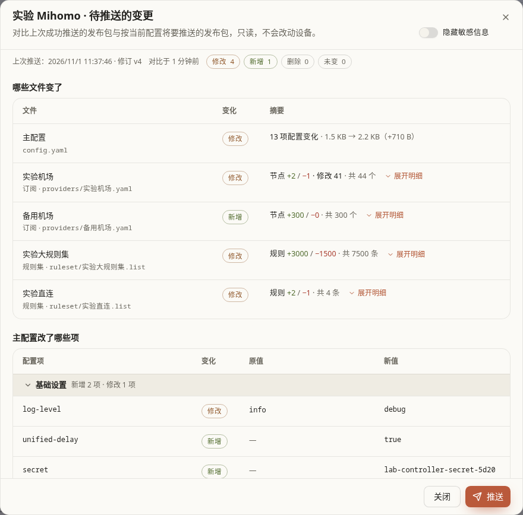

窗口从上到下是：

| 区域 | 内容 |
| --- | --- |
| 标题下方 | 说明文字，有变更时右侧（手机上在下一行）是“隐藏敏感信息”开关，见[截图分享前先隐藏敏感信息](#push-diff-hide)。 |
| 顶部一行 | 上次推送的时间与修订号、对比时间，以及修改 / 新增 / 删除 / 未变的文件数。 |
| 哪些文件变了 | 每个变化的文件一行：主配置、订阅名、规则集名，变化（新增 / 删除 / 修改）和摘要。订阅写“节点 +N / −M”（同名节点内容变了另写“修改 N”），规则集写“规则 +N / −M”，主配置写有几项配置变化，其他文件写大小变化。订阅和规则集的摘要旁有“展开明细”，见[展开订阅和规则集的明细](#push-diff-details)。没变的文件收在最后一行，点开才列出。 |
| 主配置改了哪些项 | 只对 YAML 主配置按配置项比较，按 `dns`、`hosts` 这类顶层键分组，每项给出变化、原值和新值，见[主配置改了哪些项](#push-diff-config)。 |
| 原始差异 | 默认收起。主配置的 unified diff，较长时只显示前面部分，配置特别大时不生成；只有注释、空白或引号写法不同时没有可显示的行。 |

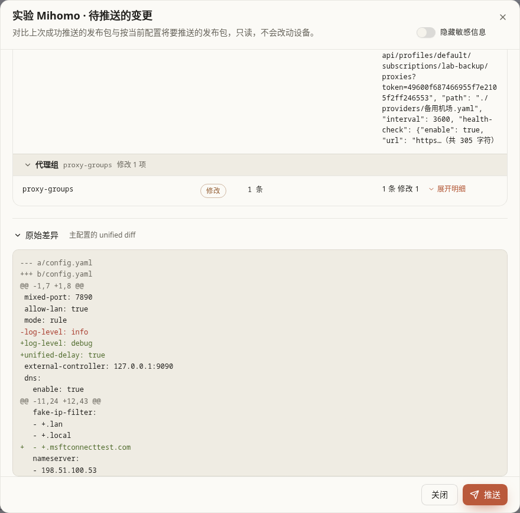

#### 展开订阅和规则集的明细

“哪些文件变了”里订阅和规则集那一行，点摘要旁的“展开明细”，下方按“新增 / 删除 / 修改”分组列出具体内容，再点“收起明细”收回：

- 订阅（包括[订阅聚合](subscription-aggregation.md)生成的节点文件）：每组一张表，列为“节点 | 变更项 | 变更前 | 变更后”。
  - 新增的节点占一行：变更项写“新增”，变更前是“—”，变更后是“类型 · 服务器:端口”，例如 `trojan · edge-c.example:443`。
  - 删除的节点同样占一行：变更项写“删除”，变更前是“类型 · 服务器:端口”，变更后是“—”。IPv6 地址写在方括号里，如 `[2001:db8::e]:1080`。
  - 修改的节点每个改动的字段占一行，节点名跨这几行；变更项写字段，`type`、`server`、`port` 排在前面，例如 `port`：`11005` → `11008`。`plugin-opts`、`ws-opts` 这类嵌套字段写成路径，如 `plugin-opts.host`、`ws-opts.headers.Host`；`alpn` 这类列表字段写条数，删掉的条目在变更前一侧，加上的在变更后一侧。字段原来没有时变更前是“—”，现在没有了时变更后是“—”。
  - 长的路径、服务器名在 `.`、`-`、`/` 后换行，没有这些位置的长串（如密码）才在格子里折行，表格不会被撑宽。
  - 手机上每个节点一条记录：节点名作标题，下面每行写“变更项：变更前 → 变更后”；新增、删除的节点写“新增 / 删除”标签加“类型 · 服务器:端口”。
- 规则集：列出新增和删除的规则（文本规则集按行，YAML 规则集按 `payload` 条目）；同一条规则原来写了两遍、现在只剩一遍，算删除一条。

新增的订阅或规则集也可以展开，列出它带来的节点或规则。

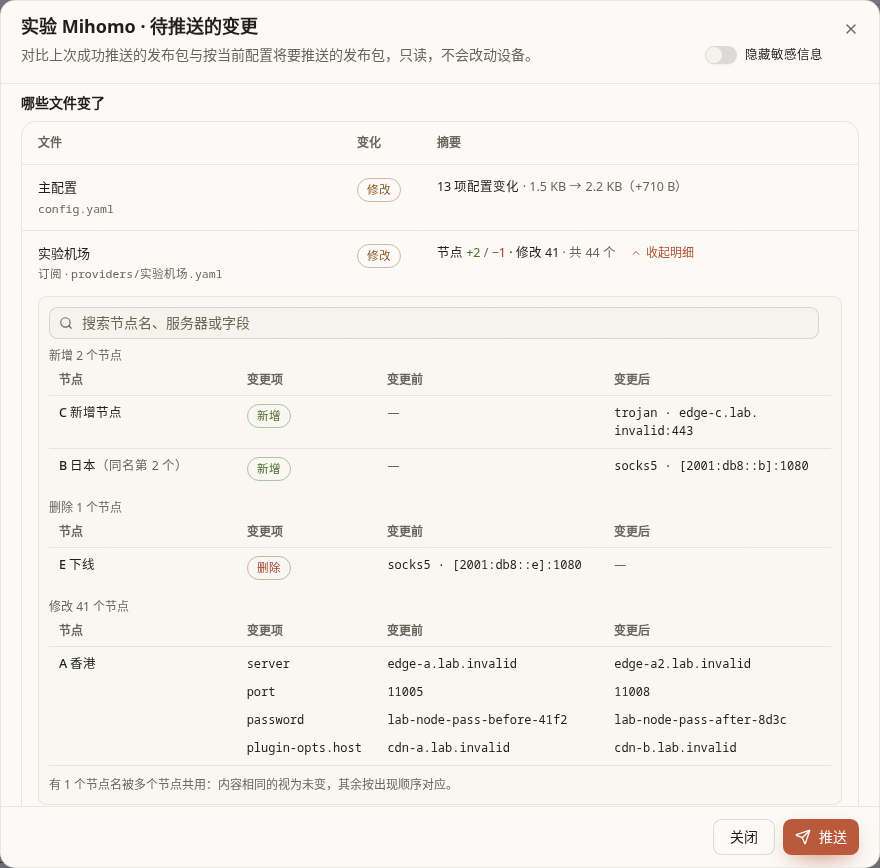

节点按名称对应。同一个订阅里有几个节点同名时，内容完全相同的视为未变，其余按出现顺序一一对应，多出来的算新增或删除；这样的节点在“节点”一列注明“（同名第 N 个）”，明细末尾也会说明。密码、`uuid` 这类字段和主配置一样标为敏感值，打开“隐藏敏感信息”后同样只显示“已隐藏”。

每组先列前 20 条，下面的“加载更多（还剩 N 条）”每次再读 50 条，新读到的节点接在同一张表里，读完显示“已全部加载”；读取失败会写出原因，点“重试”再读。展开的明细最高约 420 像素（手机上约为屏幕高度的六成），条目多了在这块区域里滚动，不会把整个窗口撑长；用键盘时按 Tab 选中这块区域，再用方向键滚动。

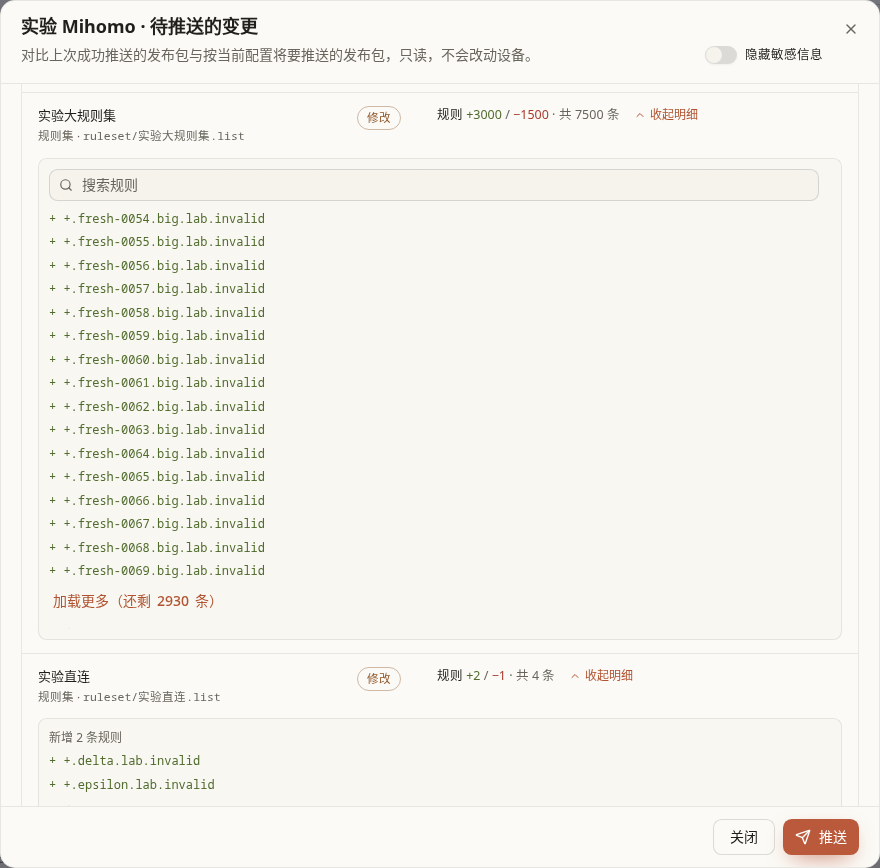

还有没列出的条目时，明细上方有搜索框。输入后稍等片刻（按回车立即开始），服务端开始搜索，搜索框右侧显示一共匹配多少条（手机上不占这一行），每组标题也写出本组匹配多少条，只列匹配的条目（节点同样排成表格），同样可以加载更多；没有匹配时写“没有匹配「…」的规则”。清空搜索框（点右侧的 ×）回到原来的列表，之前加载的条目还在。搜索不区分大小写：

- 订阅：节点名，新增和删除节点的类型和“服务器:端口”，修改节点的字段名（如 `port`、`password`）和字段值。
- 规则集：规则文本。
- 密码、`uuid`、网址里的令牌这类敏感值不参与搜索：搜它们的内容什么也搜不到，也就不能靠搜索结果反推出原文。可以按字段名搜，比如搜 `password` 找出改了密码的节点。

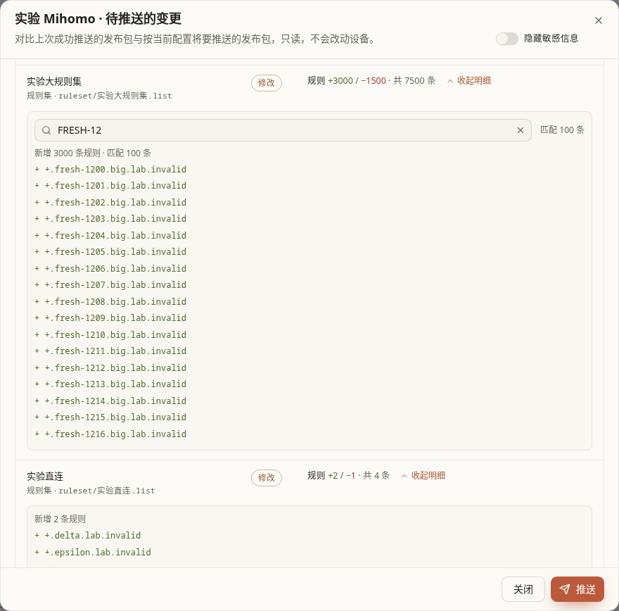

每个文件最多保留 10 万条明细（由新增、删除、修改分摊，条数少的一组会全部保留），超出的部分在读完保留的条目后写“另有 N 条超出明细上限，未列出”，也搜不到。一次对比保留的明细总量也有上限，变化特别多时排在后面的文件只列每组前 20 条，写“还有 N 条未列出”，不能加载更多和搜索。摘要里的数字始终是完整的。

对比结果保留 15 分钟。过期了、配置已经改过，或者已经有了更新的对比结果时，加载更多和搜索不会把新旧两次对比的条目拼在一起，而是在明细上方提示“对比结果已更新，请重新加载”，焦点移到“重新加载”按钮；点它重新对比，已经展开的文件保持展开。

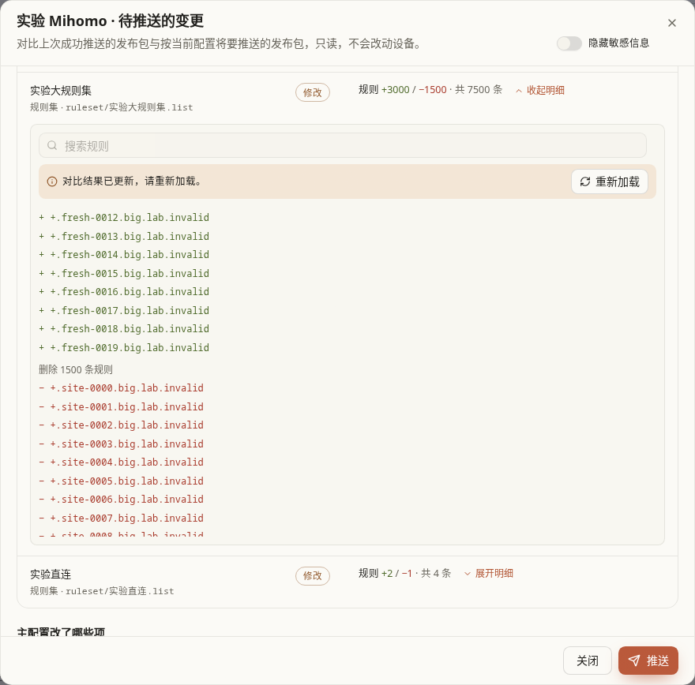

没有基准、只能按文件摘要比较（MosDNS、旧版本推送）、规则集是二进制格式（`.mrs`）或订阅文件无法解析时，没有“展开明细”，只看摘要；节点和规则都没有增减、只有顺序或格式不同时也没有。

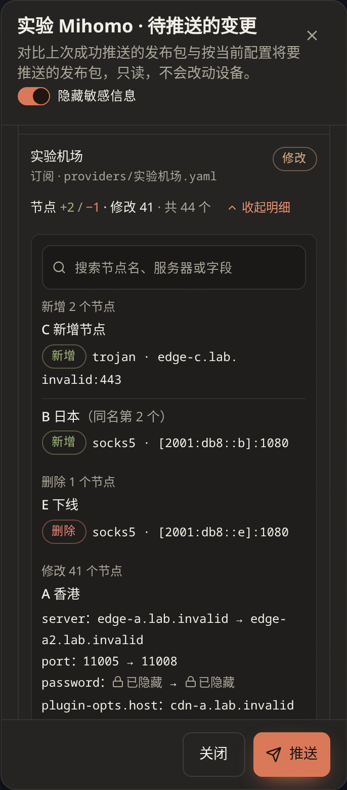

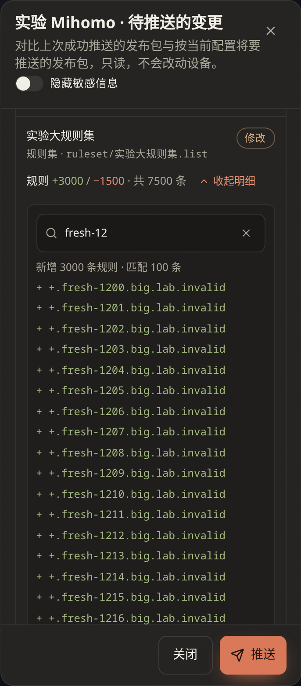

#### 主配置改了哪些项

主配置按顶层键分组，每组一行标题：中文名、原始键名和这一组的增减，例如“DNS dns 新增 3 项 · 修改 1 项”。组里的“配置项”只写组内的路径，不再重复组名，比如 DNS 组里写 `fake-ip-filter`，而不是 `dns.fake-ip-filter`。

| 顶层键 | 组名 |
| --- | --- |
| `dns` | DNS |
| `hosts` | Hosts |
| `rules` | 分流规则 |
| `proxy-groups` | 代理组 |
| `proxies` | 节点 |
| `proxy-providers` | 订阅 |
| `rule-providers` | 规则集 |
| `sniffer` | 嗅探 |
| `tun` | TUN |
| `listeners` | 入站监听 |
| 其他键 | 直接写键名，如 `experimental` |
| `secret`、`mixed-port`、`log-level` 这类顶层的单个值 | 基础设置 |

- 同一个映射块里有 2 处及以上改动时，例如 `dns.proxy-server-nameserver-policy` 新增了几个域名，或某个订阅改了几项，先列一行“块名 · 新增 N 项”，下面每行只写子键（例如域名）；只有 1 处改动时直接写组内路径，如 `fallback-filter.geoip-code`。`hosts` 本身就是一组，组里直接列域名。
- `rules`、`fake-ip-filter`、`proxies`、`proxy-groups` 这类列表只写条数和增减，点“展开明细”看具体条目；节点、策略组按名称对应，列出改了哪些字段。每个列表最多列 60 条，超出的注明还有多少条。
- 点组标题可以收起或展开这一组；用键盘时按 Tab 选中标题，再按回车或空格。改动超过 20 行的组默认收起，标题上照样写出有多少项。
- 长的路径和域名只在 `.`、`-`、`/` 后换行，不会从单词中间断开。
- 原值、新值两列等宽，长值在格子里折行，表格不会横向滚动。

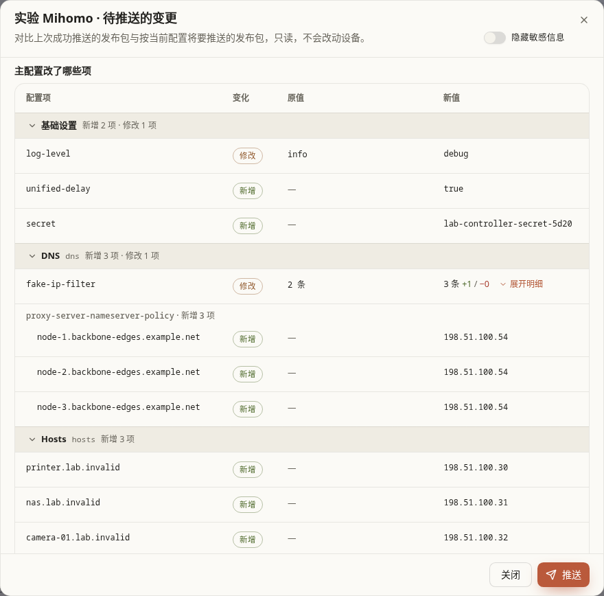

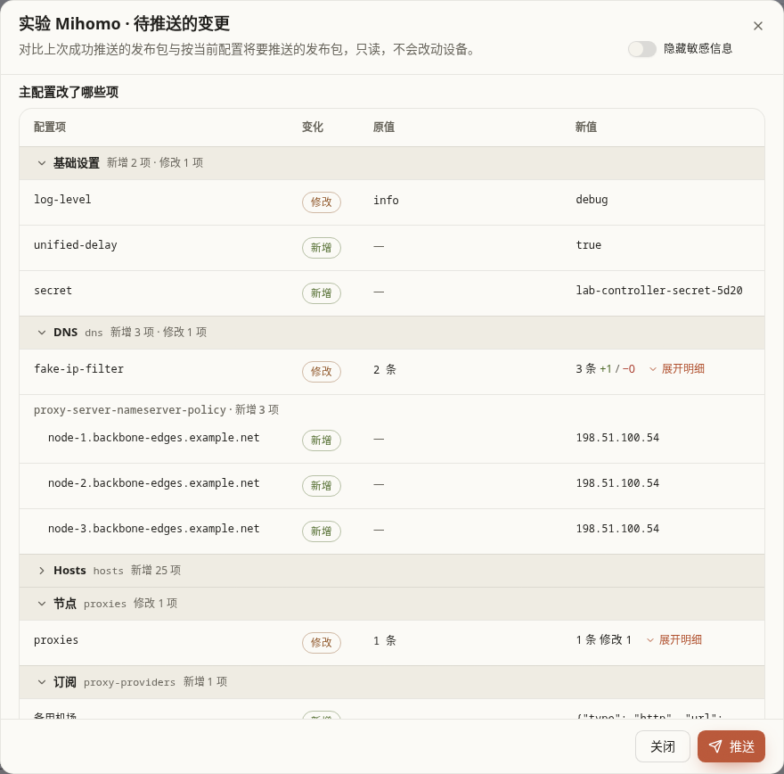

手机上组标题作分隔（整行可点，点击区 44 像素），下面每条写成“配置项：原值 → 新值”，变化标签在右上角；新增的项没有原值，只写“配置项：新值”。

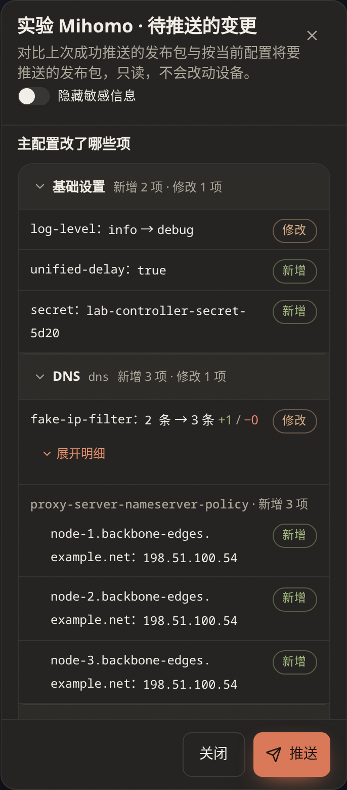

#### 截图分享前先隐藏敏感信息

窗口默认显示原值，方便核对密码、令牌这类值到底改成了什么。要截图或把内容发给别人时，先打开标题下方的“隐藏敏感信息”：两张表、展开的明细（包括订阅节点的密码，以及之后“加载更多”和搜索出来的条目）、文件名和原始差异里的敏感值都换成“已隐藏”（带锁图标），域名、IP 和端口照常显示；再点一次恢复原值。切换不用重新读取。这个开关不会记住，每次打开窗口都显示原值。

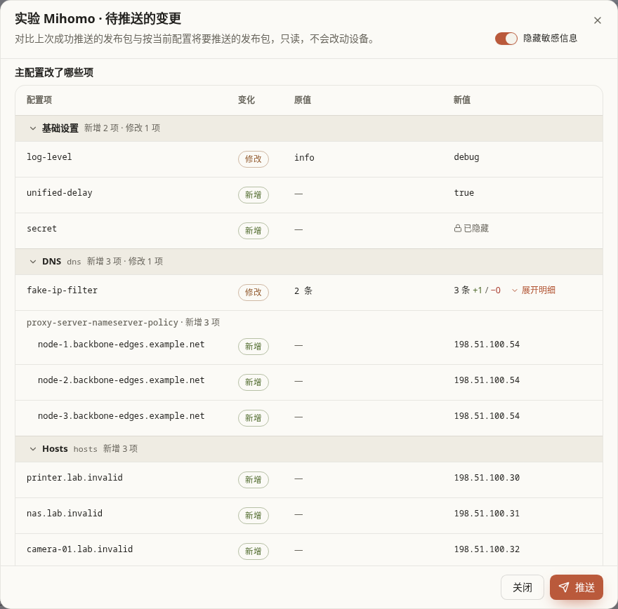

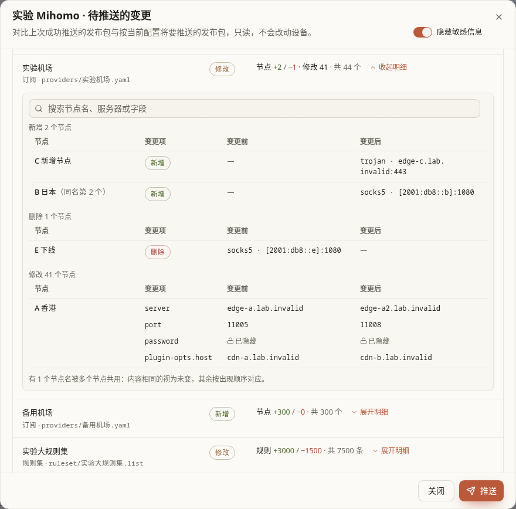

哪些值算敏感由服务端标出：

- 键名为 `password`、`uuid`、`private-key`、`pre-shared-key`、`secret`（包括 `external-controller` 的 secret）、`token`、`auth`、`psk`、`obfs-password`、`short-id`、`api-key`、`cookie`、`authentication`、`authorization` 等，或以 `-password`、`-secret`、`-token` 等结尾的配置项：整个值；
- 网址里的账号密码，`token`、`key`、`sign` 等参数的值，以及路径里的长串令牌；
- `user:pass@host:port` 写法里的 `user:pass`。

> 注意：ConfigFlow 自己的访问令牌（“系统设置 → 访问令牌”，Mihomo 拉取订阅的地址 `…/proxies?token=…` 里的那一串）默认也原样显示，打开开关后才隐藏。这个令牌还能调用 MCP 管理操作，截图或复制窗口内容给别人前，请先打开“隐藏敏感信息”。规则代理令牌、Agent 令牌这类 ConfigFlow 内部保存的凭据不会发到浏览器，任何时候都显示为 `[REDACTED]`。

窗口底部的“推送”就是卡片上的推送：点它后窗口关闭，进度显示在卡片上，结果按[发布记录](#history)处理。Agent 离线、正在推送或回滚失败时不能推送。

| 窗口里看到 | 说明 |
| --- | --- |
| 无变更 | 当前配置生成的发布包与上次推送一致，推送不会改动设备上的文件。卡片还显示“有变更”时，窗口会让列表重新读取。 |
| 没有可对比的基准 | 从未成功推送过，或上次推送由旧版本完成、没有保存发布内容，或改绑了配置空间、设备上的配置与推送记录不一致。成功推送一次后即可查看变化。 |
| 只能列出哪些文件变了 | 上次推送的发布包没有保存（MosDNS 推送时不保存发布包，旧版本推送也没有），只按文件摘要比较，不细分节点、规则和配置项。 |
| 无法生成这次将要推送的内容 | 按当前配置生成发布包出错。错误原文可能带令牌，这里不显示；点“推送”会给出具体原因。 |
| 无法读取待推送的变更 | 请求失败，例如这台 Agent 已被删除。按提示处理后点“重试”。 |

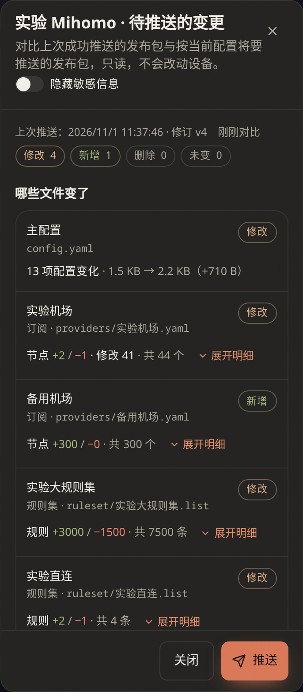

有变更时的截图（默认、隐藏、原始差异、展开的明细、手机深色）来自测试服务器上的一份私有 ConfigFlow（`scripts/tests/push_diff_local.py`）：这台 Agent 背后没有真实设备，推送时由脚本代替 Agent 回应“已应用”，发布包和推送记录照真实流程保存；先推送一次作基准，再加 hosts 和 secret、给手动节点改密码、改两个规则集（其中一个增删的规则超过单个文件的上限）、订阅里新增两个节点（一个与已有节点同名）、删除一个、修改一个（服务器、端口、密码和 `plugin-opts.host`），策略组多加一个有 130 个节点的订阅。其余截图来自 PVE 隔离实验网里的 Mihomo Agent（CT152）和一份私有 ConfigFlow，当时窗口列出的内容与推送后设备上实际变化的文件、节点数、规则数和配置项一致。

## 规则自动同步与手动更新

Mihomo 和 OxiDNS 卡片会显示“规则同步”。两个开关默认都关闭。它们让选定范围的规则变化自动送到设备，不会把其他尚未发布的代理/DNS 设置一起自动发布。

### 两个开关怎样选

| 开关 | 默认 | 开启的效果 | 关闭的效果 | 推荐用法 |
| --- | --- | --- | --- | --- |
| 规则库自动同步 | 关闭 | 跟进已启用引用的规则集内容和新增引用，只下载变化的文件；未引用的规则库条目不会触发下发。 | 停止后续这类自动同步，已有设备规则保留。 | 已完成首次发布，且希望启用规则库变化自动落到设备时开启。 |
| 单条规则自动同步 | 关闭 | 跟进已选择的内嵌单条规则变化。 | 后续单条规则修改需自己发布，当前设备配置保留。 | 经常维护单条规则且愿意让保存后的规则自动生效时开启。 |

操作开关后会立即保存，看到“自动同步设置已保存”再离开。尚无基线时会提示“先成功发布一次配置，建立自动同步基线”：先完整推送一次，不是反复开关就能解决。

“等待规则变更”表示开关已启用、暂时没有要做的事；“等待同步/正在同步规则”表示后台在处理；“自动同步等待处理/规则同步失败”需要阅读旁边原因。浏览器关闭后，服务端仍继续处理。关闭开关阻止后续任务，不撤回已经被接受的同步任务。

OxiDNS HA 的两个成员共用这些开关。首次开启 HA 使用主机当时的设置，之后改任一台会同时作用于两台；不能把一个成员开、另一个关。

### OxiDNS 的“更新规则”按钮

想立即刷新**当前已发布配置**使用的可下载规则时，点“更新规则”。它不会自动保存编辑器里的草稿，也不是更新 OxiDNS 程序。

1. 先确保 OxiDNS 已成功发布、管理 API 已启用，且核心和 Agent 支持规则更新。
2. 点“更新规则”，看“下载 x/y · 热重载 x/y”。
3. 等“已完成”；如果失败，查看下载、热重载阶段和 OxiDNS 日志。
4. 出现“待确认”时优先点“查询更新结果”。响应丢失不代表远端没执行，不要直接反复重新提交。
5. “重新尝试更新”会先查当前任务，确认没有运行中的任务才重新提交；明确失败并修正原因后可点“重新更新”。

如果提示“请先完整发布相同的主备配置”，应先完成整组配置发布，再更新规则。在 HA 里该按钮操作的是整组；纯规则热重载按顺序完成，不为此强制迁移 VIP。普通单机规则更新失败时，可能已有部分规则完成下载或重载，不能一概当成完全没变化。

## DNS 联动：跟随 Mihomo 的 DNS

OxiDNS 卡片的 **DNS 联动 → 设置** 打开“跟随 Mihomo DNS”。默认未开启。它解决的是：Mihomo 的 DNS 监听端口变了，OxiDNS 选中的那条上游随之更新。它不是把所有 DNS 设置都复制过去，也不是 HA。

### 什么时候用

OxiDNS 把一部分查询交给某个 Mihomo，且你会从 ConfigFlow 发布这个 Mihomo 的配置时，可使用联动。先给 OxiDNS 成功发布一次；如果它还没配置可绑定的 UDP/TCP 上游，列表会为空。

| 字段/按钮 | 默认、推荐和效果 |
| --- | --- |
| Mihomo 来源 | 默认未选。选择真正接收这条上游查询的 Mihomo Agent，不按名字猜；没有选项先接入 Mihomo。 |
| OxiDNS 上游 | 默认未选。选择要跟随的一条 UDP/TCP 上游，其他上游保持原样。手动改变这条上游或调整其顺序后，要重新绑定。 |
| 连接方式 | 新设置默认“同一 LXC / All-in-one 容器（自动验证）”。只有两个核心由同一套 All-in-one Agent 管理并通过验证时使用；需要 Agent 1.8.24 或更新。 |
| 指定网络地址 | 两服务在不同容器、LXC、虚拟机、物理设备，或用于 OxiDNS HA 时选它。同一台 PVE 上的两个 LXC 也不是同一网络环境。 |
| Mihomo DNS 地址 | 选择网络连接后出现，默认建议所选 Mihomo Agent 的地址。填 OxiDNS 实际能访问的地址；端口自动跟随生效的 `dns.listen`，不要用本机回环地址指向另一台机器。 |
| 开启自动同步并发布 | 提交绑定；**首次同步从 Mihomo 下一次发布成功开始**，不是点按钮后立即把当前草稿全部下发。 |
| 保存跟随设置 | 已绑定时显示。修改绑定后保存，继续按新的来源和上游跟随。 |
| 重试同步 | 失败时出现。先处理原因，再重试原同步；不需要删除 Agent。 |
| 停止跟随 | 解除后续自动联动，现有 OxiDNS 配置保留。若要恢复以前的上游，要自己改回并发布。 |
| 关闭 | 只关对话框，不关闭已开启的联动。 |

### 完成一次可验证的联动

1. 先成功发布 OxiDNS，确认目标上游存在。
2. 填好以上字段，点“开启自动同步并发布”。卡片显示“等待发布”属于正常。
3. 发布所选 Mihomo 的配置，等它真正成功并确认 DNS 生效。
4. OxiDNS 卡片会显示“准备同步/正在同步”，最终“已同步”；展开可看来源、地址和步骤。
5. 再从客户端查询，确认 OxiDNS 的实际转发正常。

联动读取的是设备上**已确认生效**的 Mihomo DNS 监听，不是未发布草稿。OxiDNS 还有其他未发布修改时会暂停并提示，避免联动把那些修改一起发布。先决定这些草稿要发布还是撤回，再重试。OxiDNS HA 应使用网络连接，两台共同指向同一个 Mihomo。

## DNS 高可用入口

OxiDNS 卡片上还有独立的“DNS 高可用”一行，默认“未开启”。它让两台不同设备共用一个 VIP，和上一节 DNS 联动解决的是不同问题。

完整操作见 [OxiDNS 高可用指南](../guide/oxidns-ha.md)：包含两台 Shell、两台 Docker Host、两台 macvlan、Shell + Docker 以及 Host/macvlan 混用的条件、安装准备、配对、客户端接入、迁移、停用与回退。

在本页日常查看时注意：

- “配置主机/配置备机”表示偏好角色；“主 · VIP …”表示这台当前实际持有地址。
- “主备正常”应有且只有一个持有者；“虚拟 IP 冲突”表示两台都持有，需要处理通信/地址冲突。
- 已成组后，从任一成员推送配置会更新整组。单机的“发布记录与回滚”不能用来只回滚一个成员。
- 更换绑定空间、删除、卸载前应先停用 HA；停用会让 VIP 下线，先安排客户端临时 DNS。

## 发布记录、失败处理与回滚

点击卡片右下角 **… → 发布记录与回滚**，查看发布编号、时间、修订、结果及检查信息。Mihomo、MosDNS、OxiDNS 提供此入口；其他类型的流程可能不同。

### 先读结果，再选择下一步

| 结果/按钮 | 含义和操作 |
| --- | --- |
| 准备、校验、应用、启动、检查中 | 同一次发布的不同阶段，等待结束。 |
| 已校验，待应用 / 应用并启动 | 候选内容已准备但没有应用；确认后点“应用并启动”。 |
| 失败 | 展开步骤、错误和修复建议，判断失败发生在准备、校验还是运行阶段，修正后重新发布。 |
| 已回滚到原配置 | 本次发布未成功，Agent 已恢复原配置；修正新配置后再发布。 |
| 回滚失败 / 查询恢复状态 | 服务恢复尚未成功。优先查询恢复状态、看日志并修复；不要接着反复推送新版本。 |
| 结果待确认 | 请求可能已被接收，但尚未取得可靠结果。保持原任务，等待/查询，不把它算成功或失败。 |
| 重试同一次发布 | 页面提供时按原发布编号重新提交/确认，避免把响应丢失变成另一次新发布。 |

DNS 检查会区分错误、提醒和通过项；展开查看“修复建议”和时间。旧服务的解析探测通过，只证明检查当时的服务能回答；新配置仍要等发布后的服务检查。

### 手动回滚的范围

只有**当前仍生效的最新成功部署**能显示“回滚到发布前”。点它后确认“回滚并重启”，会恢复到这次发布之前的配置和受管规则，并重启核心检查健康状态；`state/` 运行数据保留。

这不是任意版本历史选择器：旧记录主要供查看，不能直接跳回任意历史时间。Agent 离线、忙于其他任务、活动配置/备份不匹配时，回滚会被禁用或拒绝。

回滚远端不等于撤销 ConfigFlow 中保存的草稿。恢复后回到“设置”核对目标内容，避免下一次推送又把刚撤回的错误配置发回去。HA 主备发布不能单独回滚一个成员，应把想恢复的配置重新发布到整组。

## 更新 Agent 与重启服务

### Shell Agent 的“更新”

有可用更新时，卡片出现提示和“更新”按钮。先等配置发布完成，点“更新”并确认，程序会保留身份与核心配置，更新后重启 Agent；网页继续查询最终结果。

看到“更新文件或安装方式尚未就绪”时，先确认 ConfigFlow 主服务已更新且有适合目标设备的安装文件。不要只修改版本字符串。

- “查询更新结果”：原请求已经提交或结果不明，先查最终状态。
- “重新确认并提交更新”：尚未发现新任务记录时出现；点击后还会让 Agent 检查是否已有更新在执行，避免重复操作。
- 更新完成后，点顶部“刷新”核对在线状态、Agent 版本和核心状态。Agent 的更新不是 OxiDNS/Mihomo 核心升级按钮。

### Docker Agent 的“更新”

Docker 的按钮打开 **Docker Agent 更新步骤**。网页只生成说明，不会直接替你拉镜像或重建容器。

| 选项/按钮 | 默认及正确用法 |
| --- | --- |
| 原安装方式 | 默认“Docker Compose”；用 `docker run` 或容器管理器装的，选“Docker Run / 容器管理器”。 |
| Compose 服务名 | 默认 `agent`，应以原 Compose 文件中的服务名为准，**不是容器名**。可用页面提示的命令查看。 |
| 复制 Compose 命令 | 在原项目目录、沿用原项目名/环境文件执行拉取并重建。如果原命令有 `-f`、`-p`、`--env-file`，每条都保留相同参数。 |
| 目标镜像 | Docker Run 路径默认官方 `thsrite/config-flow-agent:latest`；私有镜像或固定版本改为自己实际目标。 |
| 复制拉取命令 | 只拉取镜像，还需要按原参数重建容器。 |
| 刷新 Agent 列表 | 远端完成后回来核对版本与在线状态；它本身不更新容器。 |

更新前备份原部署定义和挂载数据，保留环境变量、网络、端口、权限、重启策略和所有挂载。沿用原 Agent 身份，不用“新安装”命令覆盖旧部署。Docker Run 场景可保留旧容器用于恢复；新容器失败时停止它，用旧镜像/旧容器和相应数据备份恢复。

OxiDNS HA 一次只更新一端，先处理未持有 VIP 的核心容器，确认恢复后再处理另一端；Host 的独立 HA 辅助容器保持运行。普通容器不会因为更新镜像就自动具备 HA 条件。

### “… → 重启服务”

此按钮让 Agent 重启它管理的核心服务，会有短暂中断；不是更新程序，也不负责保存当前编辑器草稿。若已有“已校验，待应用”的候选任务，会转到应用该任务的流程。

正常排查优先读错误和日志，只有确实需要重新启动核心时再用。HA 成员上的普通“重启服务”不等于发布时的计划 VIP 迁移，不能把它当成无中断切换按钮；先确认另一端健康，勿同时重启两台。

## 日志、系统监控与网络速率

### 查看日志

进入 **… → 日志**，Agent 会按这台设备的服务配置寻找可读日志来源，默认选第一个可读来源。选对服务再判断：Agent 自己的通信日志和 OxiDNS/Mihomo 的核心日志解决不同问题。

| 控件 | 默认及效果 |
| --- | --- |
| 选择日志 | 默认自动读取来源列表中的可读项；标“不可读”时先确认服务位置或权限。 |
| 自定义路径… | 自动来源不合适时填写目标设备上的实际日志路径，再点“查看日志”或按回车；受 Agent 的路径与访问规则限制。 |
| 刷新 | 重新读取当前来源的新内容，不重启服务。 |
| 清空 | 会删除所选日志文件里的全部内容，不能恢复；排查资料需要保留时先另存。系统 journald 日志和不可读来源不能在这里清空。 |
| 关闭 | 关对话框，服务仍继续运行并记录日志。 |

不要用“清空”修复报错：它只删记录，不处理原因。看到“请求成功但结果待确认”时，先保留发布编号和日志，方便与原任务对照。

### 资源和流量怎么读

“系统监控”显示最近 24 小时已有的记录；没有数据时等待 Agent 上报后刷新。指标属于 Agent 能观察到的系统/容器环境，不能一概当作整台物理机所有资源。

卡片“网络速率”从打开页面起记录近 5 分钟，统计该网络环境的全部网卡；它不是宽带带宽占比，也不是某个代理节点的测速。上传/下载数值使用字节每秒；“暂无数据”“数据未更新”“离线”时显示的横线不是零速率。重开页面后的图线从重新采样开始。

## IPv4 转发提示

某台 Mihomo 被上游路由选作代理网关时，卡片可能出现“IPv4 转发”。它表示 Linux 是否允许把收到的流量继续送出去，不是 OxiDNS HA 开关。

- “未开启”：这条网关路径可能不能转发流量。
- “已开启，未持久化”：当前可用，但重启后不一定保持。
- “已开启并持久化”或“已开启，系统已持久化”：按详情确认由谁负责保持。
- “开启并持久化”：符合条件时出现，点击后启用并写入持久设置；不是一个可以随意来回拨动的开关。需要取消时，应按原网关/系统配置流程处理，避免切断正在使用的流量。
- “请先更新 Agent”“Docker 部署”“不支持自动持久化”“持久化文件已被修改”：按提示处理，不要把文件冲突当作按钮失灵。

“转发过滤”显示主机防火墙检查提醒，帮助判断是否仍有拦截；提醒本身不会自动修改防火墙，也不等于开启/关闭转发。完整网关设置和撤销见 [核心设置中的 Linux 网关](core-settings.md#linux-网关)。

## 卸载 Agent 与删除记录

两者后果不同，先确认是要停止远端管理，还是只清理已经不用的列表项。

| 操作 | 会做什么 | 前提及验证 |
| --- | --- | --- |
| … → 卸载 Agent | 请求远端停止并移除 Agent 程序、Agent 配置和服务项。不是卸载整个代理/DNS 核心的通用按钮，独立核心配置按安装方式保留。 | 需要能联系设备；先完成发布/更新，HA 成员先停用组，网关受管状态按提示先撤销。收到“命令已发送”后还要等远端执行，再刷新并核对目标主机。 |
| … → 删除记录 | 仅删除 ConfigFlow 管理记录，不卸载远端 Agent，不停止核心。 | 页面在无心跳或心跳超过 5 分钟时才开放；HA/任务冲突仍可能阻止。确认设备确实不再需要管理后使用。 |

卸载或删除前保留要恢复的配置、身份和部署资料。这些操作没有网页“撤销”按钮；以后重新接管要按安装/登记流程处理。不要把删除记录作为排除暂时离线、发布待确认、HA 残留的第一步。

## 按现象查问题

| 现象 | 建议顺序 |
| --- | --- |
| Agent 装了但列表没有 | 确认命令在目标设备实际执行、服务已启动、ConfigFlow 地址可达；检查安装/Agent 日志，再刷新列表。见安装手册。 |
| Agent 在线，但设备没用新配置 | 核对绑定空间 → 草稿是否保存 → 是否选对发布目标 → 最终发布状态 → 核心健康 → 客户端实际接入地址。 |
| 改了一台，另一台设置也变了 | 它们是否绑定同一空间、管理同一种核心。共享配置是按空间划分，独立设置需独立空间。 |
| 绑定空间/推送/更新按钮灰色 | 看是否正在发布、更新、回滚、离线或待确认；先处理正在进行的任务。 |
| 想知道“有变更，待推送”到底变了什么 | 点这行状态，按[推送前查看会改动什么](#push-diff)核对文件和配置项后再推送。 |
| 自动同步一直提示建立基线 | 先完整成功发布一次；只有保存草稿不够。 |
| 更新规则提示 API 未配置 | 在 OxiDNS 设置启用管理 API，完整发布成功，再重试；不能靠反复点更新规则补上配置。 |
| DNS 联动一直“等待发布” | 开启后需要来源 Mihomo 下一次成功发布；还要确认 OxiDNS 已有成功发布及可绑定上游。 |
| DNS 联动失败 | 看未发布草稿、所选上游是否被改动/重排、Mihomo 地址是否从 OxiDNS 可达；处理后重试同步。 |
| 更新 Docker 后版本没变 | 确认拉取了含新 Agent 的镜像并实际重建了正确服务；只拉镜像不会替换运行容器。 |
| 发布/更新断网后不知道成败 | 查原任务、日志和状态，使用页面的结果查询/同次重试入口，不立刻另建一次操作。 |
| HA 中想回滚或改空间 | 不能单独回滚成员；目标配置重新发布到整组。改对端/VIP/绑定时按 HA 指南先安排临时 DNS 并停用。 |

需要进一步定位时，保留设备名称、服务类型、Agent 版本、绑定空间、发布/更新编号、具体错误和检查时间。令牌、密码等凭据不要放进公开截图或问题描述。
