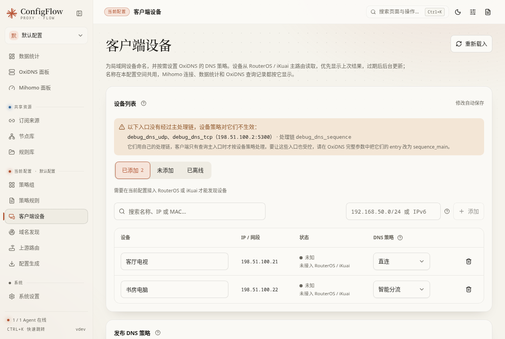

# 客户端设备

这里的“客户端”是家里的手机、电脑、电视等上网设备。你可以给它们起名，安排 DNS 策略，并在支持的路由器上固定 IP 地址。

**把设备加进列表，不会自动改变它的 DNS 或上网出口。** 要让策略起作用，设备的名称查询必须实际经过 OxiDNS，并让 OxiDNS 能识别原来的设备地址。

## 先看当前正在编辑谁

从侧栏进入时，编辑顶部当前配置空间。从某个 OxiDNS 面板进入时，编辑该 Agent 绑定的空间，页面会显示来源。首次使用向导中的页面可能只允许起名，不提供完整策略编辑。

| 分类或按钮 | 作用 |
| --- | --- |
| 已添加 | 已经在 ConfigFlow 保存名称或策略的设备，不代表已经走代理 |
| 未添加 | 从上游路由器发现，但还没有加入管理的设备；仍按现有网络安排工作 |
| 离线 | 路由器能够判断离线的设备；不是所有来源都能提供此状态 |
| 搜索 | 按名称、IP、MAC 地址找设备；MAC 是网卡的标识 |
| 重新载入 | 从来源重新获取设备列表；不会自动发布策略 |
| 手动添加 | 填入具体 IP 或网段，适合发现不到的设备或整组设备 |

普通打开页面可能先显示一分钟内的缓存，然后后台更新。服务重启后第一次发现设备可能需要约 20 秒，先等待结果，不必连续点击。

**两种添加方式的默认策略不同：**从“未添加”列表添加路由器发现的设备时，默认取设备主机名并设为“智能分流”；手动输入 IP／网段时，先出现名称为空、策略为“默认”的待编辑行，需要填写名称或选择策略后保存。首次向导或策略只读时，发现列表只添加名称，不设置 DNS 策略；没有主机名的设备不能从该入口添加。

## 名称和 DNS 策略怎么选

名称只是方便识别，修改后保存即可，不需要发布。IP 决定规则对应谁，写错会管到别的设备。一个网段代表一组地址，例如 `192.168.1.0/24` 表示这一段局域网；不会填写时，先只添加单个设备 IP。

| 选项 | 选中后 | 不选 / 改成默认后 | 推荐场景 |
| --- | --- | --- | --- |
| 默认 | 不为这台设备单独指定模式，遵循全局或包含它的网段设置 | 不额外覆盖原安排 | 没有特殊要求的设备 |
| 智能分流 | 按已配置的全局规则查询；可覆盖较大网段的直连设置，也可作为 RouterOS 按设备分流的来源 | 不再用该条记录明确指定智能分流 | 需要参与 RouterOS 按设备分流，或从直连网段中单独放行的设备 |
| 直连 | 让 OxiDNS 为这台设备返回真实地址，而不是用于分流的临时地址 | 恢复全局或网段安排 | 希望这台设备的 DNS 查询不触发该类分流 |

“直连”不保证所有连接绝不走代理。主路由如果还配置了按目标 IP 转交 Mihomo 的规则，连接仍可能经过代理网关。要彻底调整设备走向，还要核对 [上游路由](routers.md) 的规则。

单个 IP 比包含它的网段更具体，小网段比大网段更具体。系统按更具体的记录决定，不靠列表先后排序。IPv6 地址也可用于 OxiDNS 策略，但不会因此生成 RouterOS 的 IPv6 按设备分流规则。

## 设备策略对哪些 DNS 入口生效

设备策略只加在 OxiDNS 的主处理链上，客户端查询主入口（通常是 53 端口）时才会按设备区分。OxiDNS 上还可以有别的入口，例如节点测速专用的 DNS 入口、调试用的入口，它们监听其他端口，用自己的处理链。

- **节点测速专用入口**：在“节点库 → 测速设置”里由 ConfigFlow 创建的托管入口，以及测速 DNS 正在使用、只转发给自己上游的旧版专用入口，都不影响设置设备策略，页面也不提示。
- **其他端口上的旁路入口**：可以照常设置设备策略。设备列表上方会提示“以下入口没有经过主处理链，设备策略对它们不生效”，并列出入口名称、监听地址和处理链。经这些入口查询的设备不受设备策略控制；要让它们也受控，在 OxiDNS 完整参数中把入口的 `entry` 改为 `sequence_main`。
- **监听 53 端口却没进主处理链的入口**：不能设置设备策略，名称仍可修改。IPv6 的 `[::]:53`、高可用的虚拟 IP 等也算客户端端口；主处理链自己监听的端口不是 53 时，那个端口同样算。

不能设置时，页面会写明是哪一项不满足，例如哪个入口监听了什么地址、它的 `entry` 是什么，或主处理链的最后一步是什么，再到 OxiDNS 完整参数中按提示调整。

## 改完后怎样生效

1. 修改名称或模式，等待保存完成。此时策略先保存在 ConfigFlow。
2. 在底部确认 OxiDNS 发布目标。从侧栏打开时，默认勾选当前空间的在线 OxiDNS；从某个 Agent 进入时，默认只勾选该设备。勾选才会发送，取消勾选则保持该设备现状。
3. 发布并观察结果。它发送该空间**完整的已保存配置**，包括其他页面还未发布的改动，不只是本页设备列表。
4. 若使用 RouterOS 按设备分流，再到“上游路由 → 策略路由”重新保存、预览并确认发布。

没有可用 OxiDNS Agent 时，只能保存草稿。显示“已上传 / 待应用”也不等于正在使用；点击“应用并启动”会应用那次上传的内容，上传以后新增的草稿需要重新发布。

## 固定 IP：让规则一直对应同一台设备

家用路由器可能每次给手机分配不同地址。“固定 IP”会在来源路由器上创建或调整地址绑定，让同一块网卡下次仍领取指定地址。这里修改的是路由器，不只是 ConfigFlow 名称。

| 控件 | 结果与注意事项 |
| --- | --- |
| 单台设备“固定 IP” | 先预览将写入哪台路由器、哪条绑定，确认后才写入 |
| 勾选固定 IP / 批量固定 | 仅处理已勾选且满足条件的设备；默认不勾选，刷新或添加后会清空本次选择 |
| 不支持 / 无法固定的原因 | 查看该行提示；没有可靠的来源、地址或网卡标识时，不能强行绑定 |
| 取消勾选 | 取消尚未提交的选择，不会撤销已经写入路由器的绑定 |

推荐先固定用于单台策略的设备地址，再发布策略。确认框若显示的 IP、网卡或路由器不是你要改的设备，先取消并核对。

## 删除记录和恢复默认

清空名称并将模式恢复默认，可以移除这里的管理记录。它不会删除物理设备，也不会自动撤销之前写入路由器的固定 IP。要撤销固定地址，需要到对应路由器管理绑定。

策略恢复默认后，仍需发布到 OxiDNS；用到 RouterOS 按设备分流时也要重新发布路由设置。仅从列表消失不能证明实际设备已经恢复。
