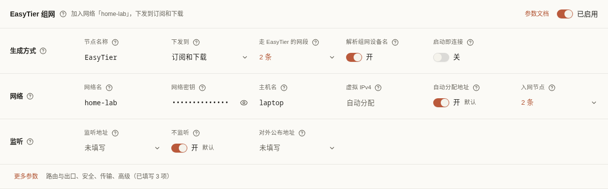

[文档首页](../README.md)

# 核心设置：每个选项怎么用

先选择需要查看的软件；OxiDNS 的说明再按用途切换。选项卡只改变这份手册显示的内容，不会修改实际配置。

## 保存和生效

进入路径：选择配置空间 → **配置生成** → 选择软件 → **基础配置**或**设置**。也可从 Agent 的对应服务面板进入；此时先看窗口显示的配置空间与目标设备。

这些设置属于**当前配置空间**。同一个空间绑定的同一种软件共用草稿，不是每台设备各保存一份独立参数。只想给另一台设备试验不同配置，先使用不同配置空间。

本章表格中的“开启后”“改为”均指**保存并让目标核心应用之后**。只修改输入框还没有生效；“保存草稿”只存到面板，“保存并发布”还要完成设备检查和激活。手动部署则需重新下载或更新配置地址并在客户端应用。完整流程见[配置生成](generate.md)。

“默认”指 ConfigFlow 新建模板的初始值。已有配置、安装向导及手写原生配置可能不同；打开页面时显示的实际值优先。不要为追求与本文一致而覆盖已验证可用的设置。

## 选择要查看的软件

<DocsTabs id="core-software" label="选择软件" :tabs="[{ id: 'mihomo-settings', label: 'Mihomo' }, { id: 'surge-loon-settings', label: 'Surge / Loon' }, { id: 'linux-gateway-settings', label: 'Linux 网关' }, { id: 'mosdns-settings', label: 'MosDNS' }, { id: 'oxidns-settings', label: 'OxiDNS' }]">

<template #mihomo-settings>

### Mihomo 基础配置

页面从上到下是 **订阅同步间隔**、**IPv6 模式**、**[EasyTier 组网](#easytier-组网)**、**基础参数**表单和 **YAML 编辑器**。基础 YAML 是基础参数的唯一数据来源：表单只是它的另一种编辑方式，修改表单就是修改 YAML 中对应的键，在 YAML 中修改后表单立即更新。EasyTier 组网是单独保存的设置，不写进基础 YAML，只在生成配置时加入。

1. 直接点要改的值：数字和文字就地输入，回车或点别处结束，按 Esc 撤回这次输入；开关直接点；几选一和列表（显示为「N 条」）会弹出小窗修改。每项问号写明 YAML 键名、作用、默认 / 推荐值、修改后的结果和注意事项。
2. 有标红的「需修正」时先改正，否则不能保存。只是「提醒」（已保存配置中原有的问题，例如仍在用模板密码 123456）不阻止保存其他改动，但建议顺手改掉。
3. 保存草稿，或「保存并发布」到目标设备。保存时服务器做同样的检查，不通过会显示原因且不保存。

| 分组 | 表单项 | 推荐与注意 |
| --- | --- | --- |
| 控制面板 | `secret`（默认隐藏，可点眼睛查看）、`external-controller` 监听（局域网可访问 0.0.0.0 / 仅本机 127.0.0.1 / 自定义）与端口、网页面板 `external-ui` 开关和 `external-ui-url` | 密码规则与首次向导相同：8–64 个字母、数字或符号，不含空格，不能是 123456；对局域网开放时必须设置。自定义地址只能是 `::` 或回环地址，监听某个局域网 IP 时 Agent 无法热重载和做 IPv6 检查。Agent 遇到 0.0.0.0 会改用 127.0.0.1，两种选择都能读取连接和流量。改动控制面板相关设置后发布会重启 Mihomo |
| 代理端口 | `mixed-port`，以及 `port`、`socks-port`、`redir-port`、`tproxy-port` 是否保留和端口 | 一般只留混合端口；使用 TUN（含向导方案）时不需要 redir / tproxy。端口不能互相重复，也不能与 DNS 监听、控制面板或同机 Agent 的端口相同 |
| 局域网访问 | `allow-lan`、`bind-address` | 其他设备手动填代理时才需要允许局域网；TUN、网关和主路由分流的接管不受影响 |
| DNS 上游 | 「DNS 方案」选「国内 DoH」或「国内外分开解析」预设；旁边的 `default-nameserver`、`nameserver`、`proxy-server-nameserver`、`direct-nameserver`（点开后每行一个）及 `respect-rules`、`direct-nameserver-follow-policy` 可直接修改，改过后方案显示为「自定义」 | 「国内 DoH」与初始模板一致。「国内外分开解析」让 `geosite:cn,private` 用国内 DoH、其他域名经代理用 Google / Cloudflare DoH，依赖 GeoSite 数据（Mihomo 首次自动下载）和可用节点。切换预设只改这几项并删除旧的 `fallback` / `fallback-filter`；`nameserver-policy` 只增删 `geosite:cn,private` 一条（追加在最后），自己写的条目（如 `+.115.com`）保留并优先匹配。上游不能指向本机、本机 OxiDNS 或 `system`，否则形成解析循环 |
| Fake-IP | `fake-ip-range`（IPv4 网段）、`fake-ip-filter-mode`、`fake-ip-filter`（每行一个） | 网段只接受 /8 至 /30 的 IPv4 网段（与 Linux 网关的规则相同），改了以后到「上游路由」预览并发布新的路由；写入过滤列表会替换 Mihomo 自带的默认名单，局域网域名、对时服务器等需要真实地址的服务放在这里。IPv6 网段在上方 IPv6 卡片里 |
| 域名嗅探 | `sniffer.enable`；`sniff` 的 HTTP、TLS、QUIC 各一格：端口就地输入（逗号分隔，单个端口或 `8080-8880` 这样的范围），右侧开关增删这个协议；HTTP 的 `override-destination`；`skip-domain`、`force-domain` | 关闭后按 IP 进入的连接无法匹配域名规则；首次开启时补上 HTTP / TLS / QUIC 常用端口，打开某个协议的开关时写入初始模板的端口。端口写错时标红并禁止保存，不会等到发布后 Mihomo 才报错。协议名大小写不限（如 `http`），表单改动沿用原来的写法；还在用旧写法 `sniffing` 时这几格只读，请在 YAML 中修改。总开关开着但三个协议都关了时会提示嗅探不生效 |
| 进程匹配与日志 | `find-process-mode`、`log-level` | 网关、主路由分流等替别的设备转发的机器建议 `off`：客户端进程不在本机，查找只会白耗 CPU。已有配置不会被自动修改。`debug` 只在排查时临时使用 |
| 进阶 | `tun.stack`、`tun.mtu`、`unified-delay`、`tcp-concurrent`、`keep-alive-idle`、`keep-alive-interval`、`disable-keep-alive`、`profile.store-selected`、`profile.store-fake-ip`、`dns.prefer-h3`、`dns.cache-algorithm`、`global-ua` | 一般保持初始模板的值，遇到兼容性问题再调整 |

**表单里没有的 DNS 键**：`nameserver-policy` 是映射，表单只提示其中你自己写的条目，请在 YAML 中编辑；`dns.concurrent`、`dns.query-timeout` 不是 Mihomo 的配置项（旧版初始模板里有这两行，删掉即可），Mihomo 会忽略它们，写不写都不影响解析。`global-client-fingerprint` 已在 Mihomo v1.19.27 移除：写了不生效，每次加载还会报错。旧版初始模板写的是 `chrome`，这时属性表「进阶」里会出现这一格并提示，选「不设置」即可删除，删除后这一格不再显示；需要 TLS 指纹的节点在节点自己的 `client-fingerprint` 里设置。

**只读项**：`dns.enable`、`dns.listen`、`dns.enhanced-mode` 以及 `tun.enable`、`tun.auto-route`、`tun.auto-detect-interface`、`tun.auto-redirect`、`tun.dns-hijack` 决定流量和 DNS 由谁接管，未填写时注明 Mihomo 的默认值，在「接管与 DNS 监听」（标有「只读」）中只显示不修改。启用 Linux 网关时发布会自动改写它们；首次向导的「Mihomo + OxiDNS 分流（完整 TUN）」要求 TUN 保持完整，改动会在发布前被拒绝。确实需要调整时在 YAML 中编辑。

**与 YAML 的同步**：表单每次只改对应的键，未涉及的键、注释和缩进保持原样；只有紧挨着改动的几行可能按标准格式重新排版（例如注释前的空格）。YAML 无法解析时属性表隐藏（读不出当前值，不拿默认值冒充），只显示错误原因；某个值使用了锚点、别名、合并（`<<`）时该项只读并说明原因。两种情况都不会覆盖你的内容。密码以明文保存在 YAML 中，编辑器里同样可见；表单只是默认隐藏。

| 项目 | 用途与推荐选择 | 修改后的结果 |
| --- | --- | --- |
| 基础 YAML | 只放自己需要的基础行为。`proxies`、`proxy-groups`、`rules` 由当前配置空间资源生成 | 手工写节点、策略组、规则不能替代面板对应资源管理；以最终生成结果为准 |
| 留空保存 | 用于恢复默认基础配置，操作前保留自己的内容 | 恢复内置基础设置；不会删除共享订阅或面板中的规则 |
| 订阅同步间隔 | 单位秒，通常保留 `3600`；允许 `0` 或 `60–604800` | 正数让 Mihomo 定时从面板同步订阅/聚合；`0` 仅手动同步。原始订阅重新下载仍由[订阅刷新间隔](subscriptions.md)决定 |
| `mode` | 通常用 `rule`，按规则分流 | 改成全局或直连模式会改变规则是否参与，不能只凭生成文件里有规则判断它在生效 |
| `tun` 其他子字段 | 仅按实际网关部署编辑；不同设备的网卡、路由和权限不同 | 影响流量接管。完整 TUN 的主路由分流不能随意删掉或加入绕过过滤，见 [Linux 网关](#linux-网关) |

#### EasyTier 组网

Mihomo v1.19.31 起内置了 EasyTier（`type: easytier` 节点）。开启后，生成的配置会多一个 EasyTier 节点，手机、笔记本等外出设备不用另装 EasyTier 客户端，就能访问组网里的设备和其他节点公布的网段。它和原生 EasyTier 使用同一个核心：入网后自动选择直连（包括 IPv6 直连）或经中转，直连断开时自动切换。

1. 打开右上角的开关，填写 **网络名**、**网络密钥** 和至少一个 **入网节点**（例如中转 VPS 的 `tcp://203.0.113.10:11010`，可写多个）。网络开启了安全模式或私有模式时，在「更多参数」里同样开启。
2. 在 **走 EasyTier 的网段** 填写要经 EasyTier 访问的 IPv4 网段，通常是虚拟网网段（如 `10.144.144.0/24`）和其他节点公布的网段。生成时这些规则排在所有规则之前；规则里也可以直接引用节点名称。
3. 选择 **下发到**：默认只加到订阅和下载的配置里。家里网关上的 Mihomo 和家里的 EasyTier 节点在同一个局域网，一般不需要；选择「Agent 设备」或「全部」时，设备内核低于 v1.19.31 会拒绝生成，以免 Mihomo 读不懂新节点而整份配置加载失败。
4. 保存草稿，或保存并发布。

| 项目 | 说明 |
| --- | --- |
| 解析组网设备名 | 用主机名访问虚拟网设备（如 `nas.et.net`）：添加该后缀的分流规则，并把解析交给 EasyTier（`nameserver-policy` 中已有同名条目时保留你的） |
| 启动即连接 | Mihomo 的 EasyTier 默认等第一次访问时才连接；开启后生成一个带健康检查的策略组，Mihomo 启动就入网并保持连接，分流规则改为指向这个策略组。需要别的节点连进来（开启了监听）时必须开启 |
| 监听端口 | 默认关闭，只主动连出去，外出设备保持关闭即可。打开后才显示「监听地址」（不填时用 `tcp://0.0.0.0:11010`）和「对外公布地址」（经过端口映射或内网穿透时填写）；关闭时一并清除。监听时要同时开启「启动即连接」，否则 EasyTier 在第一次访问前没有启动，别人连不进来 |
| 安全模式与本机密钥 | 网络开了安全模式时这里也要开。Mihomo v1.19.34 以下（例如 FlClash 0.9.3 内置的 v1.19.33）还必须填写本机私钥和公钥，否则启动失败并报 `local private key is not set`；每台设备要用自己的一对，不能共用 |
| 更多参数 | 路由与出口、安全、传输、高级四组，与 [Mihomo 文档](https://wiki.metacubex.one/config/proxies/easytier/) 的参数一一对应，问号里写明 YAML 键。不填的项不写进配置，由 Mihomo 使用默认值 |

**注意**：

- **每台设备都是一个独立成员**：开启后，每台用这份配置的设备都会以自己的身份加入 EasyTier 网络，有自己的虚拟 IP。在其他节点上运行 `easytier-cli peer` 能看到它们，但 EasyTier 网页控制台的成员列表里没有，因为它们的配置由 ConfigFlow 管理。同一个配置空间的订阅被多台设备使用时，**虚拟 IPv4、主机名、本机私钥 / 公钥要留空**。大家拿到的是同一份配置，写死会抢同一个地址、同名，或变成同一个身份互相顶掉。只给一台设备用的配置空间才适合固定这些值。
- **公布本地网段**（`proxy-networks`）不支持原生 EasyTier 的 `->` 映射写法，填写会被拒绝。
- 每次 Mihomo 重新加载配置，EasyTier 都会重新连接，中断约 10 秒。所以作为常驻的家里节点，原生 EasyTier 更合适。
- **网络密钥**、**本机私钥**和其他节点密码一样保存在配置里，脱敏导出时会被隐去。
- Surge 和 Loon 没有这种节点，不受此设置影响。

YAML 错误会阻止生成或保存相关配置，不会悄悄回退到默认值。Mihomo 原生字段很多，编辑器允许手写；表单只覆盖常用字段，任意扩展字段仍须与目标核心版本相符。

</template>

<template #surge-loon-settings>

### Surge 与 Loon

| 页面 / 字段 | 怎么改、推荐与结果 |
| --- | --- |
| Surge 基础配置 | 使用 INI 段落格式，例如 `[General]`。填写日志、测试地址、DNS 等基础参数；`[Proxy]`、`[Proxy Group]`、`[Rule]` 由当前空间生成，不要用此处维护另一份同名资源 |
| Surge `loglevel` | 日常可用 `notify`；它控制 Surge 日志，不控制服务器日志 |
| Surge `internet-test-url`、`proxy-test-url` | 分别用于网络/代理测试；选目标设备能稳定访问且响应轻量的地址。与 ConfigFlow 节点测速地址独立 |
| Surge `skip-proxy` | 需要直接访问的本机或局域网范围；按实际网段填写，不要误把需要代理的范围全部绕过 |
| Surge **Smart** → 策略组 | 添加需要生成 Surge Smart 行为的现有组；未选中的组维持正常转换。不会把 Mihomo 的组也改成 Smart |
| Smart `policy-priority` | 按 Surge 格式填写，例如 `香港:0;美国:1`；按自己节点名称及优先安排填写，避免粘贴不匹配的示例 |
| Smart 添加、移除 | 添加一条组设置；移除仅取消该组的 Smart 特例，不删除策略组本身。保存后下一次生成 Surge 才体现 |
| Loon 基础配置 | 使用 INI；可编辑 `[General]`、`[Rewrite]`、`[Plugin]`、`[MITM]`。代理、远程订阅、策略组、规则等段落由面板生成 |
| Loon `ip-mode` | 示例 `dual` 表示双栈取向；按设备实际 IPv6 网络选，不能靠此字段补出不存在的 IPv6 网络 |
| Loon `dns-server`、`proxy-test-url`、`skip-proxy` | 分别控制 Loon DNS、代理探测和绕过范围；按真实网络设置，独立于 ConfigFlow 的测速 DNS |
| Loon Plugin / Rewrite / MITM | 属于手工高级配置；引用的插件、重写规则及证书由你负责准备。编辑器保存不表示已经安装或信任设备证书 |
| 留空保存 | Surge、Loon 都可清空基础内容并保存以恢复默认；恢复前先备份自己的手写段落 |
| 保存草稿 / 保存并发布 | 支持 Agent 的设置按目标发布；Loon 使用下载、配置地址或“导入 Loon”，不走 Agent 推送 |

Loon 导出名为**当前配置空间名称 `.lcf`**，名称中的路径等非法字符会被清理；导入名称也来自配置地址末段。

</template>

<template #linux-gateway-settings>

### Linux 网关

入口：配置生成 → Mihomo → **Linux 网关**。这里同时涉及“生成什么配置”和“改变哪台 Linux 的转发”，两者要分别完成。它针对 Linux Shell Agent 管理的 IPv4 网关；Docker Agent 不能用此窗口改宿主机网络，IPv6 也不由此功能自动接管。

常规选择性网关的顺序是：启用并选择规则 → **预览配置变更** → 保存并发布 Mihomo → **刷新检测** → 核对网卡和地址 → **预览并检查** → **应用网关转发** → 最后修改客户端网关/DNS。始终保留原客户端设置，以便恢复。

| 选项 / 按钮 | 用途、选择与结果 |
| --- | --- |
| 启用 Linux 网关 | 先在本页试用，开关本身不写草稿。预览、保存、发布后生成接管配置；关闭不等于已撤销 Linux 上的转发 |
| IP 接管（可选） | 勾选当前空间已关联启用、可提取目的 IPv4 的规则集。Fake-IP 范围自动接管；不勾选真实 IP 规则集时不会额外接管它们 |
| 搜索规则集 | 只过滤可见列表，不改变已选择范围。不可用规则旁会说明原因 |
| Classical 规则集 | 只提取其中可用于接管的目的 IPv4，不能把域名或进程规则当作路由网段 |
| DIRECT 提醒 | 勾选会把流量交给 Mihomo，但该规则策略为 DIRECT 时仍由 Mihomo 直连；“接管”不等于“走代理” |
| 预览配置变更 | 展示保存前后的差异，不保存。先检查每个改动再保存；首次保存会建立 Mihomo/OxiDNS 草稿恢复点 |
| 预览恢复变更 → 恢复这份草稿 | 先看旧草稿恢复会改什么，再恢复。恢复点之后的相关修改会撤销；恢复草稿后仍需重新发布，且不会代替网络撤销 |
| 重新读取已保存草稿 | 出现并发修改或读取错误时重新获取，以最新保存内容为准；确认是否要放弃本页试用修改 |
| 承担网关的 Linux 设备 | 选择当前空间的目标 Mihomo Shell Agent。规则草稿由此空间共用，网络操作仅作用于所选设备 |
| 刷新检测 | 读取该设备真实网络、受管状态与已部署配置；不会应用变更 |
| LAN 网卡 | 填实际接口名，如 `ens18`；不是显示名称。不能用 `lo`，不能照抄另一台机器 |
| Linux 局域网 IPv4 | 填网关机器的固定 IPv4，不带端口或掩码；必须与主路由不同 |
| LAN 网段（CIDR） | 填网络地址，例如 `192.168.1.0/24`，不是 `192.168.1.2/24`；支持 `/8–/30` |
| 上游主路由 IPv4 | 填连接外网的主路由。本向导用于同网段单网卡方案，Linux 与主路由均须处于所填 LAN 网段 |
| 预览并检查 | 按当前网络信息检查条件并显示阻断问题、提醒和操作说明；修改信息后要重新检查 |
| 查看网络操作预览 / 复制 | 复制 Agent 将做什么的说明，**不是可直接粘到终端执行的 Shell 脚本** |
| 应用网关转发 | 真正修改所选 Linux 的受管网络转发；必须先部署接管配置并通过当前预览 |
| 撤销网关转发 | 撤销受管转发。常规模式先恢复客户端原网关/DNS，再撤销，最后保存发布关闭的网关配置 |

若页面显示 **主路由分流（完整 TUN）**，客户端网关仍是主路由，转发哪些网段由 **上游路由**管理。此时不能启用本页选择性接管；基础 YAML 必须保留完整 TUN，出现“缺少 TUN”“TUN 带有过滤”时应按提示修复再发布。

**旧版主路由分流**可能仍依赖此接管：关闭、恢复到关闭快照或撤销转发会中断主路由送来的连接；先移除主路由上指向该 Linux 的静态路由。完整 TUN 模式若发现“旧网关记录”，只有先持久化 IPv4 转发、满足界面条件后才清理。转发过滤提示用于检查宿主机防火墙，显示提醒不等于已经自动修复。

完整 TUN 模式需要清理旧记录时，先按首次向导第 5 步或 Agent 卡片的提示，**开启并持久化 IPv4 转发**。然后回到「配置生成 → Mihomo → Linux 网关」，选择这台设备并点 **刷新检测**；只有出现可用的 **清理旧网关记录** 按钮后再清理。不能仅凭另一处显示“系统已持久化”就自行删除旧文件，仍需通过这里的检查。

撤销时若提示规则已被其他程序修改，先保留现场并核对变化，不要强行删除。存在网关恢复记录时，卸载 Agent 会被阻止，应先按上面的顺序恢复设备网络。若出现“转发过滤”提醒，展开后按当前设备给出的说明处理，再刷新状态并测试一台客户端。

</template>

<template #mosdns-settings>

### MosDNS 设置

入口：配置生成 → MosDNS → **设置**。以下是 MosDNS 表单，不能把 OxiDNS 的 Lazy cache、备用 DNS 含义照搬过来。

| 分页 / 选项 | 用途、推荐与开关结果 |
| --- | --- |
| 规则配置：直连规则集 / 直连规则 | 选命中后使用“国内 DNS”的整组规则或单条规则。只选真正需要的项目；同一项不能同时归入代理分组 |
| 规则配置：代理规则集 / 代理规则 | 命中后使用“国外 DNS”；选 DNS 去向不会给设备自动建立网络代理 |
| 可选规则类型 | 界面提供 DOMAIN、DOMAIN-SUFFIX、DOMAIN-KEYWORD、DOMAIN-REGEX、IP-CIDR、IP-CIDR6；按对应匹配语义使用，IP 条件需要流程已有相关地址结果 |
| 自定义 Match：插入位置 | `head` 在自动规则前，`tail` 在后，通常先用后置。前面已经结束处理的查询不会执行后面的项 |
| 自定义 Match：添加、启用、上下移动、删除 | 添加一条高级匹配；关闭保留条目但不生成该项，开启参与；移动改变判断顺序，删除移除草稿条目 |
| 匹配条件 | 每行一条 MosDNS `sequence.matches` 表达式，如 `qname $某个集合`；空行忽略。使用已有对象，不要只抄名称 |
| 执行动作 | 填 MosDNS 表达式，如 `goto china_dns` 或 `$proxy_dns`；目标必须存在。不同动作的继续/返回行为由核心语法决定 |
| 缓存：启用缓存 | 通常开启；关闭后不再复用这份 DNS 缓存，重复查询更多 |
| 缓存条目数（size） | 初始 `10240`，单位是条，不是字节；设备内存有限就避免盲目增大 |
| 过期缓存保留秒数（lazy_cache_ttl） | 初始 `21600` 秒；MosDNS 的延迟清理设置，区别于 OxiDNS 的“从写入起总保留时长” |
| 将缓存保存到文件 | 初始开启；开启后定期写快照供重启恢复，关闭后不做该持久化。闪存设备可按写入承受能力选择 |
| 缓存文件 / 保存间隔秒数 | 初始 `./cache.dump`、`300` 秒；文件在运行设备，保持可写。缩短间隔增加写盘，不延长 DNS 记录本身 TTL |
| DNS 服务器：国内 DNS、国外 DNS、Fallback DNS | 分别设置直连、代理及备用查询。国内/国外留空用模板默认；MosDNS 的 Fallback 留空会使用国内 DNS，这与 OxiDNS“空即关闭备用”不同 |
| 上游条目：添加、删除、顺序 | 按需管理上游列表；移除前确认该分组仍有符合意图的上游，列表排列不等于一定严格逐个故障切换 |
| 地址 | 填实际可达的 DNS 地址和协议，不要把网页控制台地址当 DNS 查询地址 |
| 引导 DNS（Bootstrap） | 域名型加密上游需要时填写，帮助先找到上游 IP，避免循环；普通 IP 上游通常无需填 |
| 连接流水线（Pipeline） | 已确认 TCP/DoT 上游兼容时开启，同连接同时查询；不确定保持关闭，UDP 不会因此变 TCP |
| 条目 / YAML | 两种方式编辑同一上游；复杂连接参数可用 YAML。修正解析错误后再切回表单，不能把 YAML 字符串当普通地址 |
| 默认转发 | 未匹配规则时使用国内或国外 DNS；界面推荐“国外 DNS”。这是未命中时的处理，并非自动检测网站所在地区 |
| 自定义 Host：Hosts 记录 | 每行 `域名 IP`，如 `myserver.local 192.168.1.100`；优先于分流规则。留空不添加本地固定答案 |
| 日志：启用日志 | 初始开启；关闭后不输出这份运行日志，排错信息减少 |
| 日志级别 / 文件路径 | 日常 `Info`，排错临时 `Debug`，也可 Warn/Error；文件初始 `./mosdns.log`，位于运行设备 |
| API：启用 API | 初始开启；关闭会停止管理接口，依赖该接口的管理操作不可用，DNS 服务本身与 API 分开 |
| API 监听地址 | 初始 `0.0.0.0:8338`，接收所有 IPv4 网卡；仅本机使用可设 `127.0.0.1:8338`。需外部访问时同时安排防火墙/端口映射 |
| 保存草稿 / 保存并发布 | 保存只更新该空间 MosDNS 草稿；选择匹配 Agent 发布，或重新下载完整包并手动部署 |

只改某个网站的 DNS 时，先调整规则分组；不要为一个网站直接替换全局 DNS。复杂手写插件必须按依赖顺序初始化，最后检查生成文件。

</template>

<template #oxidns-settings>

### OxiDNS 编辑入口

入口：配置生成 → OxiDNS → **设置**。建议先用常用设置，确实需要扩展再进入完整参数。

| 控件 | 用途和结果 |
| --- | --- |
| 配置 / 附加文件 | 分别编辑主配置和随部署提供的文件；两者统一保存，不是两个独立配置空间 |
| 常用设置 / 完整参数 / YAML | 编辑同一份草稿。切换不会另外生成一套配置；表单修改可能整理 YAML 注释与排版，但会保留未主动修改的字段和值类型 |
| 自定义配置 / 使用手工结构 | 当前结构无法安全映射成普通开关；按“完整参数”编辑真实字段。不是功能已关闭，也不应为了显示开关而删除未知内容 |
| 已验证性能参数 | 填入一组建议：2 线程，直连/代理/备用并发 2/1/2，备用等待 500ms，代理 TTL 1，主缓存 10240 条、Lazy 3600 秒、关闭持久化等；保留上游地址、规则和自定义参数。只改草稿，最后仍要保存 |
| 正在同步当前草稿 | 正在把一种编辑方式的更改同步到同一份编辑内容；**不是已保存到服务器，更不是已发布** |
| 重试同步 / 撤销未同步修改 | 前者重做失败的编辑同步；后者放弃尚未同步的那部分输入，不是回滚运行设备 |
| 返回未完成输入 / 查看引用 | 定位不能提交的字段或引用，修复后再同步。不要跳到别处继续堆积改动 |
| 配置检查结果 / 定位问题 | 展开错误和提示，可点击定位对应参数；提示可能需要目标设备上的文件或能力才能验证 |
| 保存草稿 | 允许保存可解析但尚有发布检查问题的草稿；YAML 语法、值类型或未完成同步错误仍须先修正 |
| 保存并发布 | 必须通过规则检查和目标 OxiDNS 核心检查。页面显示“规则检查通过”还不能代替目标设备检查 |
| 旧草稿备份 | 旧版曾有快捷/完整两份草稿时，下载当时未生效的那份供比较。保存后备份仍保留；它不是运行设备、数据库或全部附加文件的完整备份 |

策略规则页的 **DNS 去向**直接修改这里的同一份已保存草稿。两个窗口同时编辑时若出现版本冲突，重新读取并核对，避免用旧窗口覆盖新规则。

按要修改的内容选择下方分类，第一次使用先看“基础与上游”。

<DocsTabs id="oxidns-topics" label="OxiDNS 设置分类" :tabs="[{ id: 'oxidns-basic', label: '基础与上游' }, { id: 'oxidns-features', label: '查询与规则' }, { id: 'oxidns-management', label: '管理与文件' }, { id: 'oxidns-full-fields', label: '完整参数' }]">

<template #oxidns-basic>

### OxiDNS 基础与上游

#### 基础

| 界面字段 | 建议与初始值 | 开启、关闭或改值后的结果 |
| --- | --- | --- |
| DNS 监听地址 | 初始 `0.0.0.0:53`；按设备实际空闲端口填写 | 接收客户端查询，UDP/TCP 共用此地址。`0.0.0.0` 是所有 IPv4 网卡；客户端 DNS 还需另行指向它，容器桥接还需映射对应端口 |
| 工作线程数 | 初始 `2`，范围 `1–256`；普通设备先保持 | 增大可分担任务，也增加调度开销，不是越多越快 |
| 启用 TCP DNS | 推荐开启，初始开启 | 开启兼容 TCP 及较大响应的重试；关闭只提供 UDP，依赖 TCP 的客户端可能查询失败 |
| 优先 IPv4 | 初始开启；需要真实双栈时按网络情况决定 | 有 A 记录时对 AAAA 返回空成功应答，引导客户端用 IPv4，必要时会额外探测 A。关闭不再按此偏好压制 AAAA，但不会自动修复 IPv6 路由 |
| 轻量指标 | 初始开启，建议保留 | 统计请求量和耗时；关闭不再收集这些指标。它不保存逐条历史，历史另开“查询记录” |
| 合并相邻同策略规则 | 初始开启，通常保留 | 仅合并相邻、同类且目标一致的规则，保持原顺序；关闭生成更多单独项，不改变预期分流优先级 |
| 屏蔽查询类型 | 初始 `65`（HTTPS）、`255`（ANY）；按需要增删数字 | 对选中类型返回空成功应答；清空全部条目即停止此屏蔽。它不是屏蔽域名，也不是把网络全部改成 IPv4 |
| 未匹配时转发到 | 初始“代理 DNS”；按未分类网站希望走向选择 | 明确规则和动态名单都未命中时直接用所选上游，不先向直连 DNS 试探网站位置 |

#### 上游和备用

“直连 DNS”“代理 DNS”是查询分组名称。把公共 DoH 放进“代理 DNS”，并不会自动为其连接设置 SOCKS5 代理。OxiDNS 本身也不凭名称生成 Fake-IP；需要 Fake-IP 时必须填写能提供它的外部上游。

| 界面字段 | 怎么选 | 实际结果 |
| --- | --- | --- |
| 直连 DNS | 填适合直接访问网站的上游；空列表使用 `223.5.5.5`、`119.29.29.29` UDP | 用于被分到直连的查询；留空不是关闭直连 DNS |
| 直连并发数 | 初始 `2`；上游少就按数量选择 | 最多同时询问这么多个上游，1–32 且不超过上游数量；更多请求可能更快，也增加请求量 |
| 代理 DNS / 外部 Fake-IP 上游 | 按方案填外部 DNS/Fake-IP 服务；留空用 Cloudflare/Google DoH | 用于代理分支；默认公共 DoH 返回真实结果，不等于已经搭好 Fake-IP 网关 |
| 代理并发数 | 初始 `1`，多个上游再考虑提高 | 控制代理分组并发，不改变代理节点数量 |
| 代理响应 TTL（秒） | 初始 `1`；`0` 保留上游原 TTL | 正数固定代理分支返回的 TTL，影响客户端复用时长；备用 DNS 返回的结果不被此项改写 |
| 备用 DNS | 初始空。需要代理上游超时后的备用路径才添加有效地址 | 添加即启用，删完即关闭；**不会继承直连 DNS**，也不改变直连分支。已收到 SERVFAIL/NXDOMAIN 等响应不保证触发备用 |
| 备用并发数 | 初始 `2`，限 1–32 且不超过实际数量 | 仅已配置备用地址时生效；增加会增加备用请求 |
| 触发备用等待时间（毫秒） | 初始 `500`，即半秒 | 主分支太慢才允许备用参与；执行失败或无响应可提前触发。不是每个 DNS 错误都等待后切换 |
| 同时请求备用上游 | 初始关闭，日常按需备用即可 | 开启主备同时查询，但达到阈值或主失败后才采用备用；关闭按需启动备用，节省请求 |

每个上游可添加/删除，使用条目方式或 YAML，并展开连接参数。一般只填地址；其它字段只在明确需要时添加。

| 上游连接字段 | 用途、推荐与空值/开关结果 |
| --- | --- |
| 上游地址 `addr` | 支持 UDP、TCP、DoT、DoH、DoQ、DoH3。无协议通常按 UDP；加密 DNS 填完整查询地址，不是服务商首页 |
| 日志标识 `tag` | 可选，自定义易认名字便于日志区分，不改变服务器地址 |
| 出站配置 `outbound` | 引用“共享网络”中已有的出站名称；省略沿用默认，不会创建代理 |
| 连接 IP `dial_addr` | 固定连接 IP，原域名仍用于证书/SNI/HTTP Host；优先于 Bootstrap。避免上游域名解析循环时使用 |
| 端口 `port` | 覆盖默认端口；通常直接在地址里写清即可，避免两处相互矛盾 |
| 引导 DNS `bootstrap` | 域名上游需独立解析时填 `IP:端口`；纯 IP 上游一般不用。不要把它又指回依赖该上游的 OxiDNS |
| 引导地址族 `bootstrap_version` | `4` 获取上游 IPv4，`6` 获取 IPv6；初始建议 4。它不改变客户端原始 A/AAAA 查询 |
| SOCKS5 代理 `socks5` | `主机:端口` 或 `用户名:密码@主机:端口`，IPv6 加方括号。局部值覆盖共享出站代理；UDP、DoQ、DoH3 不支持此方式 |
| 连接空闲时间 `idle_timeout` | 建议先保留 `10` 秒；决定空闲连接何时回收，不是单次查询超时 |
| 最大连接数 / 最小预热连接数 | 建议 `64` / `0`；最大 1–4096，最小 0–4096 且不得大于最大。预热较多更占连接资源 |
| 超时 `timeout` | 用带单位的时长，如 `5s`；太短会把慢上游判失败，太长会延长等待 |
| 跳过证书校验 | 日常关闭；开启虽仍加密但不核对服务身份。只在定位证书问题时临时使用 |
| 连接流水线 `enable_pipeline` | 初始关闭；确认 TCP/DoT 兼容才开启，同连接同时处理多个查询。UDP 不受影响 |
| HTTP/3 `enable_http3` | 初始关闭；支持 HTTP/3 且网络可用时开启。`h3://` 地址会强制 HTTP/3，要关闭需一并改地址 |
| SO_MARK `so_mark` | 仅 Linux 已有按标记分流规则时填；单独填数字不会建立策略路由 |
| 绑定网卡 `bind_to_device` | 已确认接口和权限时填如 `eth0`；限制连接出口，但不配置该网卡地址或路由 |

### OxiDNS 缓存

| 字段 | 建议与初始值 | 开启/关闭或改值结果 |
| --- | --- | --- |
| 启用主缓存 | 初始开启，通常保留 | 缓存直连真实 IP 分支的应答，命中直接复用；关闭会增加重复查询。代理/Fake-IP 分支不使用这份主缓存 |
| 主缓存条目数 | 初始 `10240` | 更大容纳更多条目，也占更多内存；不是字节数 |
| Lazy cache 总保留时长（秒） | 初始 `3600`；不想复用过期结果填 `0` | 3600 表示从写入起至少保留 3600 秒（1 小时），原 TTL 更长则沿用原值；不是“原 TTL 再加 3600”。设得比域名原 TTL 还短时，记录到期即被删除，几乎没有过期命中。过期命中可先应答再后台刷新；0 只关闭此功能，不关闭主缓存 |
| 缓存持久化 | 初始关闭，普通/闪存设备可保持 | 开启定期写快照，重启可恢复；v1.6.1 恢复不扣除停机时间，结果可能偏旧。关闭不保存这份磁盘快照 |
| 缓存文件 | 初始 `./state/cache.dump` | 用工作目录内安全相对路径，不可绝对路径或 `../`。放 `state/` 便于部署保留 |
| 持久化间隔（秒） | 初始 `300` | 只在主缓存和持久化都开启时生效；缩短增加写盘，不改变 DNS TTL |

IP 优选还有独立的“探测结果缓存”，关闭主缓存不会关闭它。**完整参数中的原生 `lazy_cache_ttl` 不能填 0，关闭必须删除该字段**；常用设置会替你完成相应转换。

</template>

<template #oxidns-features>

### OxiDNS 查询记录与其他功能

#### 查询记录

需要在 DNS 面板逐条查看域名、结果、处理路径时开启；仅看请求量和延迟概况不需要。普通模板初始关闭；安装向导可能另有默认选择，以实际草稿为准。开启后持续写 SQLite，关闭停止新记录，不代表自动删除历史数据库。

| 字段 | 建议起点 | 改动结果 |
| --- | --- | --- |
| 数据库路径 | `./state/queries.db` | 放在 `state/` 下保存运行数据，部署保留；换路径相当于读取另一份数据库，旧历史不会自动搬迁 |
| 保留天数 | `7` | 超期数据到下一次清理才删除；数据库文件不一定立即缩小，空间可复用 |
| 写入队列 | `8192` | 暂存待写记录，不是历史总数；增加占用更多内存 |
| 每批条数 | `256` | 批量提交可少写盘，凑批期间新历史可能暂不可见 |
| 刷新间隔（毫秒） | `200` | 未满一批也定期提交；越短越及时，也越频繁写盘 |
| 内存最近记录数 | `1024` | 为实时流回放保存近期记录；不改变数据库保留天数，v1.6.1 填 0 仍至少保留 1 条 |
| 清理间隔（小时） | `1` | 多久检查一次过期历史；不等于保留一天或一小时 |
| 读取并发数 | `2` | 限制同时查历史/统计的任务数；增大方便多人同时查看，也更占资源 |

#### IP 优选（实验性）

初始关闭。仅对**直连分支真实 IP**测速，代理与 Fake-IP 不参加。先保持关闭确认 DNS 正常，再按需要试用；它测连接表现，不是测宽带下载速度。

| 字段 | 建议起点 | 结果与取舍 |
| --- | --- | --- |
| 探测模式 | `background` | 先回答再后台测速；`first_success` 等第一个成功 IP，`best_within_budget` 在预算内比较，后两者增加查询等待 |
| 保留 IP 数量 | `0` | 0 保留全部只排序；正数只留前 N 个，可能减少可用备选。0 不表示关闭功能 |
| 探测方法 | `tcp:443`、`tcp:80` | 也可 `ping` 或 `none`；Ping 依赖系统权限。测速不能执行时保留 DNS 结果 |
| DNSSEC 策略 | `reorder_only` | 带签名时仅排序不裁剪；`skip` 完全跳过优选。两者都不等于替你开启签名验证 |
| 探测间隔（毫秒） | `200` | 错开一次测速内的多种方法，0 同时启动；不是每隔多久重新测速 |
| 探测超时（毫秒） | `600` | 单次探测等待上限；太短可能误判慢 IP |
| 等待预算（毫秒） | `1000` | 前台模式整次优选的额外等待上限，区别于单次超时 |
| 最大探测并发 | `64` | 整个插件同时探测的上限；提高增加连接负担 |
| 缓存探测结果 | 开启 | 复用评分减少重复测速；关闭每次可能需重新测，与 DNS 主缓存独立 |
| 探测结果缓存条数 | `4096` | 缓存目标评分数量，更多更占内存 |
| 探测成功缓存（秒） | `3600` | 越长越省探测，但网络变化后更新慢 |
| 探测失败缓存（秒） | `60` | 越短越快重试恢复的地址，也会反复探测持续故障地址 |

#### 动态域名集（实验性）

初始关闭。开启后使用已有名单或通过 API 增删的域名进行分流；关闭后该名单不参与标准流程。标准流程**不会根据查询结果的 IP 自动学习新域名**，历史已有和手工添加的条目仍可继续使用。

| 字段 | 建议与结果 |
| --- | --- |
| 动态规则文件 | 初始 `./state/learned-domains.txt`，保存到 `state/` 以便重启、部署后继续用 |
| 动态规则转发到 | 初始直连 DNS，可改代理 DNS；只影响命中此名单的域名，明确规则仍优先 |
| 初始规则 | 文件首次不存在时才写入，不覆盖已有文件。`full:example.com` 只该域名，`domain:example.com` 包含子域名；修改初始列表不会自动刷新现存动态名单 |

确实要自动学习属于高级原生 `learn_domain` 配置，需要指定可写集合与执行链位置，见[完整参数](#oxidns-完整参数)，不要把普通动态名单开关理解为自动学习。

#### AdGuard DNS 过滤

初始关闭。开启后按域名规则拦截，关闭不再由该功能拦截；不支持网页元素、URL 路径、`dnsrewrite` 或 `$client` 过滤。

| 字段 | 怎么填与结果 |
| --- | --- |
| 自定义规则 | 每行一条，例如 `\|\|ads.example.com^` 拦截、`@@\|\|allowed.example.com^` 放行；与订阅规则一起参与 |
| 规则订阅 | 每项一个 HTTP(S) 过滤规则文件地址；文件放入完整下载包。仅填地址不代表会定时更新，需要配置原生规则定时更新 |
| 拦截响应 | 初始 `nxdomain` 表示不存在；`nodata` 为空成功应答；`null` 对 A/AAAA 回 `0.0.0.0`/`::`；`refused` 拒绝。通常保留初始值，按客户端兼容性再调整 |

### OxiDNS RouterOS 联动

这两项初始关闭，只有 RouterOS 已提供 API、账号具备相应权限且路由器基础策略已准备好才开启。常用设置生成的联动只处理**直连分支真实 A/AAAA 地址**；代理或 Fake-IP 分支不写入。

- **RouterOS 地址列表**：把地址加入指定 address-list，供现有防火墙/路由策略使用；不会自动创建使用列表的策略。
- **RouterOS 主机路由**：维护单个地址的路由租约；不会自动创建路由表、默认路由或 routing rule。

关闭功能会停止新联动；RouterOS 中已写入状态如何清理还取决于正常停止清理选项、租约和旧进程是否正常退出。不要把关闭开关当作已立即清空路由器。

| 两项共有字段 | 建议与结果 |
| --- | --- |
| RouterOS API 地址 | 填 OxiDNS 能访问的 `主机:端口`，常见明文 8728、TLS 8729，以路由器实际配置为准 |
| 用户名 / 密码 | 使用可读取和维护目标列表/路由的账号；只读账号可能连得上却写不进去。凭据会写进生成配置 |
| 使用 TLS | RouterOS 已启用 API-SSL 才开启并配正确端口；关闭走明文 API，仅勾选不会替路由器启用服务 |
| TLS 服务器名称 | 用 IP 连接但证书颁给域名时填证书域名；空时由连接地址推断，不改变实际连接地址 |
| TLS CA 文件路径 | 私有 CA 时填目标设备上可读的 PEM 文件；空用系统信任。与“跳过证书验证”不能同时用 |
| 跳过 TLS 证书验证 | 日常关闭；开启不核对路由器身份，仅用于临时排错 |
| 异步写入 | 初始开启，DNS 不等路由器完成；关闭等待一次尝试，可能增加延迟。入队成功不等于已写入 |
| 最小 TTL（秒） | 初始 `60`；为动态租约设下限，0 不提高原值；不能大于最大值 |
| 最大 TTL（秒） | 初始 `3600`；限制租约上限。**0 会立即到期，不是永久保留** |
| 队列容量 | 初始 `16384`；限制不同 IP 的待写与重试积压，同 IP 可合并，满载丢弃新增 IP 以免阻塞 DNS |
| 注释前缀 | 初始 `configflow`，供识别受管条目；不能含 `;` 或 `=`，不要手动改掉受管条目的归属注释 |
| 正常停止时清理临时条目 | 初始开启，正常关闭/重载时清理本插件管理的条目；关闭则保留，可减少重启间隙。异常断电不等于执行了清理 |

| 专属字段 | 建议与结果 |
| --- | --- |
| 地址列表：IPv4 地址列表 / IPv6 地址列表 | 初始名称 `oxidns`；按路由器已有策略用的名字填。某地址族留空就不处理它，至少需要一个目标 |
| 主机路由：已有路由表 | 填路由器中已存在的表，不能只起名字期待自动创建 |
| 主机路由：IPv4 网关 / IPv6 网关 | 填 RouterOS 支持的下一跳表达式；某一项空则不处理该地址族，至少填一个 |
| 主机路由：路由距离 | 初始 `100`；相同目标前缀比较时通常较小优先，不能靠 distance 覆盖更具体前缀的路由 |

完整参数另可设置连接/发送/接收超时、常驻地址、固定 TTL 和连接跟踪保护，见 [OxiDNS 完整参数](#oxidns-完整参数)。常用设置未展示不代表它们不存在。

### OxiDNS 规则更新

**原生规则定时更新**由目标 OxiDNS 执行，与 ConfigFlow [规则库](rule-library.md)的服务器缓存刷新是两件事。初始关闭；设备需要自主定时更新且没有别的脚本同时写同一目录时再开启。关闭定时功能后仍可手动更新，下载连接设置仍用于手动更新。

| 字段 | 推荐起点与结果 |
| --- | --- |
| Cron（五段） | 初始 `30 3 * * *`，依次为分、时、日、月、星期，表示每天 03:30。按实际需要改，不要写六段秒级表达式 |
| 时区 | 初始 `Asia/Shanghai`；计划按此时区解释，不依浏览器当前显示时间 |
| 下载超时 | 初始 `60s`，也可 `2m` 等带单位格式；每个文件分别计时，多个文件总耗时可能更长 |
| 出站配置标签 | 已在完整参数定义 `network.outbound.profiles` 时引用其名称；留空沿用默认出口 |
| SOCKS5 代理 | 可为规则下载单独填 `主机:端口` 或带凭据地址；填写覆盖出站代理，留空沿用，不会主动关闭共享代理 |

文件按顺序更新，失败文件保留旧版，但没有“整批全部恢复”的保证，前面成功的文件可能已更新。Agent 手动更新只有所有下载成功后才热重载。不要同时让外部定时脚本和原生任务管理同一份文件。

</template>

<template #oxidns-management>

### OxiDNS 管理接口与日志

#### API / WebUI

API 是管理入口，DNS 监听是查询入口，它们各有端口。修改 9199 不会改客户端 DNS 的 53。

| 字段 | 建议与开关结果 |
| --- | --- |
| 启用 API / WebUI | 初始开启，建议保留。ConfigFlow DNS 面板、规则更新及发布热重载依赖它；关闭后无法读管理数据，发布只能重启核心 |
| API 监听地址 | 初始 `127.0.0.1:9199` 只供目标本机；需 LAN 访问时可用 `0.0.0.0:9199` 并设置账号。Docker 桥接还需映射端口 |
| 用户名 / 密码 | 两项同时留空无认证，同时非空启用 HTTP Basic；用户名不可含英文冒号，两项不可含 `${` 或控制字符以兼容面板读取。凭据会进入运行配置 |
| WebUI 静态文件目录 | 目标设备已有网页文件才填，Docker 镜像常见 `/usr/share/oxidns/webui`；留空只提供 API，不自动下载网页 |
| API TLS 证书路径 / API TLS 私钥路径 | 两项一起填可开启 HTTPS，填的是目标设备文件路径，不是证书正文。**目前 ConfigFlow DNS 面板和规则更新不支持 HTTPS 核心 API**，受管使用通常保持两项空；需要 HTTPS 时明确接受这一限制 |

完整参数可额外设置跨域来源、首页文件和双向 TLS。API 认证保护管理接口，不等于为普通 UDP/TCP DNS 查询增加登录。

#### 日志

| 字段 | 推荐与结果 |
| --- | --- |
| 日志级别 | 日常 `info`；`error`/`warn` 更少，`debug`/`trace` 更详细，`off` 关闭。排障后调回，避免大量日志 |
| 日志文件 | 初始空，仅服务标准输出；填写后同时输出到文件和标准输出。路径在目标运行环境，服务须可写 |
| 日志轮转 | 模板初始 `daily`；`never` 不拆分，`minutely`/`hourly`/`daily`/`weekly` 按分钟/小时/天/周拆分。只影响文件日志 |
| 保留日志文件数 | 模板初始 `7`；超过后清理旧文件，`0` 不自动清理，不代表关闭日志，也不限制单文件大小 |

运行日志、查询历史、ConfigFlow 操作日志是不同数据。关闭其中一项不会替你删除另外两项。

### OxiDNS 自定义匹配和附加文件

#### Hosts 和自定义匹配

“自定义 Hosts”在常用设置的“核心设置”页；“自定义匹配”在“高级”页，用于少量特殊处理。先用[策略规则的 DNS 去向](rules.md)解决普通域名分流，只有标准动作无法表达时再写匹配链。

| 字段 / 操作 | 用法与结果 |
| --- | --- |
| 自定义 Hosts | 每行域名规则加 IP，如 `full:printer.lan 192.168.1.20`；`domain:example.com` 还涵盖子域名，可同列 IPv4/IPv6。固定答案会覆盖之后的普通查询路径，留空不加入自定义 Hosts |
| 自定义匹配执行顺序 | 前置先于自动规则，后置先让自动规则判断；通常先选“先执行分流规则”。已经在前面结束的查询不会进入后面；两者仍位于动态名单/默认转发之前。提示中的“先执行自定义匹配”按钮会将它改为前置 |
| 条目 / YAML | 编辑同一组匹配，复杂原生表达式可手写；不识别的字段保留。语法无效先修正再切换 |
| 添加、上移、下移、删除 | 添加条件和动作；顺序影响命中。当前常用设置的原生匹配没有单独启用开关，想停用需删除该项或按完整参数修改流程 |
| 匹配条件 | 多条件为“全部满足”；原生项无条件表示总是执行，不能以为空白代表关闭。可引用已定义的匹配器或快速表达式 |
| 执行动作 / 目标 | 选实际存在的执行链或插件。目标选择来自主配置与附加 include 文件；不存在的名称会提示，不会自动替换成相似名称 |

| 动作 | 执行结果与使用建议 |
| --- | --- |
| 执行序列 | `goto` 指定序列，转交后不继续当前序列后面的规则；适合明确切换处理路径 |
| 执行插件 | `$tag` 调用插件；是否结束还看插件及后续流程，不能假定调用完就返回客户端 |
| REFUSED | 返回拒绝查询，适合明确拒绝某类请求 |
| NXDOMAIN | 返回域名不存在，客户端可能缓存负结果 |
| NODATA | 返回成功但没有需要的记录；不是网络超时 |
| accept | 接受当前结果并结束后续处理；应先确认已有合适响应 |
| return | 返回调用处，区别于“查询成功”；之后是否继续取决于外层执行链 |
| 自定义 | 保留手写动作，如 `jump`、`goto`、`$序列`。跳转/返回含义不同，按原生流程编排，勿为改显示名称而转换动作 |

想仅抑制 AAAA 时，应明确限定查询类型。不要直接给整个域名设置 NODATA 后期待 IPv4 仍照常回答。

#### 附加文件

需要 GeoSite/GeoIP 数据库、规则文本、证书或其他 include YAML 时使用。附加文件跟随完整包和发布提供；单独复制主 YAML 不会带走文件。

| 控件 / 限制 | 用法与结果 |
| --- | --- |
| 文件 / YAML | 两种方式编辑同一份文件列表；一般文件方式更直观，批量手写需保持结构正确 |
| 上传文件 / 添加 | 可上传多个已有文件，或新增文本文件；上传只是进入草稿，仍需保存和发布 |
| 文件路径 | 用部署根目录下的相对路径，如 `rules/custom.txt`、`includes/home.yaml`。不可绝对路径、反斜线、`../`；不能覆盖主 `config.yaml`、受保护内部目录或 `state/` |
| 展开 / 内容编辑 | 文本可编辑；二进制以 Base64 形式保存和还原，不要把数据库当文本改 |
| 删除 | 从将来发布的文件列表移除；先检查主配置/include 是否仍引用，否则核心检查或启动会失败 |
| 文件大小 | 最多 256 个文件，单文件最大 16 MiB，总计最大 64 MiB；按实际需要上传，不把整机备份塞入附加文件 |
| include | 按配置中声明的顺序载入插件，嵌套最多 8 层；相对路径以声明 include 的文件位置为基准，不是永远以主文件目录为准 |
| 外部绝对路径或环境变量路径 | 需要你在目标环境另外准备文件；检查提示不代表它已经随包上传 |
| `state/` 运行数据 | 查询数据库、动态名单、缓存等由运行服务维护，发布时保留；附加文件不能用于覆盖这些状态。备份这些内容需单独备份设备数据 |

证书私钥和账号若放入配置或附加文件，会随导出与发布一并携带。分享示例前去掉真实凭据；这也说明“旧草稿备份”和配置包都不是完整运行数据备份。

</template>

<template #oxidns-full-fields>

### OxiDNS 完整参数

这是按原生配置逐项编辑的高级入口，字段目录基于界面内置的 OxiDNS 1.6.1 参数说明。**新增原生插件的建议值可能与 ConfigFlow 常用模板不同**，例如缓存容量、优选模式；打开已有配置不会自动补齐所有建议值。目标版本能否使用，最终以发布时核心检查为准。

#### 编辑操作

| 控件 | 用途与结果 |
| --- | --- |
| 目录、面包屑、分类卡片 | 定位全局设置、现有插件及子字段；手机可先打开目录 |
| 添加 / 恢复功能 | 补回标准功能，适合之前删除了模板功能又想恢复；检查草稿差异后保存 |
| 添加自定义实例 | 创建一个原生插件实例。填唯一 `tag`、正确 `type`、对应 `args`；仅新增定义不会自动接入查询流程 |
| 添加参数 | 从该对象支持的字段中选一项；不添加意味着保持省略，可能采用核心默认，不一定等于 false 或 0 |
| 添加自定义字段 | 按真实原生字段名输入扩展项；拼错的名字不会自动替换成正确参数 |
| 添加条目、上下移动、删除条目 | 管理列表；顺序在执行链、下载任务等场景直接影响行为 |
| 更改值类型 | 文本、数字、布尔、列表、对象、空值。**更改类型会清空该字段当前值**；仅切换表单/YAML不改变值 |
| `true · 是` / `false · 否` | 原生布尔值。关闭效果按具体参数解释，不等于删除整个插件 |
| 删除字段 | 真正省略此参数，可能恢复核心默认；与填空字符串、0、false、null 各不相同 |
| 插件上移、下移、删除 | 调整定义顺序或移除插件；先确认被引用对象存在、依赖顺序正确，删除后同步修复引用 |
| YAML | 可完整手写，包括界面不认识的扩展。语法无效时输入会保留供修正，但不能强行切回表单或发布 |
| 字段帮助 | 说明当前字段的条件、单位、范围和原生文档入口；拿不准先保留，避免一次添加所有高级参数 |

原生流程分四类：**入口**接收查询，**执行器**做动作，**匹配器**判断是否命中，**规则资源**提供名单。匹配器或资源本身不会把网站改为直连/代理；必须由执行链引用并配置相应动作。

#### 全局、共享网络与入口

| 区域 / 字段 | 怎么填、推荐与效果 |
| --- | --- |
| `runtime.worker_threads` | 工作线程大于 0；原生省略时由系统可用并行度决定。常用模板明确写 2，与省略不同 |
| `log` | 级别、文件、轮转周期、历史文件数见前文；原生省略轮转时不轮转，别把模板 daily 当所有核心的默认 |
| `network.outbound.default` | 选择已存在的 profiles 名称作为默认出站；空/省略不主动设置默认代理 |
| `network.outbound.profiles` | 每个键是可复用名称；分别配置目标域名解析器 `resolver` 和连接代理 `proxy` |
| 解析器 `resolver.nameservers` | 每项填写地址 `addr` 和必要的连接 IP `dial_addr`；域名型解析服务器必须固定连接 IP，以免解析自己形成循环。也可把 resolver 值类型改成文本 `system` 使用系统 DNS |
| 解析器 `ip_version`、`timeout` | 地址族 4 或 6、带单位超时；控制出站目标域名查询，不改变客户原始查询类型 |
| 解析器 `proxy` | `none` 直接解析；`profile` 让支持的 TCP/DoT/DoH 查询使用该出站代理，不能据此认为 UDP/DoQ 均支持 |
| 连接代理 `proxy.socks5` | 设置 SOCKS5；也可把 proxy 改成文本 `none` 或 `direct`。局部上游/下载的 socks5 可覆盖它 |
| `api.http` | 可为监听地址字符串，或对象。对象的 listen、auth、webui、ssl 与前文相同；Basic 不会自动启用 TLS |
| `api.http.ssl.client_ca`、`require_client_cert` | 为双向 TLS 设置客户端 CA，并要求客户端证书；不开启要求则不会强制每个访问者提供证书。只在已准备客户端证书方案时配置 |
| `api.http.cors.allowed_origins` | 按浏览器 Origin 精确填写如 `https://dns.example`；`*` 不能与跨域浏览器凭据配套。不是允许访问 DNS 的客户端 IP 列表 |
| `api.http.webui.index` | 静态目录首页名，通常 `index.html`；文件需真实存在 |
| 顶层 `include` | 按顺序加载其它 YAML 的插件，相对当前声明文件解析路径，最多嵌套 8 层；见附加文件 |
| UDP 入口 `udp_server` | `listen` 填监听地址，`entry` 填已定义执行器 tag，不加 `$`；新入口不自动生成处理链 |
| TCP / DoT 入口 `tcp_server` | 同上，`cert`、`key` 同时提供才是 DoT；`idle_timeout` 为空闲连接超时，建议先保留 10 秒 |
| HTTP / DoH 入口 `http_server` | `listen`、可选证书/私钥；`entries` 每项给 `/dns-query` 等以 `/` 开头的 `path` 和 `exec` 执行器；`json_api` 开启才接受相应 JSON 查询 |
| DoH 高级项 | `idle_timeout` 通常 30 秒；`src_ip_header` 仅填可信反向代理传递的头；`enable_http3` 开启需证书私钥并支持额外 QUIC 监听，关闭不提供该 HTTP/3 入口 |
| DoQ 入口 `quic_server` | `entry`、`listen`、证书、私钥必需；`idle_timeout` 控制空闲回收。占底层 UDP 端口，避免与普通 UDP DNS 同地址冲突 |

原生入口地址支持 `IP:端口`、`[IPv6]:端口` 和 `:端口`；内置说明中的 `:端口` 用于双栈监听，是否实际可达仍取决于内核、容器和防火墙。

#### 执行链、解析与缓存插件

| 插件及可见字段 | 用途、建议与开关效果 |
| --- | --- |
| 规则执行链 `sequence` | 列表每项有 `matches`、`exec`。多个条件全部满足，`!` 可取反；无条件总执行。动作支持 `$tag`、accept、return、reject、mark、set_mark、jump、goto；从前往后安排，先读前文匹配动作区别 |
| 主备切换 `fallback` | `primary`/`secondary` 填主备执行器 tag；`threshold` 毫秒等待；`always_standby` 开启同时发起、关闭按需；`short_circuit` 开启有结果后结束。是否成功先看有无响应，需排除错误码要在分支中自己判断 |
| DNS 转发 `forward` | `upstreams` 使用前述上游字段，`concurrent` 1–32且不超数量；`response_selection` 的 fastest 偏最快、balanced 折中、prefer_positive 等正响应、consensus 更谨慎确认负响应。一般保留 balanced；`short_circuit` 决定得到结果后是否继续 |
| DNS 缓存 `cache`：容量和持久化 | `size` 条目容量；`dump_file` 快照路径，`dump_interval` 保存秒数；`lazy_cache_ttl` 正数启用，关闭必须删除。`short_circuit` 开启缓存有结果即结束，关闭继续后续执行器 |
| DNS 缓存：负响应 | `cache_negative` 开启缓存 NXDOMAIN/NODATA、关闭不缓存；`max_negative_ttl` 限最长秒数；`negative_ttl_without_soa` 控制无 SOA 时保留多久，0 不缓存此类响应。日常可用建议值 true/300/60 |
| DNS 缓存：正响应 | `max_positive_ttl` 限进入缓存后的最长有效期；`min_positive_ttl` 是准入门槛，低于它就不存，**不是提高响应 TTL** |
| DNS 缓存：ECS | `ecs_in_key` 开启按 ECS 网段区分缓存，更多条目但可减少不同来源误用结果；关闭不按该信息分区。它不自动给请求添加 ECS |
| 静态 Hosts `hosts` | `entries` 填域名规则和一个或多个 IP，`files` 读取文件，`short_circuit` 开启匹配后结束；需要固定地址时使用 |
| 静态 DNS 记录 `arbitrary` | `rules` 和 `files` 使用 zone record 语法，适合 TXT/MX/SRV 等；`short_circuit` 控制结果后继续与否。记录需按类型填写，不是普通 Hosts 两列 |
| 构造完整响应 `response` | `rcode` 指响应码；`answers`/`authorities`/`additionals` 分别填应答、权威、附加记录。模板可用 `{qname}`/`{qclass}`；`authoritative`/`authentic_data` 设 AA/AD 标志，关闭不设，不能仅凭勾选声称结果已验证。`short_circuit` 建议保留结束行为 |
| 域名重定向 `redirect` | `rules` 写“域名规则 目标域名”，也可 `files`；重写查询目标并恢复客户端可见 CNAME，不是 HTTP 页面跳转 |
| 从 ECS 读取来源 `client_ip_from_ecs` | 列表填可信转发器 IP/CIDR；默认只信回环。只信受控转发器，否则影响按设备分流和记录 |
| ECS 处理 `ecs_handler` | `forward` 保留已有 ECS，`send` 缺少时按来源补充，关闭各自不做该动作；`preset` 固定来源；`mask4`/`mask6` 指网段前缀，通常24/48。只在希望上游按来源网段选答案时添加 |
| 转发 EDNS0 选项 `forward_edns0opt` | `codes` 填要从请求复制到最终响应的数字选项代码；不懂用途无需添加，不是把整个请求转发 |
| TTL 改写 `ttl` | `fix` 固定、`min` 提高过短、`max` 截短过长，单位秒；放在已有响应之后。与缓存容量/准入条件不同 |
| IP 优选 `ip_selector` | 字段见前文，另可配置出站/代理；原生调用范围取决于执行链位置，不自动保证只处理直连。旧 `reorder_only` 仅兼容，显式 `dnssec_policy` 优先。常用模板的 background/0/64 不等于每次新增原生实例的建议值 |
| 优先 IPv4 / IPv6 `prefer_ipv4` / `prefer_ipv6` | `probe_executor` 填偏好地址族探针执行器，不能引用自身形成循环；`cache` 开启复用偏好地址存在性、关闭重新探测，`cache_ttl` 控制秒数，通常3600。偏好地址有结果时抑制另一族 |
| 拦截响应 `black_hole` | `mode` 可 nxdomain/nodata/null/custom/refused；`ips` 为 custom 地址，按查询族返回，其他类型为空。未填 mode 时有 ips 用 custom、否则 nxdomain；`null` 是字符串模式名，不是 YAML 空值；`short_circuit` 控制结束 |
| 清空响应 `drop_resp` | 无参数，清除已拿到的应答以便后续重查；自身不会发起新查询，必须安排后续转发 |
| 反向查询缓存 `reverse_lookup` | `size` 默认65535、`ttl` 默认7200秒；`handle_ptr` 开启直接用映射回答 PTR，关闭只学习映射。`args: {}` 合法，插件仍需被调用 |

“命中后结束”适用于多种插件：开启可避免后续重复查询/改写，关闭允许继续日志、响应处理等步骤。没有统一“全部开启”的推荐，必须看执行链；过早结束可能跳过需要的记录或联动。

#### 查询观察、学习与系统联动插件

| 插件及字段 | 用途和推荐选择 |
| --- | --- |
| 查询摘要 `query_summary` | `msg` 给日志标题；后续链结束时输出简要结果，沿用全局日志。不替代可检索的历史数据库 |
| 查询记录 `query_recorder` | 数据库、队列、批量、刷新、内存尾部、保留天数、清理和读取并发见前文；原生新增默认路径可能不同，选 `state/` 下可写路径并避免多个记录器误用同一文件 |
| 指标收集 `metrics_collector` | `name` 区分不同处理路径的统计；无逐条历史。需插入目标执行链才收集该路径 |
| 调试输出 `debug_print` | `msg` 区分输出位置，打印请求/响应，排错后移除以减少日志 |
| 异步等待 `sleep` | `duration` 毫秒，真实延迟当前查询；仅做超时/主备试验时临时添加，正常运行不需要 |
| 域名学习 `learn_domain`：目标与范围 | `provider` 指可写 dynamic_domain_set；`questions` first 学第一个、all 检查全部；`qtypes` 限类型；`rule_kind` full 精确、domain 含子域，通常先用 full 避免扩大范围 |
| 域名学习：执行条件 | `phase` before/after 后续链；需要应答时用 after；`success_only` 开启仅成功响应，`answer_required` 开启要求有记录，关闭则放宽；按业务需要保留较严条件 |
| 外部动作共用：异步、超时、失败处理 | `async` 开启后台排队，关闭当前请求等待；`timeout` 带单位。`error_mode` continue 记错继续、stop 结束链、fail 向调用方报错；通常从 continue 开始，后两项会影响 DNS |
| HTTP 回调 `http_request`：目标与数据 | `method`、`url` 必填；`headers`、`query_params` 分别填请求头/查询参数；`body`、`json`、`form` 三选一；`content_type` 只给原始 body。运行时可用 `${qname}`、`${client_ip}` 等变量。只有明确需要外部联动才加，会真实发送请求 |
| HTTP 回调：执行与连接 | `phase`、`async`、`timeout`、`error_mode` 如上；`outbound`/`socks5` 选出口；`insecure_skip_verify` 日常false；`max_redirects` 通常5；`queue_size` 异步队列通常256，增大更占资源 |
| 外部命令 `script` | `command` 目标设备已有程序，`args` 每项一个参数，`env` 环境变量，`cwd` 工作目录，另设 timeout/error_mode/max_output_bytes（通常4096）。直接启动程序，不自动套 shell；不会替你安装程序 |
| Linux ipset `ipset` | `set_name4`/`set_name6` 指已有集合，`mask4`/`mask6` 通常32/128单地址；写入应答 IP，需要系统权限，不自动创建集合或防火墙规则 |
| Linux nftables `nftset` | 推荐 `ipv4`/`ipv6` 对象：table_family、table_name、set_name 和 mask，分别指定已有表/集合及前缀。旧 `table_family4/6`、`table_name4/6`、`set_name4/6`、`mask4/6` 为兼容字段；不应重复写两套矛盾配置 |
| RouterOS 两类插件 | 常用字段见前文。原生范围由调用位置决定；若放到代理分支也会尝试写那里的结果，不能沿用常用模板“仅直连”的保证 |
| RouterOS 连接超时 | `connect_timeout`、`send_timeout`、`receive_timeout` 分别连接、发送单条命令、接收下一段响应，单位秒且大于0，建议先5秒；`wait_timeout` 是同步写入等待预算，通常8s，超时不代表后台已取消 |
| RouterOS 常驻与固定 TTL | `persistent.ips`/`files` 为启动同步、不按 DNS TTL 到期的地址；`fixed_ttl` 优先于原 TTL 和上下限，**0表示动态项不按时间到期**，与 `max_ttl=0` 立即到期相反 |
| RouterOS 路由连接跟踪保护 | `ros_route.conntrack_guard` 开启到期删路由前检查活动连接，有连接延后30秒再查；关闭按租约清理。只延后路由清理，不延长 DNS 响应 TTL |

#### 维护插件

这类插件会下载文件、重载甚至更换核心。通常先用 ConfigFlow 的 Agent 维护入口；自定义原生任务只在确实需要核心自主执行时添加。

| 插件 / 字段 | 用途与开关结果 |
| --- | --- |
| 文件下载 `download` | `downloads` 每项填 HTTP(S) `url`、保存 `dir`、可选 `filename`，空文件名由URL推导；按顺序下载，单文件完整后替换旧版。目录在目标设备，不是浏览器下载位置 |
| 下载连接 | `timeout` 每个文件等待，`outbound`/`socks5` 选出口，`insecure_skip_verify` 日常关闭 |
| 启动时补齐 `startup_if_missing` | 开启启动时下载缺失文件，失败会阻止启动，已有文件不覆盖；关闭不自动补齐缺失文件，需你预先部署 |
| 重新载入规则 `reload_provider` | 列表填 `$provider_tag`，重新读对应文件型规则；不下载文件，不重建完整链，通常放在成功下载之后 |
| 重新载入全部配置 `reload` | 无参数，触发完整依赖与插件重建；不会自动修改配置文件 |
| 定时任务 `cron` | 全局 `timezone`；`jobs` 每项 name、schedule 或 interval 二选一、executors。五段 Cron 或 `5m`/`1h`/`1d` 等固定间隔；执行器按列出顺序运行。不要把同一任务重复交给外部定时器 |
| 自动升级 `upgrade`：版本来源 | `repository` 通常 svenshi/oxidns，`asset` auto 自动选平台或填确切资产；`bundle` auto/full/standard/minimal 仅自动选资产时用，应与需要的能力匹配 |
| 自动升级：文件与认证 | `github_token` 按需设，推荐环境变量；`cache_dir`/`backup_dir` 为下载与备份目录；`webui_dir` 要与实际 API 网页目录一致 |
| 跳过 WebUI `skip_webui` | 开启只换核心，关闭还处理网页；要避免界面/核心版本不匹配 |
| 暂不重启 `no_restart` | 开启替换后不自动重启，运行进程可能仍是旧版本；关闭允许升级流程重启 |
| 包含预发布版 `allow_prerelease` | 开启可能选测试版，日常关闭 |
| 强制升级 `force` | 开启即使版本不更新也替换，日常关闭 |
| 完成后清理 `cleanup` | 开启成功后清理缓存和备份，失去相应回滚文件；需要保留恢复材料时关闭 |
| 升级连接参数 | timeout、outbound、socks5 和跳过证书校验按前文含义；先确认下载可达、目标架构正确 |

#### 匹配器和规则资源

匹配器判断真假，必须在 `sequence.matches` 中使用。以下“命中”都不直接等于放行或拦截，后续动作在执行链设置。

| 匹配器 | 可见参数、判断对象与推荐 |
| --- | --- |
| 查询域名 `qname` / CNAME 目标 `cname` | 域名规则列表或 `$域名集合`；前者看原始问题，后者看应答中的别名目标。支持 full/domain/keyword/regexp 前缀，先选覆盖范围最小的表达方式 |
| DNS 问题 `question` | 引用支持问题匹配的 provider，如 `$adguard规则`；仅提供是否匹配，不自动拦截 |
| 查询类型 `qtype` / 查询类别 `qclass` | 列表填写名称或数字；类型如 A、AAAA、65，类别如 IN、1；两者不能混用 |
| 客户端 IP `client_ip` | IP/CIDR/集合引用，判断来源设备；有转发器时确认看到的是真实来源 |
| PTR 地址 `ptr_ip` | 从反查名称提取 IP 再判断，不是检查普通应答地址 |
| 响应 IP `resp_ip` | IP/CIDR/集合引用，需已有 A/AAAA 响应；不会仅凭查询域名推断地址 |
| 响应码 `rcode` | NOERROR、NXDOMAIN 等名称或数字；NOERROR 不一定有有效答案 |
| 已有响应 `has_resp` / 包含所需记录 `has_wanted_ans` | 无参数；前者只看有无响应，后者还要求有当前查询类型需要的记录 |
| 上下文标记 `mark` | 无符号数字列表，任一交集命中；与 sequence 的 mark/set_mark 配合，不是 Linux SO_MARK |
| 环境变量 `env` | 各项须全部满足，`KEY=VALUE` 或 `KEY:VALUE` 检查值，`KEY`/`KEY=`/`KEY:` 检查存在；项内空格逗号保留 |
| 时间条件 `time` | timezone、1–64个periods；start/end 为 HH:MM，包含开始不含结束，两项一起填或省略；weekdays 为mon–sun或1–7，monthdays为1–31。多个时段任一满足，单时段条件全部满足，跨午夜归开始日 |
| 概率匹配 `random` | 只填一个0–1值，如0.1约10%；小样本不保证恰好比例，仅用于确实需要随机抽样的场景 |
| 客户端限速 `rate_limiter` | qps每秒令牌、burst突发量，建议20/40；mask4/6按来源网段合并，建议32/48。**命中表示还有额度，false才是限流**；拦截超限需配反向条件和拒绝动作 |
| 字符串表达式 `string_exp` | 文本如 `qname suffix .example.com`，或数组逐项 source/op/参数；用于额外文本条件 |
| 任一条件 `any_match` | 列表填匹配器或快速条件，至少一个成立就命中；区别于 sequence 同项多个条件的全部满足 |
| 恒为真 `_true` / 恒为假 `_false` | 无参数，分别总匹配/从不匹配，适合临时验证分支；false本身不会拦截请求 |

| 规则资源 | 字段与用途 |
| --- | --- |
| 域名集合 `domain_set` | `exps` 内联域名表达式、`files` 文件、`sets` 引用其它域名集合；供 qname/cname 等复用，不自动选DNS去向 |
| IP 集合 `ip_set` | `ips` 内联IP/CIDR、files、sets；供客户端/响应/PTR匹配，不创建系统路由 |
| 动态域名集合 `dynamic_domain_set` | `path` 可写文件、`bootstrap_rules` 仅文件不存在时初始化；`queue_size`、`batch_size`、`flush_interval_ms` 控制写入缓冲/批量/毫秒刷新，建议1024/256/200。要自动学习还需 learn_domain |
| GeoSite `geosite` | `file` 数据库，`selectors` 分类如cn或code@attribute；数据库可附加上传，选分类不自动转发 |
| GeoIP `geoip` | `file` 数据库，`selectors` 分类代码如cn；供IP条件引用 |
| AdGuard规则 `adguard_rule` | `rules` 内联规则、files文件；需由 question 判断并配置拦截动作，只支持DNS过滤子集 |

</template>

</DocsTabs>

### 常见任务

**更换一个上游，同时保留当前分流：** 打开 OxiDNS 常用设置 → DNS 上游 → 在对应分组改地址 → 域名上游检查 Bootstrap/连接 IP → 保存草稿 → 生成检查 → 向正确设备发布 → 从 DNS 面板检查该域名实际使用的路径。不要为换上游同时重写全部规则。

**让一个网站改用直连 DNS：** 到[策略规则](rules.md)新增或编辑域名规则，将 DNS 去向设为直连 → 保存 → 回到 OxiDNS 草稿核对 → 发布 OxiDNS。如果同时要改变网页连接的代理策略，再发布代理核心。

**启用查询历史：** 常用设置 → 特色功能 → 展开查询记录并启用 → 确认数据库在 `state/`、保留天数和设备写盘条件 → 保存并发布 → 到 DNS 面板查看新查询。没有历史数据时先看是否真的有客户端向这台 OxiDNS 发请求。

**添加一个规则文件：** 附加文件上传 → 填相对路径 → 在完整参数创建/修改对应规则资源的 files → 在匹配链引用并设动作 → 检查引用 → 保存并发布。仅上传文件不会让它参与分流。

**临时试参数：** 先保存现有配置副本 → 只改相关一组参数 → 保存草稿并生成 → 发布后观察。需要回退时恢复明确的旧草稿再发布，或按 Agent 的可用回滚流程操作；关闭设置窗不会回滚已发布设备。

</template>

</DocsTabs>

## 下一步

返回[配置生成](generate.md)完成导出或发布；分流行为看[规则](rules.md)，节点来源看[订阅](subscriptions.md)，设备检查和恢复看[Agent 管理](agents.md)。首次安装见[首次使用](../guide/first-run.md)，OxiDNS 双机切换见[高可用指南](../guide/oxidns-ha.md)。
