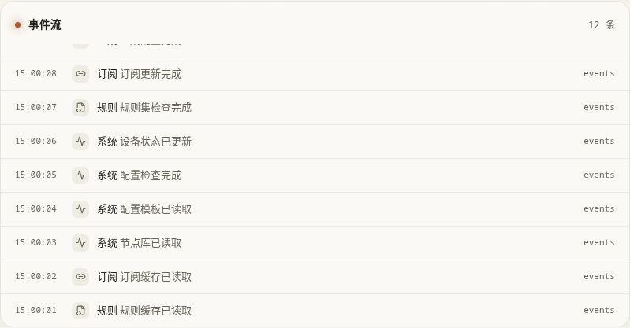
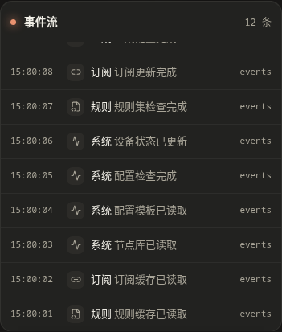

# 数据统计

这里是打开面板后的总览：检查资源有没有准备好、设备是否在线，再进入相应页面处理。它不会因为你打开页面就修改设备。

## 第一次使用入口

“开始配置”打开首次使用向导；做过一部分时会显示“继续向导”。继续会回到已保存的进度，不必重新输入所有内容。放弃向导前要阅读确认框，清理范围以确认框为准，不能把它当成普通的关闭窗口。

按 [首次使用向导](../guide/first-run.md) 选择方案。已有设备可以直接使用侧栏，不必重复安装。

## 数量卡片与流程图

| 内容 | 怎么看 |
| --- | --- |
| 订阅、节点数量 | 来自共享资源；切换配置空间不等于建立另一套订阅库 |
| 策略组数量 | 当前配置空间中的分组数量；没有组时先去“策略组”安排节点 |
| Agent 状态 | 检查被管理设备有没有回报状态；在线不代表所有网站都能打开 |
| 配置流程 | 显示订阅、节点、分组、规则、配置和设备之间的关系；点相应位置进入页面 |
| 实时流量 | 观察当前空间在线 Mihomo 上的连接，适合确认某次访问有没有经过它 |
| 刷新 | 重新读取页面数据，不会代替“拉取订阅”或“发布配置” |

“配置流程”中的连线表示配置关系，不是网络测速结果。只有切到“实时流量”，才是在观察实际连接。

实时流量会定期刷新，需要先收到连续两次数据才能算出速率。可以点选某个 Agent；再次点选已选中的设备恢复自动选择。没有连接时出现空图是正常情况，也可能是流量没有经过当前设备。点图进入 Mihomo 连接列表，可以继续检查。

## 快捷操作会做什么

这些按钮不仅会打开页面，还会触发对应动作。

| 按钮 | 点击后的结果 | 建议 |
| --- | --- | --- |
| 全部节点测速 | 打开节点库并开始全部节点测速 | 会产生网络请求；想测少量节点时先去节点库勾选 |
| 生成 Mihomo 配置 | 打开配置生成并生成当前空间的 Mihomo 内容 | 适合检查结果；生成不等于发布 |
| 拉取全部订阅 | 打开订阅来源并更新订阅 | 会改变共享订阅缓存，影响之后生成的配置 |
| 推送到全部 Agent | 打开 Agent 页并开始批量推送，跳过离线或正忙的设备 | 按各设备绑定的空间发送；不是只发给当前空间。首次使用建议先在 Agent 页操作一台 |

高可用 OxiDNS 会按一组处理，不应理解为两个互不相关的单机任务。更多说明见 [Agent](agents.md)。

## 记录和异常提示

事件流显示最近最多 12 条可解析的系统日志，右上角数字是列表中的记录数。列表每 5 秒更新，新记录在顶部；卡片内可用滚轮、触屏滑动或聚焦后的方向键滚动查看底部记录。需要更早的记录时，进入 [日志](logs.md) 页面。

页面中的订阅更新时间、失败提示和事件记录可以帮助找到问题发生的位置。它们不是完整的故障诊断：订阅失败去 [订阅来源](subscriptions.md) 看详情，设备离线去 [Agent](agents.md)，服务报错去 [日志](logs.md)。

先处理具体错误，再重试相应操作。反复刷新首页不会修复密码、地址或网络问题。
