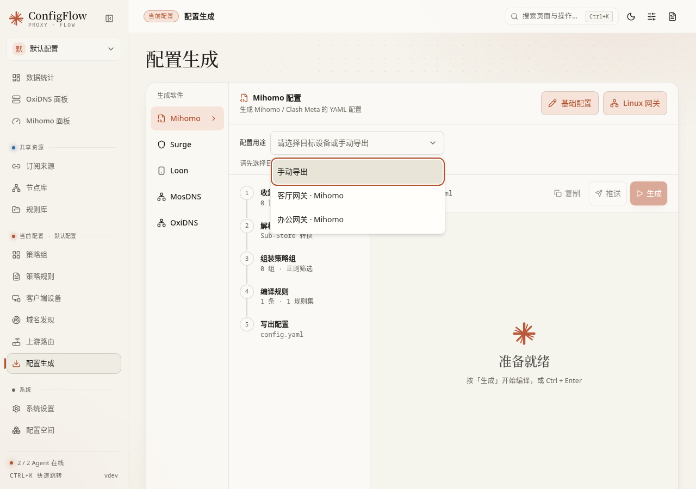
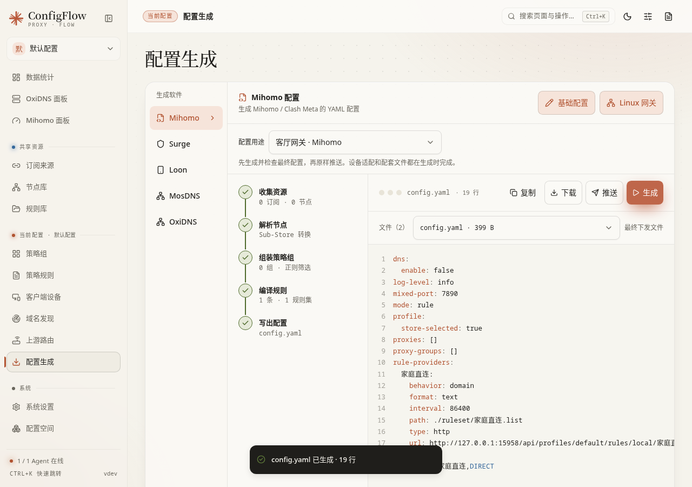

[文档首页](../README.md)

# 配置生成：预览、下载和让设备使用配置

本页目录：[先分清保存与发布](#先分清保存与发布) · [第一次生成](#第一次生成) · [按钮和结果区](#按钮和结果区) · [各软件入口](#各软件入口) · [下载和配置地址](#下载和配置地址) · [发布到 Agent](#发布到-agent) · [常见问题](#常见问题) · [下一步](#下一步)

## 先分清保存与发布

进入路径：先在顶部选择配置空间，再打开左侧 **配置生成**。

这里把该配置空间的策略组、规则和各软件基础设置合成客户端能读取的文件。订阅、节点和规则库来自共享资源；被当前配置引用后才参加生成。切换配置空间，相当于切换一套组合方案。

| 操作 | 做了什么 | 什么时候影响设备 |
| --- | --- | --- |
| 保存草稿 | 保存到 ConfigFlow，供以后编辑、生成和发布 | 不会立即下发；设备之后主动更新配置地址，也可能读到这些已保存内容 |
| 生成 / 预览 | 选择手动导出或目标 Agent，生成并固定主配置和配套文件；Agent 配置包含设备适配 | 不修改设备上的运行配置，不代表目标核心已经成功运行 |
| 复制 / 下载 | 把生成内容交给你 | 你导入客户端并应用后生效 |
| 配置 URL | 给客户端一个可以再次获取配置的地址 | 客户端拉取并应用时生效；不是自动推送通知 |
| 推送 / 保存并发布 | 通过 Agent 生成、检查和下发当前配置 | 以发布结果和设备状态为准；“已提交”不等于“已激活” |

不要把未保存的编辑器内容当作工作台的输入。先在相应页面保存，再重新生成。设备已下载的旧文件也不会因为你关闭编辑窗而自动更新。

## 第一次生成

1. 确认顶部配置空间正确，并已添加可用的[订阅](subscriptions.md)或[节点](nodes.md)。
2. 在[策略组](proxy-groups.md)中选入节点来源，在[规则](rules.md)中指定访问应走哪个策略组。
3. 在“生成软件”选择真实使用的软件，例如 Mihomo。打开“基础配置”或“设置”，按[核心设置](core-settings.md)调整并保存草稿。
4. 查看 **配置用途**：当前空间同软件只有一台启用的 Agent 时会自动选中；有多台时恢复本浏览器上次选择的 Agent，首次使用或原设备已不可用时需明确选择。没有匹配设备时默认「手动导出」，也可以主动切换到手动导出。确认后点击 **生成**，查看结果和报错，检查规则顺序、策略组名称、监听地址。文件选择器可以切换查看配套规则和订阅文件；二进制文件请下载查看。
5. 手动管理客户端时，下载或复制配置 URL；已经接入 Agent 时，确认目标设备和配置绑定后发布。
6. 在客户端确认配置加载成功，再测试一个应直连、一个应代理的实际网站。生成成功只说明文件生成成功，不能证明网络可达。

只部署 DNS 的用户可以直接选择 MosDNS 或 OxiDNS；这两类文件负责域名查询流程，不会代替 Mihomo 等软件建立代理隧道。

## 按钮和结果区

| 界面项 | 用途、推荐操作和结果 |
| --- | --- |
| 生成软件 | 切换 Mihomo、Surge、Loon、MosDNS、OxiDNS。手机版在下拉框中选择；切换目标不会把一种软件的语法直接搬给另一种软件 |
| 基础配置 / 设置 | 编辑当前配置空间下该软件的设置。先保存再生成；具体字段见[核心设置](core-settings.md) |
| 配置用途 | 只有一台匹配的启用 Agent 时自动选中，多台时按配置空间和软件分别记住上次选择；无匹配设备时默认手动导出。设备列表读取完成前等待，避免误生成通用配置。离线目标保持选中但不能生成，不会自动换成其他设备；可等待上线或主动选择手动导出。切换设备、软件或配置空间会清空旧预览，需重新生成 |
| 生成 | 固定本次主配置及配套文件。Agent 模式会读取设备信息、提前完成网关 DNS 和文件路径适配，准备订阅、规则及所需 Geo 文件；缺少资源或设备不支持时生成失败 |
| 步骤与资源数量 | 帮助理解当前配置由什么组成；请求期间显示真实加载状态，不模拟阶段进度。完整结果返回后，开启页面动效时逐行展示代码并显示完成状态；外观设置为「静止」或系统要求减少动效时直接显示完整结果。动画只影响展示，不改变复制、下载和推送的内容 |
| 文件名、行数、文本区 | 显示当前生成的文件。文本区用于查看，不能在这里直接修改并发布；请回到资源、规则或基础配置修改 |
| 订阅 hosts | 生成 Mihomo 时，从订阅合并和忽略的 hosts 条数；「详情」列出每条的来源订阅与忽略原因。有「域名 → 域名」映射时，下方写明几个被映射的节点域名改由本机 DNS 监听解析、几个映射目标加入了 Fake-IP 过滤（「查看条目」只读列出），不能改时写明原因，上报内核过旧的 Agent 也在这里点名。没有订阅带 hosts 时不显示。规则见[订阅自带的 hosts](subscriptions.md#订阅自带的-hosts) |
| 复制 | 复制当前已经生成的文本。适合粘贴到客户端或排错；修改设置后先重新生成，避免复制旧结果 |
| 下载 | 下载本次生成的原始文件；多文件结果下载 ZIP。与预览使用同一份内容，不会重新生成。修改设置后需主动重新生成 |
| 预览 | 部分软件入口打开只读预览窗；可复制、关闭。关闭仅关窗，不会撤销此前已保存的设置 |
| 配置 URL / 复制地址 | 复制当前配置空间对应的软件地址。应让目标客户端能访问其中的域名、端口及协议 |
| 推送 | 仅在已选择 Agent 并生成成功后可用；下发本次预览的文件，不再重新生成或下载规则。配置或设备绑定改变、结果过期时拒绝推送并提示重新生成。已有发布进行时需等待 |
| 返回、关闭 | 返回页面；有未保存修改时按提示决定保存还是放弃。不要把关闭当作保存 |

## 各软件入口

| 软件 | 可见入口 | 适用方式 |
| --- | --- | --- |
| Mihomo | 基础配置、Linux 网关、预览、下载 | 基础配置写 YAML；节点、策略组和规则由面板合并。Linux 网关属于透明网关部署设置，需结合真实网卡、网段和系统路由使用 |
| Surge | 基础配置、Smart、预览、下载 | 基础配置写 INI；Smart 可给选定策略组设置 Surge 专用优先级，不会改变 Mihomo 策略组类型 |
| Loon | 基础配置、预览、导入 Loon、下载 | 基础配置写 INI；“导入 Loon”调用客户端链接，需要所在设备能够打开 Loon |
| MosDNS | 设置、预览、下载 | 设置 DNS 上游、规则、缓存等；首次手动部署建议下载完整 ZIP |
| OxiDNS | 设置、下载 | 常用设置、完整参数和 YAML 是同一份草稿的不同编辑方式；首次手动部署建议下载完整 ZIP |

各目标支持的节点协议、策略组和规则语法不同。例如链式代理不能假定在 Surge、Loon 中与 Mihomo 等价。出现转换错误时，按错误定位具体资源，不要通过删掉无关配置试错。

Linux 网关、DNS 安装和绑定设备从[首次使用](../guide/first-run.md)开始；OxiDNS 双机部署另见[OxiDNS 高可用](../guide/oxidns-ha.md)。

## 下载和配置地址

| 下载文件 | 内容与用法 |
| --- | --- |
| `mihomo.yaml` | Mihomo 完整生成配置；导入后仍需客户端能访问其中引用的订阅和规则地址 |
| `surge.conf` | Surge 生成配置，交给 Surge 加载 |
| `配置空间名称.lcf` | Loon 生成配置，文件名取清理后的当前配置空间名称，可下载或使用“导入 Loon” |
| `mosdns-config.zip` | MosDNS 配置及配套规则文件；解压后保留目录关系 |
| `oxidns-config.zip` | OxiDNS 配置、生成的规则和附加文件；保留相对路径，不要只抽出 `config.yaml` |

MosDNS、OxiDNS 的配置 URL 提供主 YAML，不等于 ZIP 中的全部配套文件。已有部署若依赖相对路径文件，必须同时安排这些文件的更新。Agent 发布会走对应部署流程；手动导入者需要自己核对文件是否齐全。

地址中的服务域名由[系统设置](system-settings.md)控制。浏览器能打开面板，不代表远端客户端能访问相同地址；例如 `127.0.0.1` 在客户端看来是它自己。修改域名后，已经复制出去的旧地址不会自己变成新地址。

配置地址可能包含访问令牌，也可能返回代理凭据；把它作为私人订阅地址保管。若要长期自动更新，使用配置 URL 比反复下载静态文件方便；具体更新周期由客户端及相关订阅设置决定。

## 发布到 Agent

在工作台的 **配置用途** 中先选择目标设备，再生成、检查并推送。推送使用生成时固定的发布标识和文件字节；重试同一次发布不会改用新草稿。主配置、订阅、规则和附加文件都属于本次结果，配置 URL 仍是动态地址，不是本次结果的固定下载地址。

只有一台匹配的 Agent 时无需每次手动选择。多台设备首次使用时，生成按钮会等待你明确选择；之后按当前浏览器、配置空间和软件恢复上次所选 Agent。原设备移除或改绑后不会自动选另一台，需重新确认目标。主动选择「手动导出」仍可生成通用文件。

Mihomo、MosDNS、OxiDNS 需要支持最终配置协议的 Agent（1.8.53-go 起）；旧设备会提示更新，不会退回通用预览。Mihomo 的设备适配在生成时由目标 Agent 只读完成，发布时若环境变化导致需要改写配置，则停止发布并要求重新生成。生成不执行核心启动检查，发布仍会执行原有校验、激活和失败恢复。

结果最长保留一小时，服务器也可能因存储上限清理较早的结果。配置或设备身份、绑定改变时，旧预览保持可读，但不能作为新配置推送；应重新生成并检查。新打开的页面没有之前的生成结果，需要重新生成。

普通设备只推送给所选目标；OxiDNS 高可用配对仍按原有流程同时更新主备，结果区会明确列出两台设备。主备必须能使用相同的最终配置，设备路径或适配不一致时生成会停止。Loon 仅支持手动导出和客户端订阅。

核心设置窗口底部的 **保存并发布** 则提供目标设备选择。它先保存当前草稿，再向所选目标发布；没有可用目标仍可“保存草稿”。从某台 Agent 打开设置时，以窗口显示的配置空间和设备为准，不要只凭背景页面判断。

Mihomo 设置保存成功后，如果正在编辑的配置空间内有上游路由把这台 Mihomo 用作代理网关，发布栏下方会按路由器的实际状态提示，例如「上游路由「主路由」有 2 项待发布」，并提供「查看并发布」直达该路由器的预览发布；全部同步时不显示，读取失败时显示「无法确认上游路由状态」和原因。保存 Mihomo 不会修改路由器，路由器的改动仍要在上游路由页确认发布。详见 [待发布提醒与直达链接](routers.md#待发布提醒与直达链接)。

| 状态 / 操作 | 正确理解 |
| --- | --- |
| 保存草稿 | 仅保存供未来使用的配置；同一配置空间内、同一种软件的多个 Agent 共用这份草稿 |
| 目标选择 | 只选本次需要发布的设备。若原设备绑定改变或已不可用，应重新确认，不能假定会自动换到另一台 |
| 保存并发布 | 保存后生成新内容，检查并发送。不会把工作台之前显示的旧预览直接原样发送 |
| 已提交 / 发布中 | 设备正在处理，需要等待最终结果 |
| 已校验待激活 | 校验完成但还未成为运行配置；到 Agent 页面继续查看和执行允许的激活动作 |
| 发布成功 | 再检查服务在线状态和实际查询/访问；网络、上游账号与客户端指向仍可能有问题 |
| 超时、结果未知 | 不代表一定失败，也不代表已成功。先查看 Agent 事务和运行状态，避免立即重复发布 |
| 检查失败 | 按具体错误修复，如 YAML、缺失文件、重复监听端口或目标版本不支持；保存草稿成功不能代替目标核心检查 |

同时修改代理规则及 OxiDNS 的“DNS 去向”时，Mihomo 与 OxiDNS 是两个运行服务，应分别发布需要变更的一方。只发布其中一个，另一方可能仍使用旧配置。

## 常见问题

| 现象 | 先检查什么 |
| --- | --- |
| 生成结果没有刚新增的订阅 | 订阅是否启用、已拉取成功，策略组是否选入该来源，筛选条件是否把所有节点排除了 |
| 订阅自带的 hosts 被忽略 | 看结果区「订阅 hosts」详情里的原因；只合并本配置所用节点自己的域名，见[订阅自带的 hosts](subscriptions.md#订阅自带的-hosts) |
| 保存后设备仍用旧设置 | 是否只保存草稿；客户端是否重新拉取并应用；Agent 发布是否真正完成 |
| 预览能生成，核心却启动失败 | 目标核心版本、文件路径、端口占用、运行权限以及目标核心检查输出 |
| 推送提示重新生成 | 草稿、共享资源、设备身份或绑定已改变，或生成结果已过期；重新生成并检查。不会自动把新内容替换进旧预览 |
| OxiDNS 规则生成了，IP 规则却未参与 DNS | IP 地址规则不能直接变成“查询哪个域名”的条件；见[规则中的 DNS 去向](rules.md) |
| 配置 URL 无法访问 | 服务域名是否从客户端可达，令牌是否有效，反向代理路径与协议是否正确 |
| DNS 工作，网页仍无法代理 | DNS 只回答地址；继续检查代理核心、策略组、网关和客户端代理设置 |

## 下一步

逐项设置请看[核心设置](core-settings.md)；设备发布和回滚看[Agent 管理](agents.md)；尚未安装服务从[首次使用](../guide/first-run.md)开始。
