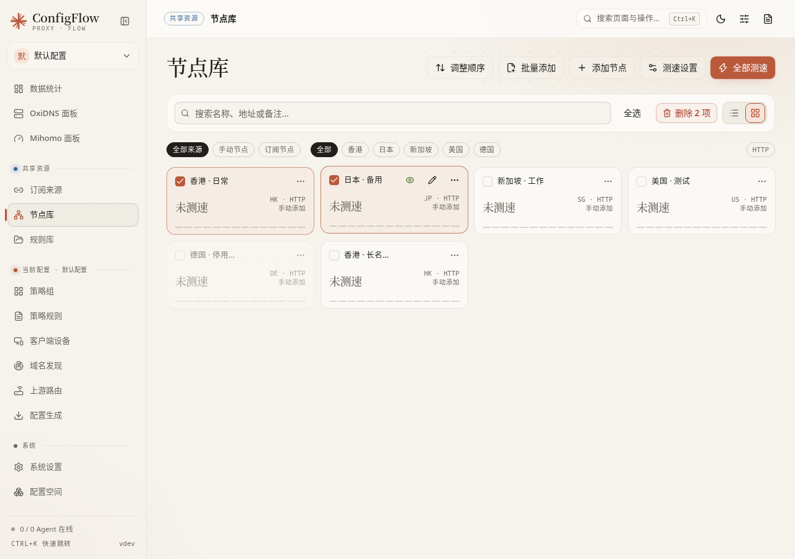
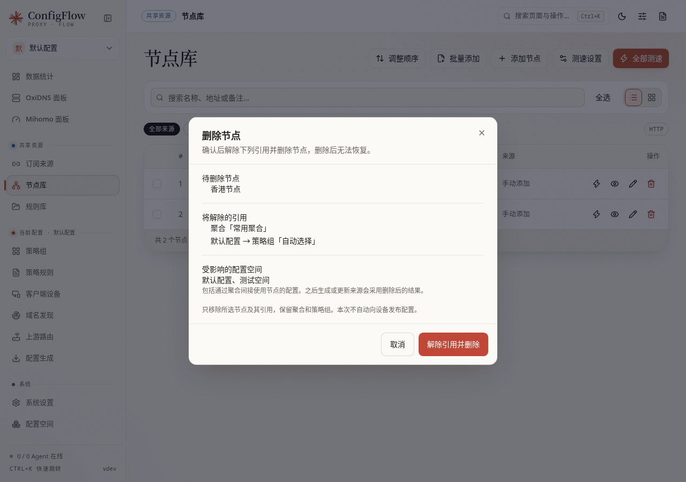

[文档首页](../README.md)

# 节点库：管理独立节点并测试代理是否可用

本页目录：[先做一次](#先做一次) · [节点与列表操作](#节点与列表操作) · [怎么看测速结果](#怎么看测速结果) · [测速 DNS 怎么选](#测速-dns-怎么选) · [生效与备份范围](#生效与备份范围)

入口：**共享资源 → 节点库**。这里能添加独立节点，也能查看订阅缓存里的节点。共享节点被多个配置使用时，修改、停用或删除都会影响这些配置之后生成的结果。

## 先做一次

1. 只有一个链接时点「添加节点」；有多个链接或一份节点列表时点「批量添加」。
2. 粘贴服务商或你自己提供的 URI、JSON、YAML、Surge / Loon 节点行。不要只填服务器地址，连接还需要协议、端口和认证信息。
3. 保持启用并保存，找到该节点，点「单独测速」。
4. 测试成功后，到 [策略组](proxy-groups.md) 勾选「手动节点」并选择它。节点库里存在并不代表它已经进入当前配置。

手机端的「批量添加」「调整顺序」在标题旁的更多菜单里。

## 节点与列表操作

| 选项／按钮 | 是做什么的；推荐怎么用 |
| --- | --- |
| 节点名称 | 给节点取易辨认的名称，例如“香港－自建”；建议不同实际节点用不同名字，避免选择或聚合时混淆。 |
| 备注 | 自己的说明，例如用途或到期提醒。可留空，不代替连接参数。 |
| 节点字符串 | 粘贴完整连接配置。页面按内容识别协议；协议专用字段在这段原始配置中，不是另有一套可视化开关。不要凭猜测删除 UUID、密码、TLS、传输路径等参数。 |
| 节点启用中／节点已停用 | 开启后可参与生成和测速；关闭保留记录，但正常使用时不再采用它。停用前检查策略组是否只剩这一个节点。 |
| 批量添加：节点链接或配置 | 可粘贴多行 URI，或 JSON/YAML 节点列表；支持 Surge / Loon 节点行，忽略空行和 `//` 注释。读导入结果，不要假定每一行都成功。 |
| 导入后默认启用／禁用节点 | 开启可直接选用；关闭适合先录入、稍后核对，但之后必须逐个或按操作启用才能正常使用。 |
| 搜索名称、地址或备注 | 只影响显示，不会改节点。 |
| 来源、地区、协议筛选 | 点击只看该类，再点可取消；地区依据节点信息展示，不是位置认证。 |
| 全选／取消全选 | 作用于当前可选且可见的节点；之前在其他筛选下选中的项可能继续保留，删除前看总数。 |
| 选择节点 | 点击卡片内容、列表行的非按钮区域或复选框即可选中，再点取消；可连续选择多个节点。键盘可 Tab 聚焦复选框后按空格切换。编辑、测速等按钮只执行各自操作，拖选文字不会选中节点；排序模式与订阅预览节点不参与选择。 |
| 卡片／列表 | 只改显示方式；小屏可能固定为适合手机的布局。 |
| 节点详情 | 查看协议与原始参数。包含凭据的内容不要直接发到公开群。 |
| 编辑、启用／停用、删除 | 手动保存的节点可管理；订阅缓存预览不是独立副本，来源节点需回「订阅来源」管理。实际可操作项以该行按钮为准。 |
| 删除 N 项 | 先查看影响，确认后一次解除聚合、各配置空间策略组中的普通引用及排序记录，并删除所选节点。整批一起成功或一起失败。 |
| 调整顺序 | 进入排序后查看完整可排序列表，保存才提交；取消还原这次排序。 |
| 单独测速 | 只测试该节点。先测一个，适合确认配置或 DNS 问题。 |
| 全部测速 | 测试当前筛选后显示的节点，不是自动覆盖所有隐藏来源；执行中显示完成数。 |
| 测速设置 | 选择测速专用 DNS。具体见下两节。 |

### 多选节点

直接点击卡片内容或列表行即可连续多选，不必对准左上角的复选框。已选节点显示勾选与高亮，工具栏显示「删除 N 项」；切换卡片／列表时保留选择。

### 删除节点及其引用

单个删除和「删除 N 项」都会先显示待删除节点、将清理的聚合与策略组，以及受影响的配置空间（包括通过聚合间接使用节点的空间）。确认「解除引用并删除」即可，无需先逐个编辑聚合或切换配置空间。聚合和策略组本身保留；移除后没有已选择来源的项会在确认框中提醒。

代理链的前置／落地引用、其他节点的 `dialer-proxy`、直接指向节点名称的规则策略不能自动改成其他出口。遇到这些依赖时，页面显示原因并禁止整批删除；先调整对应依赖，再点「重新读取影响」。清理后会破坏代理链的普通策略组也会被阻止。

确认期间节点或相关引用发生变化时，本次操作不会写入，需要重新读取并确认。取消、依赖校验失败或数据库提交失败均不会留下“引用已清、节点未删”的中间结果。删除不会自动发布到设备；后续生成或更新来源使用新的节点集合。

## 怎么看测速结果

这里测的是 **ConfigFlow 所在服务器或容器，经这个节点访问测试地址的 HTTP 代理延迟**。它不是浏览器到节点的 ping，也不是下载带宽，更不等于其他设备使用该节点时的延迟。

成功结果按毫秒显示，数值较小表示这次请求更快。超时、失败、未测试和不可用要分开看：未测试不能当成 0 毫秒；“不可用”可能是节点或来源已删除、停用，先刷新列表。结果带时间，网络变化后应重新测试。项目使用独立测速组件，不会为了这次测速切换运行中的 Mihomo 策略组。

默认测试地址是 `https://www.gstatic.com/generate_204`，超时为 5000 毫秒；这些运行参数由部署环境设置，不在本页提供一个任意修改超时的输入框。设备上的核心健康检查也有各自的 URL 与超时，别把两处结果混在一起比较。

需要更换测速地址或等待时间时怎么改

普通使用保持默认即可。确需修改时，在 ConfigFlow 面板容器的环境变量中添加对应项，然后重新创建容器；Compose 用户修改 `environment` 后运行 `docker compose up -d`。这些设置只影响节点库测速。

| 环境变量 | 默认值 | 修改后的结果 |
| --- | --- | --- |
| `CONFIGFLOW_NODE_TEST_URL` | `https://www.gstatic.com/generate_204` | 改为通过节点访问的测试网址，需支持 HEAD 请求，建议使用 HTTPS |
| `CONFIGFLOW_NODE_TEST_TIMEOUT_MS` | `5000` | 每个节点最多等待多少毫秒，允许 `500–10000`；调长会等待更久，不会让节点变快 |
| `CONFIGFLOW_NODE_TEST_UNIFIED_DELAY` | `1` | 默认先连接一次，再计时第二次请求；改为 `0` 或 `false` 后显示包含首次连接过程的耗时 |
| `CONFIGFLOW_NODE_PROBE_BIN` | 自动查找 | 测速程序的路径。官方镜像无需填写，只有自行部署程序时才按实际位置设置 |

若提示测速组件缺失或版本不匹配，Docker 用户应更新完整镜像并重新创建容器，保留原数据目录。仅替换面板的部分文件不能补齐测速程序；面板和测速程序需要配套更新。

## 测速 DNS 怎么选

DNS 负责先把节点服务器的域名查成 IP。测速需要真实 IP；如果查到 Mihomo 提供的临时 Fake-IP，独立测速可能无法连接。

| 模式／字段 | 推荐选择；保存后的结果 |
| --- | --- |
| 系统 DNS | 系统本来就能解析出真实 IP 时优先用。这里的“系统”指 ConfigFlow 服务器或容器，不是当前浏览器、手机，也不保证等于宿主机的设置。 |
| 自定义 DNS | 你已有可访问、返回真实 IP 的 DNS 时使用；每行一个 IPv4 地址、IPv4:端口、`https://主机/路径`（DoH）或 `tls://主机[:端口]`（DoT）。当前这组输入不接受 IPv6 字面地址，不要套用 OxiDNS 所有协议的格式。 |
| 引导 DNS | 自定义上游使用域名时才需要：先找到 DNS 服务商的 IP，再通过它查节点域名。填 IPv4 或 IPv4:端口，每行一个，最多 4 个；不要指回会形成循环的同一 Fake-IP 入口。 |
| 检测 | 用当前尚未保存的选择发起 DNS 检查，展示真实返回结果。只做检测，不保存测速设置，也不增加节点测速历史。 |
| 保存 | 保存模式和对应参数，供后续测速使用；不改变已完成的历史测试，也不修改所有客户端的 DNS。 |
| 取消 | 放弃尚未保存的模式/输入。 |

自定义 DoH/DoT 地址不要带账号、查询参数或片段。优先使用你能确认服务可达、用途明确的 DNS；选择哪个公共 DNS 不是这份手册替你规定的网络策略。

## 经过代理网关时用 IP 形式的 DoH

ConfigFlow 所在的机器如果在代理网关后面，或者本身就是网关（Mihomo 开着 TUN、Fake-IP 并接管 53 端口），查询结果取决于走哪个端口：

| 写法 | 结果 |
| --- | --- |
| 系统 DNS、`223.5.5.5` 这类普通 DNS | 走 53 端口，被网关接管，拿到 Fake-IP，测速不可用 |
| 域名形式的 DoH（`https://dns.alidns.com/dns-query` 加引导 DNS） | 引导这一步也走 53 端口，同样拿到 Fake-IP |
| IP 形式的 DoH（`https://223.5.5.5/dns-query`、`https://1.12.12.12/dns-query`） | 走 443 端口，不被接管，返回真实 IP |

所以这类环境里选「自定义 DNS」并填 IP 形式的 DoH。「检测」发现返回 Fake-IP 时，结果下方有「改用 DoH」按钮，点一下会填好这两个地址，再检测、保存即可。面板装在网关本机、装在网关机器的 Docker 容器里，结论相同。

旧版本里的「OxiDNS 托管」模式已经移除。升级前选的是这个模式时，测速设置会显示为「自定义 DNS」，地址就是原来那个入口（例如 `192.0.2.2:15353`），测速照常可用；设备上 OxiDNS 配置里名为 `cf_node_test_…` 的那组插件也原样保留，成为普通的自定义入口。想清理的话，先把测速 DNS 换成上面的 DoH，再到 OxiDNS 完整参数里删掉这组插件并发布。

## 生效与备份范围

节点保存会修改共享资源，运行中的客户端仍需更新配置或重新发布。测速设置只影响下一次面板测速；不修改 [策略组健康检查](proxy-groups.md#健康检查和负载策略)。

完整数据导出可用于备份节点配置，其中可能有密码和密钥；脱敏导出不适合恢复真实连接。测速历史等运行文件不能只靠配置 JSON 保全，迁移时按部署指南备份整个数据目录。

下一步：[策略组](proxy-groups.md)，或把独立节点与订阅放进 [订阅聚合](subscription-aggregation.md)。
