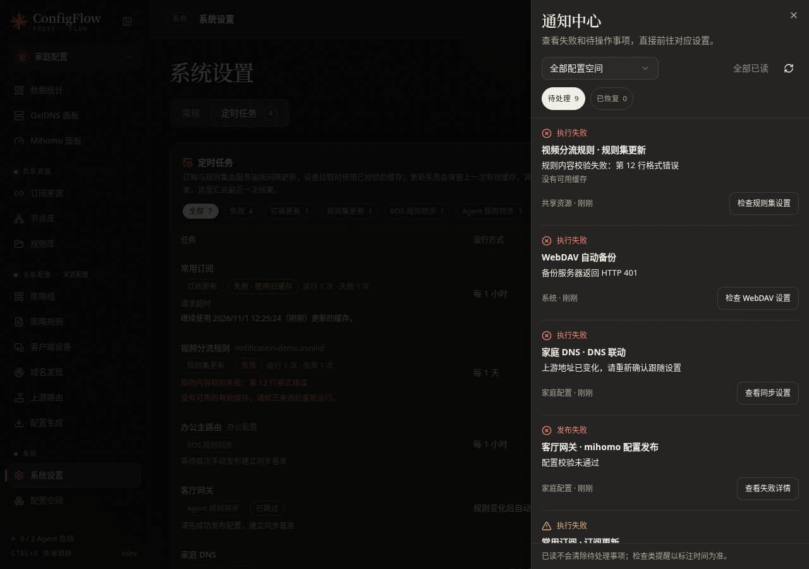
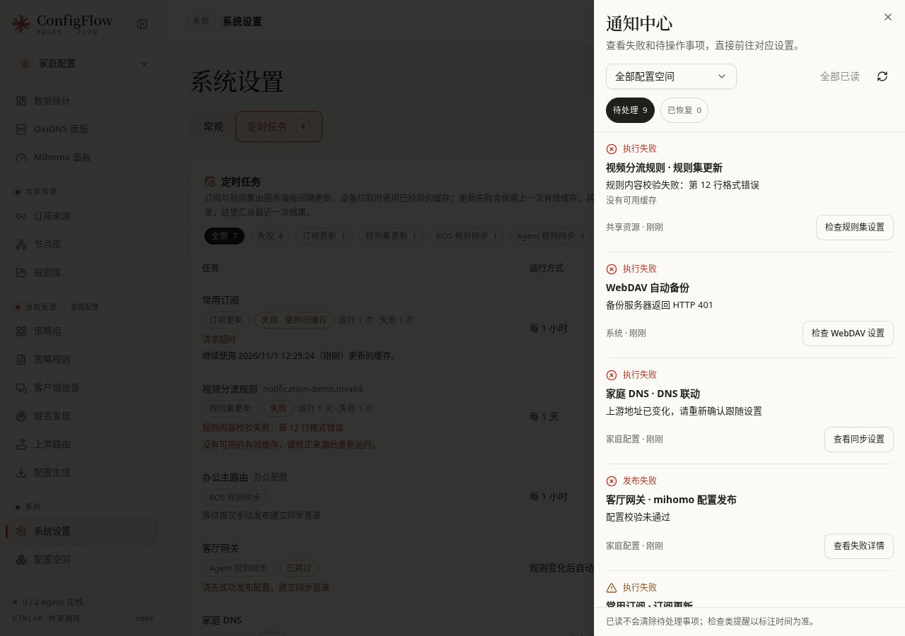
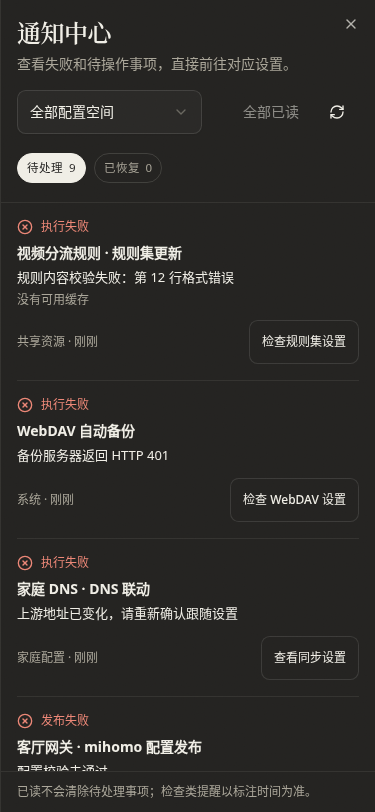

# 通知中心

[文档首页](../README.md)

入口：任意页面顶栏的 **铃铛**。数字表示当前待处理事项数，桌面打开右侧面板，手机使用全屏面板。

## 查看和处理

通知显示对象、失败或待操作原因、所属配置空间、发生或检查时间，以及对应处理入口。默认显示全部空间，可以筛选一个空间；共享资源和系统事项仍会保留。

| 通知 | 点击后的定位 |
| --- | --- |
| 订阅更新失败 | 打开该订阅的编辑窗口，定位订阅链接 |
| 规则集更新失败 | 打开该规则集的编辑窗口，定位规则地址 |
| Agent 发布、回滚失败或等待激活 | 打开该设备的发布记录，定位本次发布并展开失败详情 |
| Agent 规则同步阻断或失败 | 定位该设备卡片里的规则同步设置 |
| DNS 联动失败 | 打开该设备的 DNS 跟随设置 |
| 路由器自动同步待处理 | 打开对应路由器的规则同步区域 |
| 路由器防火墙、IPv6 DNS 等需手动处理 | 打开该路由器的差异报告，定位相应区域 |
| 路由器配置差异待发布 | 打开对应路由器的发布预览，仍需手动确认发布 |
| WebDAV 备份失败 | 打开 WebDAV 备份设置 |
| 其他后台任务失败 | 在系统设置的定时任务中定位具体任务 |

跨配置空间的路由器通知会切换到目标空间并提示。Agent 通知固定核对设备所属空间；设备改绑后会提示重新确认，不会改为操作另一台设备。当前有未保存编辑时，先保存或关闭编辑窗口再跳转。

## 已读和恢复

- **全部已读**只处理当前筛选范围内的未读标记，待处理事项及铃铛数字保留。
- 同一对象的同一问题合并显示，连续失败更新次数和原因。原因或影响程度变化会重新标为未读。
- 成功重试或检查确认恢复后，事项自动进入 **已恢复**。再次出现会重新进入待处理。
- 对象已删除或相关功能已停用时，原事项标为 **已不再适用**，不把它描述成修复成功。
- 已恢复或不再适用的事项保留 30 天，仍待处理的事项不会按时间自动清除。状态保存在服务端，刷新页面和服务重启后保留；它不属于配置导出或备份。

红色表示失败，警告色表示需操作或仍可使用旧缓存，中性色表示普通待发布。通知列表读取失败时保留上次结果并说明原因，不显示“全部正常”。

## 检查时间

通知中心汇总已有的任务、发布与设备检查结果。打开面板或刷新通知不会扫描全部设备，也不会执行更新或发布。路由器检查会在生成差异报告、预览发布和上游路由检查时更新；手动改动设备后，请到相应页面重新检查。

配置已经变化时，旧检查事项会标注需要重新检查。离线、检查失败或仍在执行均不等于已恢复。

