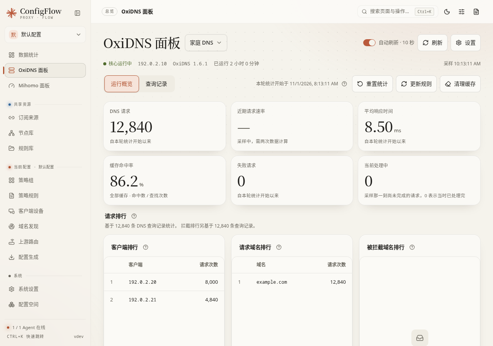
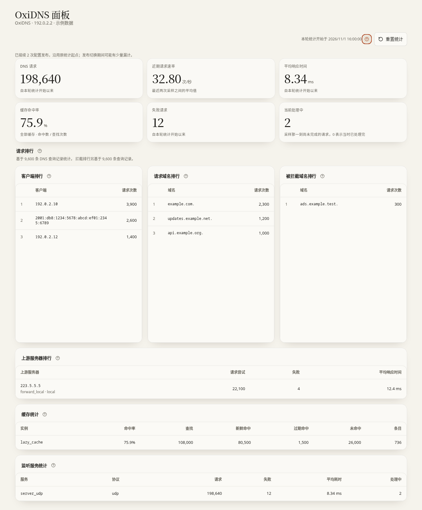

# OxiDNS 面板：看查询、查缓存和更新规则

[文档首页](../README.md) · [Agent 日常操作](agents.md) · [核心设置](core-settings.md) · [OxiDNS 高可用](../guide/oxidns-ha.md)

这个页面查看**所选设备上正在运行的 OxiDNS**。它能回答“请求有没有进来、走了哪个解析路径、缓存有没有命中”，也提供更新规则、清理缓存等操作。修改 DNS 配置仍要经过“设置 → 保存 → 发布”。

本页目录：

- [第一次打开与顶部操作](#start)
- [运行概览里的数字怎么看](#overview)
- [重置统计、更新规则、清理缓存](#actions)
- [查询记录的筛选与翻页](#queries)
- [查询详情与解析来源](#detail)
- [设置怎样生效](#settings)
- [按现象排查与回退](#troubleshooting)

## 第一次打开与顶部操作

1. 在 **Agent** 页找到 OxiDNS 卡片，确认 Agent 在线，已成功发布配置。
2. 点卡片的 **OxiDNS 面板**，或从侧栏进入。
3. 核对标题旁的设备名和下方 IP。HA 两个成员分别有自己的数据；当前页不是整组的合计面板。
4. 看“核心运行中”、版本、“已运行”和“采样”时间。读取失败时页面可能保留旧数据，不能把旧的绿色状态当作刚刚检测成功。
5. 从一台实际客户端发起 DNS 查询，再检查“DNS 请求”是否增长、查询记录能否找到该客户端。

设备选择会记住上次选择；没有可用的上次选择时优先选择在线设备。请在进行维护操作前再次核对名称，特别是两台 HA 成员名称相似时。

| 控件 | 默认/建议 | 操作后发生什么 |
| --- | --- | --- |
| 设备下拉框 | 使用当前进入的设备；日常先核对名称/IP | 切换到另一台，清空上一台的查询筛选和分页。只切换查看目标。 |
| 自动刷新 · 10 秒 | 默认开启，日常保持开启 | 页面可见时约每 10 秒重新读取。关闭后保留当前画面，DNS 服务和后台规则任务仍继续；需要时点“刷新”。浏览器页面隐藏时暂停读取。 |
| 刷新 | 按需点击 | 重新读取设备、状态、当前查询页及备注，不发布配置、不重启核心。历史页手动刷新仍保留该页的时间范围。 |
| 设置 | 编辑前先核对弹窗顶部空间/设备 | 打开所选 Agent **实际绑定的配置空间**，不依赖侧栏当前空间。相同空间的 OxiDNS 共用草稿。 |
| 运行概览 / 查询记录 | 默认“运行概览” | 切换统计与逐条查询；不改变 DNS 行为。 |

管理客户端名称和 DNS 策略，请先确认当前配置空间，再从侧栏打开[客户端设备](client-devices.md)。

页面提示“暂无 OxiDNS Agent”时，先按 [Agent 安装](../guide/agent-install.md)接入。提示管理 API 未配置时，用“前往设置”打开 API 设置并发布；提示“尚未启用查询记录”时，按[设置怎样生效](#settings)开启记录器。

## 运行概览里的数字怎么看

### 顶部六项指标

| 指标 | 通俗解释 | 容易看错的地方 |
| --- | --- | --- |
| DNS 请求 | 本轮统计起点之后收到的请求数 | 不是当前在线设备数，也不是去重域名数。旧 Agent 没有本轮统计功能时，按核心启动以来显示。 |
| 近期请求速率 | 最近两次有效采样间，每秒平均收到多少请求 | 刚打开或重置后要等两次采样；“采样中”或“—”不是零。它不是由查询记录条数估算的。 |
| 平均响应时间 | 当前统计范围内请求的平均耗时 | 平均值不能保证每一个域名都快。继续查单条慢查询更有帮助。 |
| 缓存命中率 | 命中次数除以缓存查找次数 | 同时包括新鲜缓存和过期缓存；不等于所有 DNS 请求里有多少百分比成功。选择缓存实例会改变这里的统计对象。 |
| 失败请求 | 核心报告的失败计数 | 与“拦截域名”不是同一概念，不能仅靠它判断广告拦截。 |
| 当前处理中 | 采样那一刻尚未完成的请求 | 显示 0 往往是已经处理完，不表示无人使用 DNS。 |

数字为“—”时，表示没有可确认的数据。页面若提示基线缺失或插件重新计数，当前这一轮可能不完整，不能把缺失项按 0 相加。

### 请求排行

这里有 **客户端排行、请求域名排行、被拦截域名排行**，各显示前 10 项。

- 排行根据记录器中仍保留的查询记录计算，有取样上限。说明文字会显示样本条数和上限提示；它不是无限期、全量累计排行榜。
- 多个记录器时，“排行记录器”默认选当前可用的第一个，可切换到需要的记录器。这个选择也影响“查询记录”标签中的记录器。
- 样本条数是查询记录数，不是客户端数量。域名按问题名计数，一条 DNS 查询包含多个问题时可以贡献多个域名计数。
- “被拦截域名排行”只统计能明确识别为命中拦截规则的查询。普通 `NXDOMAIN`、IPv4 优先产生的空应答都不能直接当成拦截。
- 没有记录器、记录已过期、配置没有可识别的拦截规则，都会使某些排行不可用。先读页面给出的原因，不要为了出现排行反复重启 DNS。

### 上游、缓存、监听服务

| 区域 | 用法 | 说明 |
| --- | --- | --- |
| 上游服务器排行 | 看请求尝试、失败、平均响应时间，按请求尝试数列前 10 项 | 一次客户端查询可能竞速请求多个上游，也可能重试，所以尝试数可以大于 DNS 请求数。平均耗时包含成功和失败的已完成尝试。 |
| 缓存统计 | 默认“全部缓存”；多个实例时可选择一个缓存 | 显示查找、新鲜命中、过期命中、未命中和当前条目数。筛选只是看某个实例，**不会限制“清理缓存”按钮的范围**。 |
| 监听服务统计 | 按服务与协议检查请求、失败、平均耗时、处理中 | 用于判断请求进入哪个监听服务。没有统计不等于能证明端口没有监听，还要检查核心和配置。 |

缓存条目和“处理中”是当前值；累计请求、累计失败等才属于本轮计数。比较两台机器时先比较统计起点，避免把运行一天和运行十分钟的数字直接比较。

## 重置统计、更新规则、清理缓存

三个按钮用途不同，都是对所选设备发起操作，不是“清除所有数据”的不同叫法。

### 重置统计

只在“运行概览”出现。点 **重置统计**，核对设备后确认 **重新开始统计**。

- 立即为该设备的面板累计指标与请求排行建立新起点；其他人查看同一设备时也使用新起点。
- 查询历史、缓存内容、正在处理的请求和 DNS 服务保留，不会重启。
- 从 ConfigFlow 发布 OxiDNS 配置时，面板会在激活前保存统计快照，在确认发布结果后接续累计，保留原统计起点与排行时间范围。直接发布、先上传后「应用并启动」以及主备发布的每个成员使用相同流程；只上传不会提前保存或接续。发布失败并自动回滚时，能确认恢复原配置的成员仍接续已保存的统计。
- 接续不要求 Agent 后台采集，也不新增定时任务。快照保存在 ConfigFlow 的数据目录，重启面板后仍可读取；命中率和平均耗时根据累计次数与耗时计算，缓存条目及处理中数量继续显示实时值。已从新配置移除的监听、缓存和上游仍保留本轮累计贡献，实时数量为零。
- 接续后显示「已接续 x 次配置发布」。快照采集到真正重载之间，以及失败后自动回滚的切换期间，可能有少量漏计；这不是完整审计账本。查询记录仍受原保留期限与排行采样上限约束；换记录器或数据库不会迁移旧记录。
- 绕过 ConfigFlow 重载、单独手动回滚、核心意外重启、监控目标改变或发布前快照不可用时，仍可能重新开始统计。采集失败不会阻止配置发布；统计周期提示会解释新起点。明确的「重置统计」始终清除本轮累计与待接续快照，不清除查询历史。
- 需要 Agent `1.8.14-go` 或更新版本；旧 Agent 的按钮不可用，仍可查看按核心启动时间累计的指标。

适合在“我要比较接下来十分钟的效果”之前使用。新起点没有撤销按钮；需要对比旧数字就先记录旧的起点与数值。

### 更新规则

点 **更新规则** 后，OxiDNS 下载**已部署配置中指定的规则**并热重载。界面显示“下载 x/y”“热重载 x/y”。这是更新规则内容，不会替你发布未保存/未发布的上游、插件或监听配置，也不负责升级 OxiDNS 核心。

使用前应满足：Agent 支持该功能（至少 `1.8.30-go`）、OxiDNS 支持规则更新接口、管理 API 已启用且发布、运行配置中有可下载规则。

1. 核对设备后点击，等下载和热重载都完成。
2. 若提示 **查询更新结果**，先点它确认正在运行的任务。请求超时不代表服务器任务已经停止。
3. **重新尝试更新**会先查询当前任务，仅在确认未运行时再提交。
4. 下载或热重载失败时，可能已经更新了部分规则。检查日志和错误，修正来源地址、网络或规则内容后重试；不要把失败提示理解成自动恢复了全部旧规则。

已配对 HA 时，更新由整组的规则更新流程处理；单纯规则热重载不会为了刷新规则迁移 VIP。具体并发限制和组状态见 [HA 日常操作](../guide/oxidns-ha.md#operation)。

### 清理缓存

按钮的界面原名是 **清理缓存**。点击会先读取所选设备**已部署配置**里的缓存实例，再在确认框列出将清理的实例。

- 确认后清空该设备全部已识别的 DNS 缓存，包含主缓存、本地探测缓存等；不是只清空概览下拉框选中的实例。
- DNS 服务继续运行，后续查询需要重新请求上游，因此短时间命中率下降、上游请求增加属于预期。
- 不删除查询记录，不重置全部统计，不自动清理 HA 另一台的缓存。需要两台都清理时分别选中并执行。
- 没有缓存插件时会提示没有可清理的缓存。部分清理失败时，提示会列出已完成的部分，按剩余错误排查。

适合排查“上游已变，但还看到旧解析结果”。缓存无法撤销清空，会随新查询重新建立。客户端和路由器自己的 DNS 缓存要另行处理。

## 查询记录的筛选与翻页

默认使用第一个可用记录器、**最近 1 小时、全部结果、全部客户端**；其他文本条件为空。记录按时间倒序，每页最多 50 条。

一个常用排查步骤：

1. 在目标客户端访问一个域名。
2. 打开 **查询记录**，选择该客户端 IP，输入“查询域名”，点 **查询**。
3. 找到对应时间的记录，比较结果、解析来源和耗时。
4. 点 **查看**打开应答与执行轨迹。找不到时先放宽时间/结果筛选，再检查客户端是否使用了别的 DNS。

| 筛选控件 | 默认/推荐用法 | 什么时候应用、怎样撤销 |
| --- | --- | --- |
| 查询记录器 | 第一个可用记录器；有多个时按实际记录路径选择 | 切换立即查询并回到第一页，也更新概览的排行来源。选回原记录器即可。 |
| 查询域名 | 默认空；填写要查的域名 | 文本编辑后点“查询”或按回车提交。清空再查询解除。不要把它当作新增分流规则。 |
| 查询时间范围 | 默认最近 1 小时，可选最近 24 小时、全部时间 | 选择立即查询并回到第一页。“全部时间”仍受核心记录保留期限制。 |
| 查询结果筛选 | 默认全部结果，可选处理错误、有应答、无应答 | 选择立即查询；回到“全部结果”解除。它不是拦截/放行开关。 |
| 客户端 IP | 默认全部客户端；可按 IP 或设备备注搜索已有客户端 | 选择立即查询。选择“全部客户端”解除。列表是当前范围内的记录样本，不是整个局域网的设备扫描。 |
| 查询类型 | 默认空；例如 `A`、`AAAA` | 填好后点“查询”。不修改 DNS 允许的查询类型。 |
| 响应码 | 默认空；例如 `NOERROR`、`NXDOMAIN` | 填好后点“查询”。要查处理错误可用上方“处理错误”选项。 |
| 匹配器标签 | 默认空；按当前配置实际执行的标签填写 | 填好后点“查询”；不确定标签先看一条记录的执行轨迹。 |
| 查询 | 提交当前整组筛选 | 回到第一页，重新固定本次查询的时间范围。所有条件共同限制结果。 |

时间按浏览器时区显示；“最近 1 小时/24 小时”以 DNS 设备的采样时间计算。浏览器与设备时钟相差较大时会提醒，应修正系统时间，不要只靠扩大查询范围绕开。

**上一页 / 下一页**翻阅历史。进入第二页以后自动刷新查询记录会暂停，避免新记录把当前页挤走；概览仍可自动更新。翻页保留原时间边界，回到第一页或重新查询后再查看最新记录。即使某一页为空，只要还有“下一页”，仍可能存在更早的匹配记录。

本页没有一键“清除全部筛选”按钮；将时间、结果、客户端改回需要的范围，清空文本条件，再点“查询”即可。筛选只改变读取范围，不删除历史记录。

## 查询详情与解析来源

表格“结果”优先显示处理错误，其次显示 DNS 响应码；完全没有应答时显示“无应答”。`NOERROR` 表示 DNS 应答没有报告错误，仍可能没有你期待的地址；`NXDOMAIN` 表示名称不存在，也可能与规则有关，需要看轨迹才能区分。

表格“解析来源”是根据执行轨迹归纳的路径。看到“读取失败 · 重试”时可只重读这条的来源；数据读取失败不等于 DNS 查询本身失败。

点 **查看**后，详情分为：

| 区域 | 看什么 |
| --- | --- |
| 基本信息 | 问题名、类型、时间、客户端、耗时、结果、记录器和记录编号。 |
| 解析来源 | 本地 DNS、远程 DNS、备用 DNS、缓存或本地策略等路径；不区分同一转发组里的每台服务器。 |
| 经过的插件 | 按进入顺序展示插件。经过本地探测再转远程时，最终来源会显示远程；缓存未命中后转发时也不会误写成缓存命中。 |
| 应答记录 | 名称、类型、TTL 和内容。没有应答记录可能是正常空应答，不自动等同于超时。 |
| 执行轨迹 | 核心实际记录的步骤、序列、节点、标签与结果。自定义标签可能无法归纳简短来源，原始轨迹仍保留。 |

“IPv4 优先”可能主动返回 AAAA 空应答来引导客户端使用 IPv4，不能因此认定 IPv6 网络坏了。标记 **Agent 检查** 的记录是 Agent 在发布前后用 `example.com` 检测本机 DNS 产生的，不是某个局域网用户的访问。

详情中的 **重试**仅重读这条历史；**关闭**仅关闭弹窗，不关闭 DNS 查询或记录器。

## 设置怎样生效

顶部 **设置**打开“OxiDNS 设置”。常用设置、完整参数、YAML 是同一份草稿的不同编辑入口，不能把常用设置看成一套与 YAML 分离的生效配置。

面板所需的两项设置：

| 设置 | 开启/关闭的效果 | 建议及生效时机 |
| --- | --- | --- |
| 启用 API / WebUI | 新配置默认开启，默认监听 `127.0.0.1:9199`。开启后 Agent 才能读取面板数据和调用相关管理功能；关闭后这些功能不可用 | 常用设置 → API / 日志检查当前实际值，推荐保持开启。已有自定义配置可能不同。按 Agent 能访问的地址配置，保存并发布后才改变运行核心。 |
| 启用查询记录 | 默认关闭；开启后记录新查询，供历史与排行读取；关闭后不再产生相应新记录 | 常用设置 → 特色功能 → 查询记录。需要排查时开启，默认保留 7 天并持续写盘；只开启不会补回过去未记录的请求。保存并发布后生效。 |

若 API 监听本机以外的地址，可以在“访问认证”同时填写用户名和密码；两项都空表示不验证身份。面板和规则更新自动使用这组凭据。不要只填一项，也不要为了打开面板把管理 API 随意暴露到公网。当前 DNS 面板不支持连接 HTTPS 管理 API；设置 API TLS 证书和私钥后，面板与规则更新会无法连接，不能把开启 TLS 当成这个面板的必要步骤。

查询记录的“数据库路径”建议使用 `state/` 下的相对路径，让部署保留运行数据。“保留天数”决定历史范围；“写入队列”“每批条数”“刷新间隔（毫秒）”影响写入节奏，和页面的 10 秒自动刷新不是同一项。刚发生的查询可能需要等待后台写入才可见。先保持当前可用参数，有实际问题再调整。

发布步骤：

1. 核对弹窗顶部的配置空间，修改设置。
2. **保存草稿**只保存，在线 DNS 不变；需要上线时在“发布到”明确选择目标，点 **保存并发布**。
3. 面板入口不会保证多个候选设备时自动替你选中当前设备，必须核对发布目标。HA 成员会走整组发布流程。
4. 等规则检查、目标核心检查和服务检查完成，返回面板点“刷新”，从客户端发一条新查询验证。

如果关闭管理 API 后面板失联，回 Agent 页打开同一配置空间的设置，重新启用并发布。若只关闭了查询记录，重新启用后只能恢复之后的新记录；过期清理的历史不能靠开关找回。其余常用设置、完整参数、YAML 和附加文件见 [核心设置](core-settings.md)，配置预览与发布见 [配置生成](generate.md)。

## 按现象排查与回退

| 现象 | 先做什么 |
| --- | --- |
| Agent 在线，面板无法读取 | 看具体错误和采样时间；检查 OxiDNS 核心、管理 API、认证与已发布配置，必要时到 Agent 页看核心日志。 |
| 概览有请求，但没有查询记录 | 检查记录器是否启用并已发布；放宽筛选，等一次后台写入。概览指标不依赖每条查询一定写入历史。 |
| 只能看到路由器，找不到每台客户端 | 客户端可能统一转发给路由器，再由路由器询问 OxiDNS。面板显示实际看到的来源 IP，不能凭空还原被转发隐藏的终端。 |
| 改了规则，旧解析仍存在 | 先确认规则确实同步/更新，再清理所选设备缓存，检查客户端/路由器缓存。配置结构变更需要发布，不能只点更新规则。 |
| 统计突然从零开始 | 查看统计周期说明，确认是否重置、重启、重载或插件重新计数。历史查询不一定被删除。 |
| HA 备用机请求少 | 客户端正常只请求 VIP 当前持有者；备用机没有同等请求量不等于故障。到 Agent 页检查主备状态，并从第三台设备查询 VIP。 |
| 发布后 DNS 异常 | 按 [Agent 发布记录与回滚](agents.md#history)处理；HA 不允许单成员手动回滚，应修复草稿后重新发布整组。 |

排查时一次只改一类设置，记录修改前的配置和验证结果。页面读取数据、重置统计、清理缓存都不能替代真实客户端的 DNS 验证。
