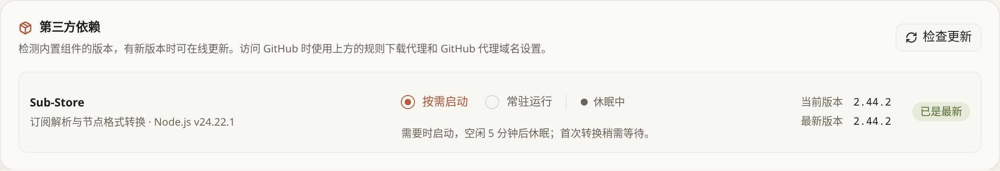
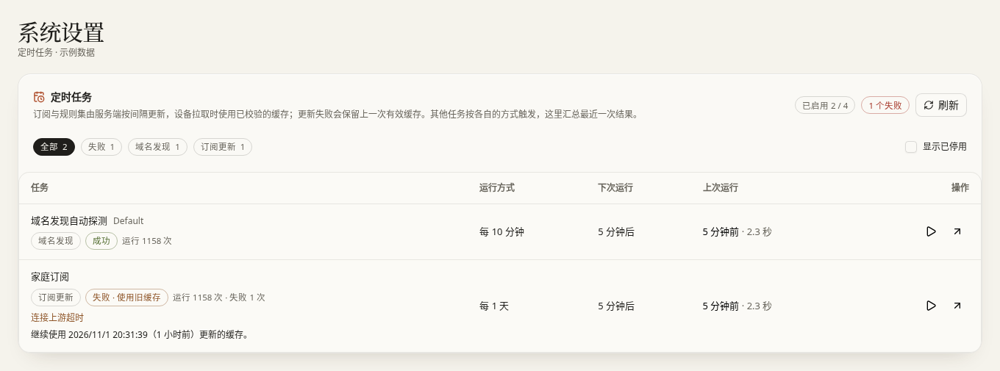
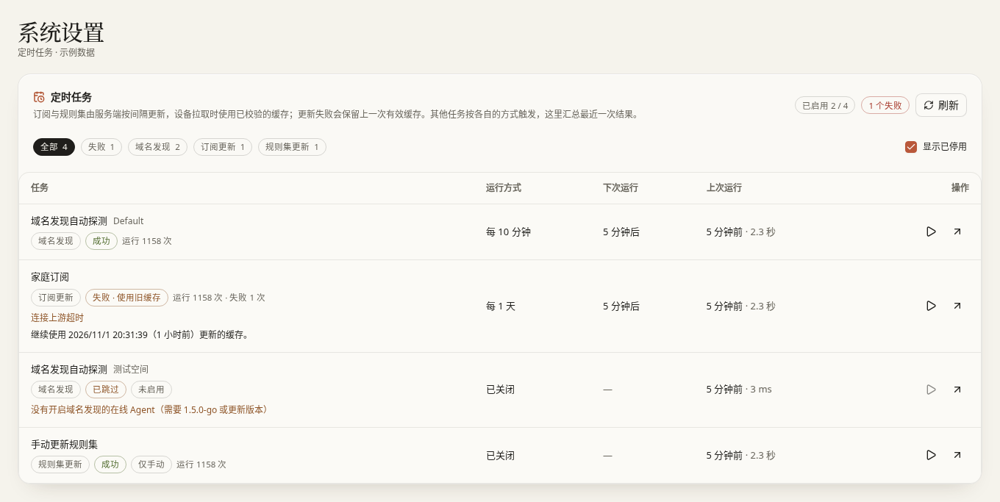

# 系统设置

[文档首页](../README.md)

入口：**系统 → 系统设置**。这里的设置对整个 ConfigFlow 生效，不只影响顶部当前选中的配置空间。

后台任务失败也会显示在顶栏的[通知中心](notifications.md)，可直接定位任务或打开对应设置。

本页目录：[服务地址与端口](#服务地址与端口) · [下载、令牌与入口开关](#下载令牌与入口开关) · [备份与升级](#备份与升级) · [WebDAV 备份](#webdav-备份) · [内置组件](#内置组件) · [定时任务](#定时任务)

## 服务地址与端口

### 服务域名：告诉其他设备去哪找面板

虽然叫“域名”，也可以填写完整的 IP 地址，例如 `http://192.168.10.10:5010`。推荐填写客户端和 Agent 都能访问的地址，而不是仅你电脑能打开的 `localhost`。

输入后点到输入框外面，出现保存成功提示才算完成。右边的圆形箭头会先询问，再恢复为**当前浏览器正在使用的地址**。

这个值用于生成订阅、规则、安装脚本等链接。它不会改变服务器监听端口，也不会自动修改已经安装的 Agent 的接入地址。

修改后，需要向 Mihomo、OxiDNS 等设备重新发布配置并确认已应用，运行中的规则下载地址才会更新。OxiDNS 标准规则下载链中，由 ConfigFlow 生成的规则下载链接会在重新发布时使用新地址；手工填写的外部下载地址保留原值。「更新规则」使用设备已应用的下载地址，不能代替重新发布配置。

### Web 监听端口：程序实际在哪个端口接收访问

1. 输入 `1–65535` 之间的整数，避开已占用端口和实际配置的后端、Sub-Store 端口（默认 `5001` / `3001`，安装指南 Host 示例为 `15801` / `15802`）。
2. 点 **应用**，读完地址变化提示后确认。
3. 成功后按提示使用新地址。页面不会强制跳转，因为反向代理或端口映射可能使外部地址不同。

| 你使用的方式 | 推荐怎么改 | 修改结果 |
| --- | --- | --- |
| 普通 Docker Bridge，原来是 `5010:80` | 只想改浏览器访问端口时，在 Docker 把左边改成如 `5011:80` | 浏览器改访问 `5011`，Web 中的监听仍是 `80` |
| Docker Host | 在本页修改 Web 监听端口 | 直接改变宿主机接收 Web 访问的端口 |
| Bridge，但确实要改容器内端口 | Web 修改后，同时把 Docker 映射右侧改成相同值并重建 | 只改 Web、不改映射，会使原地址打不开 |
| 通过其他服务器转发访问（反向代理） | 同步更新转发目标的端口 | 对外域名可保持原样，是否需要改变取决于你的代理配置 |

设置会保存在挂载的数据目录里，重建容器后保留。新端口不能正常启用时会尝试恢复原端口；出现“结果尚未确认”时，先检查原地址和新地址，不要反复点击。

**环境变量与 Web 谁优先？** 如果容器设置了 `CONFIGFLOW_WEB_PORT`，就使用这个值，Web 输入框只读。它不会改掉原来保存的值。例如 Web 保存 `8088`、环境变量指定 `9000`，实际用 `9000`；移除变量并重建容器后恢复 `8088`。从未保存过时默认 `80`。具体恢复步骤见 [打不开管理页面](../guide/troubleshooting.md#打不开管理页面)。

支持 IPv6 的系统会同时监听 IPv4/IPv6；这不会自动给 Docker Bridge 网络开启 IPv6 出站能力。源码运行和不含该组件的旧镜像可能显示不支持。

Host 模式的后端或 Sub-Store 被其他应用占用时，只修改本页 Web 端口无效。按 [各安装方式的端口说明](../guide/install.md#install-methods) 修改 `CONFIGFLOW_BACKEND_PORT` / `SUB_STORE_BACKEND_API_PORT`，选择互不相同的空闲端口并重建容器；程序不会自动避让。只改内部端口时 Web 地址不变，新变量需要支持此功能的新镜像。

<a id="下载令牌与入口开关"></a>
## 下载、令牌与入口开关

| 选项 / 按钮 | 推荐怎么选或怎么填 | 打开、填写或点击后 | 关闭或留空后 / 生效方式 |
| --- | --- | --- | --- |
| 规则下载代理 | 下载正常时留空；确有可用 HTTP/HTTPS 代理再填 | 面板下载规则、Geo 数据及相关连接检查使用该代理 | 留空恢复直接连接；移开输入焦点即保存，不改变设备上的代理设置 |
| 代理旁的眼睛 | 需要核对文字时临时显示 | 显示输入内容 | 再点隐藏；不改变设置 |
| 订阅聚合 | 需要组合多个订阅或节点才开启，初始关闭 | 资源分组出现“订阅聚合”入口 | 隐藏入口；它不是删除聚合数据的按钮，删除在聚合页处理；开关立即保存 |
| 访问令牌 | 推荐生成并妥善保存 | 生成的受保护链接需要带上令牌；也授予 MCP 管理权限 | 用“清除令牌”并确认才会清除；仅把输入框删空不会保存清空操作 |
| 生成随机令牌 | 首次使用或需要换令牌时点 | 生成并保存新令牌，旧令牌链接会失效 | 不点击则保留原值；手动填写非空内容后移开焦点也会保存 |
| 清除令牌 | 一般不推荐 | 所有配置的订阅链接取消该令牌保护，MCP 也不再受此令牌保护 | 取消确认则保留原值 |
| MCP / 复制地址 | 只有要连接 AI 管理工具时使用 | 复制管理接口地址供相应工具配置 | 不配置工具不影响日常使用；含令牌地址按密码保管 |
| 首次使用向导 | 需要重新查看安装路线时打开 | 进入向导或恢复已有进度 | 不会因为打开向导就自动重置数据 |

需要连接 AI 工具时，按 [MCP 接入步骤](mcp.md) 填写地址和令牌；只使用网页管理时无需配置。

## 备份与升级

### 四种按钮，范围不同

| 按钮 | 保存或改变什么 | 适合什么时候用 |
| --- | --- | --- |
| 导出全部数据 | 下载共享资源、所有配置空间、系统设置和 Agent 的 JSON 文件 | 修改前备份，换机器迁移配置 |
| 脱敏导出 | 导出供分享排查的内容，隐藏敏感信息 | 给别人查看结构；**不能当作完整恢复备份** |
| 导入全部数据 | 用选中文件覆盖上述全部业务数据 | 确认备份正确后恢复；不仅覆盖当前配置空间，导入前先导出当前数据 |
| 重置 | 清空全部业务数据并恢复默认系统设置 | 确实想重新开始时用；不会卸载远程设备上的程序，不应当作网络回退步骤 |

完整导出可能含订阅地址、密码和令牌，请只保存在自己控制的位置。Web 监听端口、Agent 监控历史和部分运行文件不包含在这份 JSON 里。

### 推荐的升级顺序

1. 在本页 **导出全部数据**，记录当前镜像版本和访问地址。
2. 停止容器，另外备份**整个实际挂载的数据目录**。不要只复制正在使用的数据库文件。
3. 更新镜像并重新创建容器，保留原数据挂载、账号和密钥。
4. 打开页面检查配置空间、订阅、Agent 状态，再检查一台实际设备。

使用 Compose 的用户在自己的部署目录执行：

```sh
docker compose stop
# 此时用 NAS 文件管理器或你熟悉的备份工具，复制整个 data 目录。
docker compose pull
docker compose up -d
docker compose logs --tail=100 config-flow
```

不要把上面注释当成已自动完成备份。旧版本需要回退时，使用记录的镜像版本和与之配套的数据备份。

<a id="backup-scope"></a>
### 哪些内容需要另外备份

| 内容 | 「导出全部数据」和 WebDAV 备份 | 需要怎样保存 |
| --- | --- | --- |
| 订阅、节点、规则、全部配置空间、系统设置和 Agent 登记信息 | 包含 | 下载完整导出文件，或确认 WebDAV 备份成功 |
| Web 监听端口 `web-listener.json` | 不包含 | 停止面板后复制整个实际数据目录 |
| Agent 最近 24 小时监控历史 `metrics/` | 不包含 | 正常停止会先保存历史，再复制整个数据目录；意外断电可能丢失尚未保存的部分 |
| 生成文件、规则缓存、Sub-Store 数据、升级前保留的文件与迁移备份 | 不完整 | 一并复制整个数据目录，不要只挑一个数据库或旧 `config.json` |
| Compose 文件、环境变量中的账号和密钥、端口映射 | 不包含 | 另外保留原部署文件和使用的环境变量文件，并记录镜像版本 |
| 其他设备上的 Mihomo、OxiDNS 程序及其运行目录 | 不包含 | 在对应设备另外备份；面板备份不会复制远程设备的磁盘 |

“实际数据目录”是部署文件中映射到容器 `/data` 的主机目录。比如 `./data:/data` 对应部署目录下的 `data`，`/volume1/docker/configflow/data:/data` 则对应这个 NAS 路径。恢复时仍挂载这份目录，并保留原账号、密钥及端口设置。

Agent 当前是否在线、刚收到的 CPU 和内存数值只保存在内存中。面板重启后暂时显示离线并不代表登记丢失，通常等下一次状态上报（约 30–60 秒）就会恢复。

## WebDAV 备份

WebDAV 可以理解为支持上传文件的网盘接口。没有这类服务时，先使用“导出全部数据”即可。

1. 点 **WebDAV 备份**，填写网盘提供的地址、用户名和密码。坚果云等服务需要专门的应用密码。
2. 点 **测试连接**，确认地址和凭据可用。测试成功不代表已经备份。
3. 点 **立即备份**，确认成功；需要以后继续使用这些设置，再点 **保存配置**。

| 选项 | 默认 / 建议 | 选择后的结果 |
| --- | --- | --- |
| 备份路径 | 默认 `/config-flow-backup/`，推荐给 ConfigFlow 单独一个目录 | 备份上传到这个位置 |
| 保留最近份数 | 默认 30；可填 0–1000 | 保留最近这么多份；`0` 表示不按这个条件清理 |
| 每日保留天数 | 默认 30；可填 0–3650 | 额外保留最近这些天每天最后一份；`0` 表示不额外保留 |
| 自动备份 | 初始关闭；手动备份验证成功后推荐开启 | 开启后，业务配置保存会在后台触发备份，短时间多次修改会合并；关闭后不自动备份，但仍可点立即备份 |
| 保存配置 | 改了地址、保留规则或开关后点击 | 保存这套备份设置，不等于已经产生一份新备份 |
| 取消 | 放弃当前对话框修改 | 不会撤销已经完成的“立即备份” |

保留规则按两类条件共同保留文件。清理只针对该路径里 ConfigFlow 生成的 `config_backup_*.json` 文件。备份设置改错或空间不足时，检查“定时任务”的结果。

## 内置组件

“第三方依赖”列出面板使用的辅助程序。**检查更新**只检查版本；出现“更新到…”按钮并确认后，才下载并更新对应组件。它不是更新整个 ConfigFlow 镜像的按钮。

组件以紧凑表格显示，按「组件、版本、状态、运行方式」对齐；手机上会排成两列。当前版本已经是最新时，版本号只显示一次，点击「已是最新」可以查看发布说明。有新版本时，更新按钮出现在版本列。

Sub-Store 用来转换订阅格式。在「运行方式」下拉框中选择模式，「状态」列显示组件实际运行状态：

| 模式 | 推荐场景 | 结果 |
| --- | --- | --- |
| 按需启动（默认） | 家用、资源有限的 NAS | 需要转换时启动，空闲约 5 分钟后休眠，第一次可能稍等一会儿 |
| 常驻运行 | 经常转换订阅，希望减少首次等待 | 持续运行，会占用相应内存 |

选择模式后会自动保存，保存成功才显示新选择；保存或组件更新期间不能重复切换，保存失败保留原模式。“休眠”通常是正常状态，不必为了把状态变绿而切成常驻。



## 定时任务

打开顶部 **定时任务**，查看订阅、规则更新，以及备份、设备同步、监控历史等最近结果。默认隐藏已停用的任务，勾选 **显示已停用** 可查看保留的历史记录和操作入口。停用项的“运行方式”显示“已关闭”，“上次运行”仍是历史时间，不代表还在自动执行；可手动运行的任务仍保留原操作。关闭后尚未结束的当前任务继续显示，直至执行结束。

| 按钮 / 字段 | 作用和建议 |
| --- | --- |
| 全部 / 失败 / 分类筛选 | 只改变当前显示，排错时先点“失败” |
| 显示已停用 | 默认不勾选；勾选后显示已关闭的任务及其历史。从通知定位已停用任务时会自动勾选。只改变列表显示，不启用或执行任务；分类数量随显示范围变化，失败筛选仍只统计已启用的任务 |
| 刷新 | 重新读取任务状态，不会立即执行所有任务 |
| 立即运行 | 只触发这一项；若按钮不可用，查看提示，可能需要去原页面执行 |
| 编辑间隔 | 按该任务提供的选项修改并保存；订阅和规则设为“仅手动”后不再按间隔自动更新 |
| 自动同步开关（路由器任务） | 打开后按设置周期同步；关闭只停后续自动同步，不自动撤销路由器已应用的规则 |
| 前往所在页面 | 到订阅、规则、Agent 或路由器页面修改详细设置 |
| 上次运行 / 下次运行 / 错误原因 | 判断是未执行、执行失败还是没有变化，不要只看任务是否“已启用” |
| 监控历史保存间隔 | 可选 5、10、30、60 分钟，默认 30。这个任务同时保存两样数据，任务行的说明里写明：各 Agent 的系统监控（CPU、内存、网速曲线），以及 Mihomo 面板「统计」里开启了后台记录的流量记录。越短，意外断电时最多丢失的历史越少，但写盘更频繁 |

订阅或远端规则更新失败会保留上一次有效缓存。先修复下载问题再重试，不要先把原数据清空。





下一步：[查看日志](logs.md) · [管理配置空间](profiles.md)
