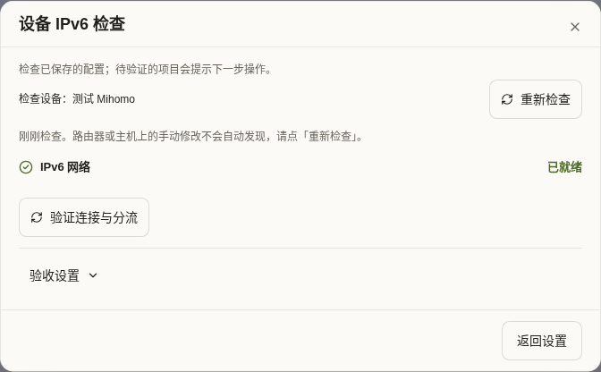

# IPv6 配置检查与补齐：PVE 实测记录

日期：2026-10-30。三轮验证使用工作区中的实现（workingtree，三轮开始时功能代码尚未提交），基础为 `upstream/main` 的 `b92d2749`；最终 smoke 和 controller 复测使用已提交的 `0d3e3bfc`。Agent 版本为 `1.8.50-go`，Mihomo 为 `v1.19.33`，RouterOS 为 `7.25`。

本页前面的三轮及清理记录是首次验收历史。之后为持续预览重新建立了同编号的任务专属隔离环境，当前仍为测试页面保留。新增的发布后自动验收记录见文末；不要将首次清理记录当成当前资源状态。

结论：隔离实验网内，三轮 Agent 实测、最终二进制的一轮 smoke，以及最终一轮真实 RouterOS/controller 联调均通过。客户端保持 IPv4 分流时，Mihomo 可以通过 IPv6 连接代理节点；另外验证了启用 IPv6 Fake-IP 后的客户端 IPv6 流量。尚未部署到生产路由器或生产 Mihomo。

## 环境与边界

所有构建和测试都由测试服务器驱动，再通过其专用 SSH 身份访问 PVE。Mac 仅编辑源码、读取报告。新建资源均标记归属 `configflow-ipv6-readiness-20261030`，每次运行先检查 guest 名称、归属和桥接网络；身份不符即停止。

| 资源 | 名称 | 用途 |
| --- | --- | --- |
| VM151 | `cf-ipv6-ready-ros` | RouterOS 7.25，提供 LAN RA 和路由 |
| CT152 | `cf-ipv6-ready-mihomo` | 原生 systemd Agent 与 Mihomo，实际上联网卡 `eth1` |
| CT153 | `cf-ipv6-ready-client` | 独立客户端，真实 DNS 查询与 HTTP 请求 |
| CT154 | `cf-ipv6-ready-node` | IPv6 SOCKS5 节点以及 DNS/HTTP 测试服务 |

三个临时网桥 `cfv6am`、`cfv6al`、`cfv6aw` 没有物理端口。分别承载管理、LAN 和测试 WAN；没有桥接生产 LAN。LAN 使用 `192.0.2.0/24`、`2001:db8:150:1::/64` 和 `fdda:150::/64`；测试节点使用 `2001:db8:150:2::10:1080`。这里的文档地址只用于封闭实验网络，不能据此推断公网 IPv6 可用性。

Linux guest 来自已停止的旧实验 CT130 的完整克隆；源 CT130 只读，配置摘要另行记录。生产 CHR VM101、Mihomo CT105 及其配置没有修改。随机凭据与实验 SSH 私钥只保存在测试服务器/PVE 的私有路径，不进入仓库或报告。

真实数据链为：

```text
CT153 客户端 → VM151 ROS → CT152 Mihomo → IPv6 SOCKS5 节点 CT154 → HTTP 测试服务
              IPv4 Fake-IP               IPv6 节点连接
              或 IPv6 Fake-IP
```

每条 HTTP 请求都有独立路径标记，并与节点刚产生的日志对应，检查节点入口确实使用 IPv6；不是只检查 TCP 端口或复用旧日志。最终 HTTP 目标可以是 IPv4，这与“客户端走 IPv4，Mihomo 到节点走 IPv6”的用途一致。

## 三轮 Agent 验证

最终功能候选于 `2026-10-30 08:24:40–08:26:09 UTC` 完成以下三轮。该候选二进制 SHA-256：

```text
23ff2fb3bcfbdd01991ae6b57a3db718811c18860eb4d91af41976bdc99b8057
```

| 轮次 | 设置的场景 | 实际结果 |
| --- | --- | --- |
| 1：首次补齐 | 功能专属配置不存在；开启转发但 `eth1.accept_ra=1`，清除学习到的默认路由 | 识别 `eth1`，持久化所缺参数，恢复 `accept_ra=2`，重新收到 `protocol=ra` 默认路由；IPv4 客户端经 IPv6 节点 HTTP 成功 |
| 2：重复操作 | 对已正确配置的设备再次补齐 | `changed=false`；受管配置、记录、服务文件的内容和修改时间不变；同一真实流量链继续成功 |
| 3：真实重启 | 重启 Agent 后重启 CT152；暂停实验 ROS 的 RA，让 Mihomo 先于主机 IPv6 就绪启动 | 先准确报告默认路由为空、实际 TUN IPv6 缺失；恢复 RA 后自动恢复地址、默认路由和实际 TUN IPv6，无需人工重启 Mihomo；IPv4 流量及 Fake6 DNS 答案正常 |

第三轮通过 PID1 启动时间变化确认进入新启动，避免将 `pct reboot` 返回后仍在响应的旧 Agent 误当作新实例。容器 uptime 从 `574.86` 秒变为 `7.97` 秒。

RA 暂停期间的实际结果为：

```json
{
  "configuration_ready": false,
  "default_routes": [],
  "tun_ipv6": {"required": true, "status": "missing", "device": "Meta", "addresses": []}
}
```

RA 恢复后，`eth1.accept_ra=2`、`all.forwarding=1`，默认路由来源仍为 RA，`Meta` 实际地址为 `fdfe:dcba:9876::1/126`，DNS 返回 `fc00::4`。没有把会过期的 RA 路由强行改为静态路由。再等待 35 秒，超过本实验 RA 默认路由 30 秒有效期，确认续期后流量仍成功。

同时通过以下负向检查：

- GET 检查不会写入功能配置。
- 使用过期网卡索引提交补齐，返回 409，文件不变。
- 加入后加载的用户 sysctl 冲突，补齐被阻断，用户文件保留。
- 真实节点 `1080` 开放端口检测成功，`1081` 关闭端口明确失败。
- 直接提供 Fake-IPv6，或者节点域名被系统 DNS 解析成 Fake-IP，均不误报真实节点可连。

## 真实 controller 与 RouterOS 验证

使用实际 Python 编排模块、实际 Go Agent HTTP API、实际 RouterOS REST；只用内存夹具提供配置空间及 Agent 登记信息。临时 SSH 端口转发只监听测试服务器回环地址，结束后关闭。

| 检查 | 结果 |
| --- | --- |
| 用户首选的 IPv4 客户端模式 | 真实核心设置为 `ipv6: true`、`dns.ipv6: false`；AAAA 答案为空，ROS 没有 Fake6 路由，controller 也不计划或新增该路由；IPv4 客户端仍经 IPv6 节点到达 HTTP 服务 |
| 首次只读检查 | 发现缺少 `fc00::/64` 路由，不修改主机或 ROS |
| 过期 `check_token` | 拒绝操作，不创建路由 |
| 添加真实 ROS 路由后模拟 Agent 失败 | 真实 REST DELETE 成功撤销本次新增路由 |
| 正常补齐 | 只新增一条 `fc00::/64 → fdda:150::cf:15ff:fe00:52%ether2`，且路由 active |
| 再次补齐 | 没有重复或改写已有路由 |
| 已有正确用户路由 | 保留原内容和注释，不收归 ConfigFlow 管理 |
| 已有冲突网关 | 检查提示冲突，补齐被阻断，不覆盖原路由 |
| 实际客户端流量 | IPv4 Fake-IP、IPv6 Fake-IP 均经 IPv6 节点到达 HTTP 服务 |
| 无关路由器配置 | IPv4/IPv6 NAT、filter、ND、DHCPv6 client 和 DNS 设置均保持原样；自然增长的包/字节计数不作为配置变化 |

这部分没有运行完整 Web 服务器的注册/发布流程；HTTP 路由、配置空间鉴权和前端交互另由自动化测试覆盖。不得将这里的编排联调表述为完整浏览器端到端验收。

## 实测发现并修复的问题

1. `ip -j -6 addr show` 在实验系统不返回接口 MAC/类型信息，导致无法确认上联网卡。改为读取完整地址列表，再筛选 IPv6。
2. RouterOS 7.25 的 REST 资源 ID 中 `*` 被编码成 `%2A` 后无法 DELETE。补偿撤销保留字面的 `*`，并由真实失败注入验证。
3. 未绑定上联网卡的 TCP 探测可能先被 Mihomo TUN 接收，让关闭端口也显示成功。探测现在绑定确认过的物理上联网卡，并拒绝 Fake-IP/TUN 地址。
4. Mihomo 早于 IPv6 RA 就绪启动时，即使 YAML 已开启 IPv6，实际 TUN 仍可能只有 IPv4。检查现在读取实际 TUN 地址；显式补齐授权后，启动恢复在主机网络就绪时按需热重载正在运行的受管核心，保留 IPv4 服务。

三轮测试后又补充了 unsupported-platform 错误分支的提前阻断，以及后端已有路由保护。对提交 `0d3e3bfc` 重新构建、更新实验 Agent 后，额外 smoke 验证了补齐幂等、开放/关闭端口、IPv4 和 Fake6 两条真实流量链；并重新执行上述完整 controller 联调。最终二进制 SHA-256 为：

```text
71a0d617de38b3a10deacd79f466bb015ffe2f1d0c0657ef2e54415c328c2559
```

最终错误分支修订没有重做第四次容器重启；真实延迟 RA 重启证据对应上方明确列出的三轮候选摘要，两版证据没有混记。

## 复现与证据

脚本：`scripts/tests/ipv6_readiness_lab.py`、`scripts/tests/ipv6_readiness_controller_lab.py`。已有实验环境的完整复测顺序如下；`prepare` 只用于空环境，现有 ID/归属不符时会拒绝创建或复用。

```sh
# 在 backend/agents/go-agent 下，经测试服务器构建
rt -- go build -o /tmp/configflow-ipv6-agent .

# 回到任务 worktree 根目录；只重置本功能拥有的实验配置
rt -- python scripts/tests/ipv6_readiness_lab.py refresh --agent-binary /tmp/configflow-ipv6-agent --reset-managed
rt -- python scripts/tests/ipv6_readiness_lab.py test
rt -- /home/sunbroke/cf-test/.venv/bin/python scripts/tests/ipv6_readiness_controller_lab.py --reset-owned-route

# 仅刷新最后的无关错误分支修订后，可额外运行幂等和流量 smoke
rt -- python scripts/tests/ipv6_readiness_lab.py refresh --agent-binary /tmp/configflow-ipv6-agent
rt -- python scripts/tests/ipv6_readiness_lab.py smoke
```

测试服务器 `/tmp/configflow-ipv6-readiness/` 中保留脱敏的 `manifest.json`、`agent-report.json`、`controller-report.json`；最终 smoke 另生成 `final-smoke-report.json`，分别记录三轮候选和最终二进制 SHA-256。凭据文件不属于证据导出范围。

脱敏证据已取回本机 `/private/tmp/configflow-ipv6-readiness-evidence-20261030/`。经最终复核后，本次 VM151/CT152–154 和三个临时网桥均已清理；manifest 状态为 `completed-cleaned`。源 CT130 配置摘要与建实验网前相同，生产 VM101/CT105 的配置摘要和运行状态在清理前后相同。测试服务器的实验凭据、隧道日志、临时 controller 数据以及 PVE 实验 SSH 密钥均确认删除。实验中没有对生产 guest 运行修改命令。

## 适用范围

本次真实环境覆盖原生 systemd 安装、单一以太网上联网卡、RA 地址/默认路由及 RouterOS 7.25。多出口、OpenRC、Docker、不同 RouterOS 版本、运营商 PD 变化、公网节点协议/认证和真实 OxiDNS 配置没有在此实验中完成实测。

UI 的保存草稿、网络补齐、发布 Mihomo 配置是不同动作；配置正确、单个节点 TCP 可连接、实际客户端分流成功和重启恢复是不同证据。公网节点仍需在目标环境独立验证；此次没有修改或部署生产环境。

## 发布后自动验收补充

2026-10-30，在同一隔离拓扑重新运行真实 ConfigFlow 后端、Agent 注册与发布流程。代码为 `f214da29`，基于 `upstream/main b92d2749`；Agent 二进制 SHA-256 为 `f6ddd624604a132bf3d4f067877cca52e28c86f5c5bf6068b6638ede794aacd2`。预览保留在测试服务器 15820，后端为 15821。CT153 安装独立检测 Agent；系统 DNS 查询测试 Mihomo 的真实 53 端口，HTTP 请求不使用环境代理或人为指定解析结果。

| 场景 | 实测结果 |
| --- | --- |
| 发布后仅自检 | 只发起发布，没有调用验收 POST、没有前端部署轮询，后台仍自动等待发布成功并保存结果；发布文件、当前开关、A/AAAA 行为、代理 HTTP 与 IPv6 节点连接分别通过 |
| 配置客户端后发布 | IPv4 Fake-IP 请求的源地址/端口与 Mihomo 新连接、ROS 记录对应；实际节点远端为 IPv6，HTTP 成功 |
| IPv6 Fake-IP | 打开 DNS IPv6 并通过原补齐入口准备路由；客户端 IPv4、IPv6 两次 HTTP 都成功，两族请求分别与 ROS/Mihomo/IPv6 节点证据对应 |
| 关闭的测试端口 | DNS 与已发布文件仍通过，代理 HTTP 和客户端 HTTP 明确失败；没有把节点存在或部分检查通过当作整链成功 |
| 恢复首选模式 | 最后恢复 `dns.ipv6: false` 并再次发布，自动客户端验收各实流项目通过；最后发布 ID 为 `abd462453af84b6392845d533061ed06` |

实验 ROS 只有测试网段的直连路由，没有公网默认路由，也没有运营商 DHCPv6；因此总报告保持 warning，相关缺项没有被强行标绿。静态规则的候选回程判断仍与实际客户端成功结果分别展示。

极简实验 ROS 的 `connection tracking=auto` 没有启用 IPv4 跟踪；最初客户端成功而 ROS 证据为空，正确显示未验证。为覆盖正向证据，仅在任务专属 VM151 将跟踪设为 `yes`，保留原值于测试记录。产品检查接口没有这个写操作，没有添加或修改防火墙/NAT 规则。观察器在请求期间收集限定目标端口、限定字段的新连接，避免同网段直返回程的短时记录在事后查询前过期。

另一个实测修正是发布文件摘要：Agent 可能在发布时适配 YAML，传输包内原始 SHA 与最终落盘 SHA 不同。验收现在使用已确认成功的部署回执中的最终 `config_version`，源配置仍绑定这次发布的不可变快照。

复现脚本为 `scripts/tests/ipv6_verification_lab.py`，仅能在测试服务器对归属检查通过的现有实验环境执行：

```sh
python scripts/tests/ipv6_verification_lab.py setup --agent-binary /tmp/configflow-ipv6-agent
python scripts/tests/ipv6_verification_lab.py verify --publish
python scripts/tests/ipv6_verification_lab.py verify --client --publish
python scripts/tests/ipv6_verification_lab.py verify --client --fail
python scripts/tests/ipv6_verification_lab.py verify --client --publish
```

脱敏结果位于测试服务器 `/tmp/configflow-ipv6-readiness/verification-*.json`，包括主机自检、客户端自动验收、Fake6 与关闭端口负向报告。首次三轮的重启恢复证据仍对应上文版本；本次新增验收没有再次重启整台容器，不能把两次证据混记。

最终代码同步最新 upstream 后，后端全量 10,817 passed、122 skipped、9 subtests passed；前端全量 165 个文件、2,786 项通过；Go 全量、类型检查和生产构建通过。浏览器包含 25 个模拟交互场景，以及真实 15820 的桌面/手机只读验收：最终发布的四项客户端证据均通过、总 warning 如实保留，无页面错误、失败请求或配置写入。后两项截图与报告位于本机 `.ci-results/ipv6-real-ui/`，不随源码提交。

## 五项摘要界面

设备检查改为 IPv6 网络、重启恢复、DNS 与 ROS 配套、节点实际连接、客户端分流五项。预检与验收的重复检查合并，正常项一行显示，问题直接给出原因；原始规则、状态和说明保留在组内详情。未配置检测客户端保持中性，不因关闭 DNS IPv6 而跳过 IPv4 分流。

验证全部在 `192.168.0.32` 运行：143 项相关前端测试、类型检查、生产构建和 29 个浏览器场景通过。真实 `15820` 测试页面另做桌面浅色与 375px 深色只读检查，无页面错误、横向溢出或配置写入；原客户端请求证据仍可展开查看。结果过期、版本不同、验收中断和新旧静态快照的顺序均有覆盖。

此次只调整界面和文案，没有执行设备补齐、修改 ROS 或重新发布 Mihomo 配置。界面截图：


## IPv6 Fake-IP 路由纳入上游路由发布

2026-10-30，使用同一隔离 VM151 / CT152–154，验证 `scripts/tests/ipv6_managed_routes_lab.py`。现在开关只补齐 YAML 中缺少的 Fake-IP 网段，ROS 写入统一从上游路由差异报告进入预览发布；设备检查的补齐不再写 ROS。

实际执行并通过：

1. 预览后更改保存的网段，旧预览返回 409，ROS 未被写入。
2. 发布创建 `fdcf:150:2::/64` 路由，回读确认生效并保存精确管理记录。
3. 再次发布为空计划，不创建重复路由。
4. 改为 `fdcf:150:1::/64` 后发布，只更新本功能创建的路由。
5. 关闭后发布撤回受管路由。
6. 重新使用实验环境已有的 `fc00::/64` 路由，报告显示「沿用已有路由」，不接管归属。
7. 恢复原始 YAML、已有路由及 IPv4 路由备注，再发布原始 Mihomo 配置；IPv4 客户端 HTTP、Mihomo 请求对应、IPv6 节点连接、ROS 请求记录四项实际证据通过。

测试退出时核对所有原有 IPv6 路由的 ID、网段、下一跳、路由表、距离、开关和备注都未变化。真实 ROS 的事务失败回滚未在本轮故障注入；对应失败补偿、外部修改保护及同步竞态由后端自动测试覆盖。实验网仍无公网默认路由和运营商 DHCPv6，相关提醒继续保留。

真实 15820 页面同时做 1440px 浅色和 375px 深色只读验收：显示受管路由、下一跳和发布入口，无页面错误、横向溢出或配置写入。开关自动补网段、保存/发布分离等交互另有 29 个浏览器场景通过；前端全量 2,838 项、类型检查与生产构建通过。


复现（先部署本分支到专用测试预览）：

```sh
rt -- /home/sunbroke/cf-test/.venv/bin/python scripts/tests/ipv6_managed_routes_lab.py
```

脚本检查实验资源归属，并恢复初始配置。脱敏结果保留在测试服务器 `/tmp/configflow-ipv6-readiness/managed-route-results.json`；凭据和原始配置备份不属于提交范围。


## 补齐检查稳定性与保存窗口修复

2026-10-30，补齐检查不再把无关 Agent 的后台记录、全局应用/备份设置和重复保存同一草稿产生的时间戳计为主机配置变化；ROS 路由按内容排序后比较。目标设备身份、网卡、实际草稿与路由变化仍会阻止执行，准备前最后一次复核沿用同样的判断范围。

在测试服务器通过 97 项后端相关用例、130 项前端用例、类型检查、生产构建和 29 个浏览器交互场景。前端覆盖生成页与设备入口保存后继续编辑、重复保存、失败重试、手动关闭和发布流程；保存后的设置窗口保留 YAML 与检查入口：


更新 15820 后，在现有隔离 VM151 / CT152 上，分别检查后立即、等待 2 秒、等待 5 秒，再刷新设备列表并补齐，三次均成功。核对原始草稿与全部既有 IPv6 路由字段前后不变，三次 `changed_routes` 均为 0；脱敏证据为测试服务器 `/tmp/configflow-ipv6-readiness/prepare-stability-results.json`。没有通过自动刷新令牌绕过真实配置变化的保护。旧页面应刷新并重新检查一次后使用。


## 三项结果与待验证操作提示

2026-10-30，设备检查、手动验证和发布后自动验收统一显示「IPv6 网络」「IPv6 节点连接」「客户端分流」三项。正常项只占一行，问题和处理动作直接显示；不再渲染逐条规则、原始详情、数量提示或组内展开入口。静态规则尚未确认不覆盖已经取得的对应请求实测结果，确定的配置问题仍给出简短提醒。

待验证结果明确指出下一步：点击「验证连接与分流」；没有检测客户端时到「检查设备 → 验收设置」选择；没有当前发布证据时先「保存并发布」。自动验收不完整时同样提供验证按钮。补齐完成提示只说明操作结束，避免之后连接已通过时仍要求单独验证。空结果、旧版本、目标变化、中断和缺少必要请求证据均不会显示已通过。

全部测试在 `192.168.0.32` 执行：前端全量 167 个文件、2,846 项通过；最终调整另通过 63 项相关测试、类型检查、生产构建和 31 个浏览器交互场景。浏览器覆盖桌面/手机、深浅主题、待验证引导、真实失败的简短提示和通过后的三行结果，无页面错误。



15820 真实测试页面另做 1440px 浅色与 375px 深色只读验收，确认仅显示三项、待验证操作提示可见、原检测客户端仍正确选中，无横向溢出、页面错误、失败请求或配置写入。当前网络显示「已就绪」，节点与客户端因缺少当前版本实测结果显示「待验证」，没有沿用旧验收冒充通过。本次只更新前端显示与交互；后台检查和补齐保护保持原有行为，未修改 ROS、Mihomo 配置或重新运行 PVE 流量验收。


## 自定义 IPv6 Fake-IP 网段与 LLA 优先

2026-10-30，在 Mihomo DNS 开关下新增网段输入框，开启 IPv6 Fake-IP 后显示，默认补齐 `fc00::1/64`，已有自定义值沿用。输入与 YAML 双向同步；非法 CIDR、公网和链路本地网段在输入框提示，不写入 YAML，并阻止生成页和面板入口保存或发布。关闭开关收起输入框、保留网段并说明受管路由需通过上游路由发布撤回。


下一跳新建时优先唯一有效的 LLA，附加 ROS 的 LAN 接口；没有 LLA 时回退同 LAN 的唯一 ULA。已有生效且仍属于同一 Mihomo、同一 ROS 接口的路由继续沿用；多 LLA 无法确定时停止，临时、弃用、待确认、地址冲突及其它网卡地址排除。归属核对、预览版本保护和失败恢复保持原流程。

测试全部在 `192.168.0.32` 执行：131 项相关前端测试、类型检查、生产构建，以及后端测试（10,940 passed、122 skipped、9 subtests passed）通过；47 个浏览器场景覆盖桌面/手机、深浅主题、网段编辑、错误拦截、关闭重开及保存发布。真实 15820 页面另执行桌面和手机只读交互检查，未保存示例输入，无页面错误、横向溢出或配置写入。

在已归属本任务的隔离 VM151 / CT152–154 运行更新后的 `scripts/tests/ipv6_managed_routes_lab.py`，实际确认新建临时网段路由使用 `fe80::…%接口`，并通过旧预览拒绝、创建后回读、重复发布不重复、修改网段、关闭发布撤回和沿用原路由检查。最后恢复完整原草稿及原有 IPv4/IPv6 路由，重新发布原 Mihomo 配置，IPv4 客户端请求、Mihomo 路径、ROS 路径及 IPv6 节点连接证据均通过。本轮未重启 guest，也未修改生产设备。

脱敏报告保留在测试服务器 `/tmp/configflow-ipv6-readiness/managed-route-results.json`。本轮验证 LLA 作为内网下一跳，不证明所有网卡更换、网段迁移或公网节点协议均已覆盖。


## 同一 LAN 的 RA DNS 发布验收

`router_ipv6_dns_lab.py` 在 VM151（RouterOS 7.25）和 CT153 上通过真实预览后端、REST 和客户端 RA 报文完成以下检查：

- `advertise-dns=yes` 并保留显式 `dns` 地址：预览只读，发布先更新 IPv4 DHCP DNS，再关闭目标 LAN 的 DNS 通告。
- `advertise-dns=self`：同样能关闭，随后重复发布不产生修改。
- 发布前改变 RA 配置时，旧预览被拒绝，DNS 通告不会提前关闭。
- 客户端实际收到的 RA 不再包含 RDNSS（类型 25）；地址前缀（类型 3）、默认路由有效期和路由器地址保持不变。
- 只有共享 `all` 通告且无明确 LAN 覆盖时不修改 ND，避免全局关闭；另一次实测确认有效 LAN 条目可以覆盖 `all`。（2026-10-31 起这种情况只跳过本项，不再阻止同一路由器的其他发布。）
- 取消 OxiDNS 关联后保留现状，不擅自重新开启 DNS 通告。
- 最终还原临时 DHCP 服务、网段、Agent 登记、关联及原 ND 配置，并确认原客户端 → ROS → Mihomo → IPv6 节点链路通过。

脚本使用临时 OxiDNS 登记指向实验网已有的 DNS 监听地址，只验证路由器发布和通告行为，不把该登记当作实际安装 OxiDNS 的验收。不会操作生产 VM101/CT105。结果保存在测试服务器 `/tmp/configflow-ipv6-readiness/router-ra-dns-results.json`。

`router_ipv6_dns_browser.mjs` 另用隔离 API 数据挂载真实路由器页面，覆盖桌面浅色、深色和手机的 18 项场景；预览和截图不触发真实配置写入。单元与集成回归覆盖写入失败、回读失败、逆序回滚、DHCP/RA 竞态和自动规则同步暂停。

### 共享 all 的专用条目命令

2026-10-31，在 VM151（RouterOS 7.25）上临时建立 bridge `cf-tmp-nd`，以现有 ND 条目参数（另加两个 `dns` 地址及 `ra-preference=high`、`other-configuration=yes`）作为 `all` 来源，经 `/rest/execute` 执行后端生成的 `/ipv6 nd add …` 命令。命令被接受，新条目除 `advertise-dns=no` 与接口外，`dns` 列表、`ra-delay`、`ra-interval`、`ra-lifetime`、`ra-preference`、`hop-limit`、`mtu`、`reachable-time`、`retransmit-interval` 及布尔项全部与来源一致；随后删除临时条目与 bridge，ND 配置与测试前完全相同。未修改原有 ND 条目或生产设备。

## IPv6 规则集路由（2026-10-31）

`scripts/tests/ipv6_ruleset_routes_lab.py` 在测试服务器上运行，用本分支后端和预览数据的私有副本直接驱动 VM151（RouterOS 7.25），不改预览服务、不向 CT152 推送配置，只写注释为 `cf-rule6:<路由器>` 的 `/ipv6/route`，结束时恢复 198.18.0.0/16 的注释并核对路由与开始前一致。

通过的场景：发布前客户端（CT153）发往 Telegram IPv6 的包到不了 Mihomo；差异报告给出 `fe80::…%ether2` 下一跳；规则集变化后旧预览被拒绝且无写入；5 条路由一次批量写入并回读；发布后 CT153 发往 `2001:b28:f23d::1` 的包到达 CT152；重复预览为空；自动同步一次增删各 4 条并回读；注入回读失败时设备上全部回滚、管理记录改指新 ID，手动确认空发布后恢复同步；Agent 离线时只跳过本项；关闭 Mihomo IPv6 后一次撤回 5 条。

观察：ping 探测后 CT153 缓存了直达 Mihomo 的路由（新路由下一跳是 LLA 加接口，ROS 因此发出了 ICMPv6 重定向；下一跳为 ULA 或 GUA 时 7.25 不发），因此每次探测前清空客户端路由缓存。TCP 场景下同口转发会被出厂 `drop invalid` 丢弃，见上游路由文档中的防火墙提示。

## IPv6 同口转发防火墙提示（2026-10-31）

`scripts/tests/ipv6_forward_hint_lab.py` 在测试服务器上运行，用本分支后端和预览数据的私有副本对 VM151 生成差异报告，不发布路由。

- 只读核对：VM151 上已有另一项测试套用的出厂 IPv6 forward 规则（`defconf: drop invalid` 为 `*36`）。「IPv6 Fake-IP 分流路由」和「IPv6 规则集路由」都给出同一条命令 `/ipv6 firewall filter add chain=forward action=accept in-interface=ether2 out-interface=ether2 comment="LAN to Mihomo via router" place-before=*36`，预览警告只出现一次；前后防火墙、接口列表与 IPv6 路由一致。
- 完整运行（另一项测试结束、VM151 恢复实验基线后）：没有 `drop invalid` 时不提示；临时追加带 `cf-fwhint` 标记的出厂 forward 规则后，两张卡片给出同一条命令，`place-before` 指向新加的 `drop invalid`，预览警告只出现一次；经 `/rest/execute` 原样执行这条命令，RouterOS 接受，新规则正好位于 `drop invalid` 之前，重新生成报告后提示消失。随后撤掉出厂规则，只加一条限定探测地址 `fc00::c0fe` 的 `drop invalid`，避免影响共用 VM151 的其他测试。CT153 经 ROS 同口连到 CT152 上该地址的 TCP 服务，每个新连接耗时 6.59–6.60 秒；同一条放行命令加在它之前后，降到 1–2 毫秒。结束后删除全部临时规则、地址列表、CT152 上的测试地址和服务，防火墙、接口列表与 IPv6 路由和开始前一致；没有改动 `/ip firewall` 和 `/ip settings`。
- 下一跳与重定向：现有 `fc00::/64` 路由的下一跳是 ULA `fdda:150::cf:15ff:fe00:52%ether2`，由 2026-10-30「真实 controller 与 RouterOS 验证」的旧补齐流程（注释 `cf-ipv6-readiness:…`）在优先 LLA 之前创建，现由 Fake-IP 发布按「沿用已有路由」保留；当前发布不再调用该补齐函数，新路由经 `_gateway()` 优先 LLA（本页 IPv6 规则集路由实验新建的路由均为 `fe80::cf:15ff:fe00:52%ether2`）。另一项补测确认 7.25 只对 LLA 下一跳发重定向且有限速，不能消除卡顿，提示不按下一跳类型取舍。
- 观察：RouterOS 7.25 刚添加带 `connection-state` 的规则时，REST 会把它标为 `invalid=true`，不到 1 秒后恢复。检查会跳过无效规则，因此刚改完防火墙立即生成的报告可能暂时没有提示，稍后重新生成即可。

## IPv4 同口转发防火墙提示（2026-10-31）

`scripts/tests/ipv4_forward_hint_lab.py` 在测试服务器上运行，用本分支后端和预览数据的私有副本对 VM151 生成差异报告，不发布路由。实验路由器设为普通静态路由（不开自动配置回流、不选规则集），现有 `198.18.0.0/16` 路由经 ether2 指向 CT152（192.0.2.3）。只加 forward 链的出厂规则和 LAN/WAN 接口列表（标记 `cf-fw4hint`），不加 input 链规则，避免影响共用 VM151 的其他测试；CT153 保持原有 sysctl（开启转发，会忽略重定向）。

- 没有 IPv4 filter 规则时不提示；CT153 经 ROS 同口连到 CT152 上 `198.18.240.0/20` 的 TCP 服务，5 个顺序连接加 10 个并发连接均为 1–6 毫秒。
- 加上出厂 forward 规则（`drop invalid` 为 `*12`）后，「代理路由」给出 `/ip firewall filter add chain=forward action=accept in-interface=ether2 out-interface=ether2 comment="LAN to Mihomo via router" place-before=*12`，预览警告只出现一次且不阻止发布，旧的「建议开启自动配置回流」提示不再重复出现。把 `*12` 的注释改成别的文字后，命令仍指向 `*12`。
- 同样的 15 个连接全部卡住：12 个约 6.6 秒，3 个约 13.4 秒。
- 经 `/rest/execute` 原样执行这条命令，RouterOS 接受，新规则正好位于 `*12` 之前；重新生成报告后提示消失，15 个连接恢复到 1–8 毫秒。
- 结束后删除全部标记规则、接收命令新增的规则、接口列表及成员，停止 CT152 上的测试服务并撤掉测试地址；`/ip firewall`（filter、nat、mangle、raw、address-list）、接口列表与成员、静态路由、`/ip settings` 及 CT152/CT153 上相关状态与开始前逐项一致。fasttrack 留下的动态 dummy 规则 `*C` 在开始前已存在，未变化。

## IPv6 Fake-IP 默认发布与检查复用（2026-10-31）

`scripts/tests/ipv6_mode_browser.mjs` 在测试服务器上用 headless Chromium 运行，后端是本分支代码加 IPv6 预览数据的私有副本（`upstream_router_pending_lab.py`）。实验进程内拒绝一切 RouterOS 非 GET 请求和 Agent 写操作，并计数读取；全程 VM151、CT152 只读，没有点保存并发布、确认发布、补齐或验证。

- 副本草稿先设为 `ipv6: false`、无 `fake-ip-range6`。选「Mihomo 用 IPv6，客户端走 IPv4」后 YAML 写入 `ipv6: true`、`dns.ipv6: false` 并补齐 `fake-ip-range6: fc00::1/64`，网段输入框显示，说明以完整名称「Mihomo 用 IPv6，客户端走 IPv4 分流」开头。
- 网段改为 VM151 上没有的 `fc00:0:0:2::1/64` 并保存草稿：步骤清单为主机准备、保存并发布、上游路由发布、路由器防火墙 / NAT、验收；上游路由「2 项待处理」，其中「IPv6 Fake-IP 分流路由：待添加」，差异报告的卡片同样为「待添加」，下一跳 `fe80::cf:15ff:fe00:52%ether2`。DNS IPv6 关闭时设备检查的 `fake_ipv6` 为提醒而不是错误，并注明客户端暂不使用此网段。
- 切到「客户端也走 IPv6」再保存，上游路由仍是同样的 2 项，说明两个模式发布同一条路由。
- 新开页面再次打开设置：设备检查与上游路由的回答都是 `cached: true`，CT152 状态读取次数和 VM151 读取次数都不变；点「重新检查」后两者都重新读取。设备检查窗口直接显示上次结果并注明检查时间。
- 手机深色 390 px：中间选项折成两行，高 44 px，页面无横向滚动，触控目标不小于 44 px。
- 结束时 RouterOS 写入与 Agent 写操作计数均为 0。`upstream_router_pending_browser.mjs` 用同一只读保护重跑通过，并重拍了改名后的待发布提醒截图。

## 去掉单独的节点测试（2026-11-28）

生产验收报「IPv6 节点连接未通过：通过节点访问检测网站失败」，而 Mihomo 面板里 IPv6 节点测速正常。原因是 Agent 自选测试节点：面板不传节点，Agent 只在 `/proxies` 里挑，订阅里的节点不在那里，内置的 `PASS-RULE`（类型 `PassRule`，不在排除名单里）按名字排第一被选中，测速必然失败。客户端分流验收同样只在 `/proxies` 里找节点，且只认 SOCKS5/HTTP 节点的 IPv6 证据，订阅里的 AnyTLS 节点永远无法通过。

改动（Agent 1.9.5-go）：去掉 Agent 自选节点测速与 socket 观察；客户端连接按连接链在 `/proxies` 与 `/providers/proxies` 中识别节点，按 Mihomo 记录的 `remoteDestination` 判断 IPv6 / IPv4，smux、dialer-proxy、域名远端判为无法确认；前端去掉「IPv6 节点连接」，未配置检测客户端时不显示「客户端分流」，「补齐缺少的配置」只在主机有可补的缺项时显示。

测试服务器上用两份 Mihomo 1.19.34（服务端用 listeners 提供各协议入站，客户端经 mixed-port 访问本机 HTTP 服务，节点分别写 `::1`、`127.0.0.1` 和映射到这两个地址的域名），每个节点连续请求两次（第二次复用连接）：

| 节点 | Mihomo 记录的远端 | 判断 |
| --- | --- | --- |
| SS、VMess、VLESS、Trojan、AnyTLS、TUIC（IPv6 地址或域名） | `::1` | IPv6 |
| 同上（IPv4 地址或域名） | `127.0.0.1` | IPv4 |
| 订阅（file provider）中的 AnyTLS | `::1`；节点只出现在 `/providers/proxies` | IPv6 |
| SS + smux（无论节点是 IPv6 还是 IPv4） | 目标网站地址 | 无法确认 |
| Hysteria2（域名） | 域名本身 | 无法确认 |

随后用新的 verify-connections 接口对同一套 Mihomo 实测：AnyTLS / VMess IPv6 节点与订阅节点判为 IPv6，AnyTLS / Trojan IPv4 节点判为 IPv4，smux 与 Hysteria2 域名判为无法确认，`client_mihomo_path` 均通过。实验只在测试服务器本机回环地址上进行，未连接生产设备。
